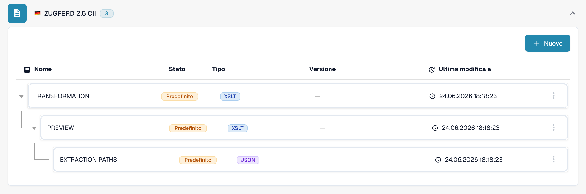

# 🇩🇪 ZUGFERD 2.5

<!-- edocs-country-scope -->


Consultate la guida del paese per i limiti delle versioni, la configurazione effettivamente utilizzata e il video esplicativo del paese. [Germania](countries/germany.md). Sintassi, versione di pubblicazione e profilo sono scelte diverse. Non deducete una pubblicazione Factur-X dal marcatore condiviso 1p0.


| Proprietà | Valore |
|----------|-------|
| **Paese / Regione** | Germania |
| **Tipi di documento** | Fattura, Nota di credito (verificare la mappatura effettiva) |
| **Formato** | XML CII incorporato in un PDF/A-3 |
| **Standard** | ZUGFeRD 2.5 |
| **Basato su** | EN 16931 |

ZUGFeRD 2.5 e Factur-X 1.09 sono pubblicazioni equivalenti. Il formato ibrido incorpora XML CII D22B in un PDF/A-3; UBL non è la sua sintassi XML. Consultare il [riferimento della pubblicazione FeRD](https://www.ferd-net.de/publikationen-produkte/publikationen/detailseite/zugferd-25-english).

Lo standard definisce i profili MINIMUM, BASIC WL, BASIC, EN16931 ed EXTENDED. Un nome di profilo nel catalogo non dimostra il rilevamento automatico né una copertura completa dei campi. MINIMUM e BASIC WL possono omettere informazioni sulle righe necessarie alla propria integrazione.

Questa pagina descrive la pubblicazione di giugno 2026. La [pubblicazione successiva Factur-X 1.09.2 / ZUGFeRD 2.5.2](https://fnfe-mpe.org/factur-x/factur-x_en/) deve essere identificata separatamente; il solo identificatore di famiglia `1p0` non basta.

## Stato del supporto

La verifica in sola lettura del catalogo di sviluppo, il 31 ottobre 2026, ha individuato voci distinte `ZUGFERD 2.5 CII` e `ZUGFERD 2.5 UBL` per `INVOICE`. La voce UBL è un’etichetta di configurazione DocBits; non rende UBL un formato ibrido ZUGFeRD conforme allo standard.

| Componente | Configurazione osservata |
|-----------|--------------------------|
| Anteprima | `PREVIEW` (XSLT) |
| Estrazione dei campi | `EXTRACTION_PATHS` (JSON) |
| Trasformazione | `TRANSFORMATION` (XSLT) |

Queste voci confermano una configurazione disponibile, non l’elaborazione riuscita di ogni file o profilo. Verificare la fonte predefinita o personalizzata e la versione attiva nella propria organizzazione. La retrocompatibilità dello standard non garantisce risultati di estrazione o trasformazione invariati. Provare separatamente fatture e note di credito rappresentative, i campi necessari e l’esportazione ERP; la validazione legale e i requisiti della rete di trasmissione richiedono verifiche dedicate.

<figure><figcaption>
Interfaccia di sviluppo in italiano, consultata in sola lettura il 31 ottobre 2026: la voce del catalogo per INVOICE e i componenti predefiniti disponibili. Questa schermata non mostra una prova di elaborazione di file.
</figcaption></figure>

## Correlati

- [Factur-X 1.09 / ZUGFeRD 2.5](facturx-1-09-zugferd-2-5.md)
- [Configurazione ZUGFeRD](../zugferd/configuration.md)
- [Mappatura dei campi ZUGFeRD](../zugferd/README.md)
- [Documenti elettronici supportati](./)
