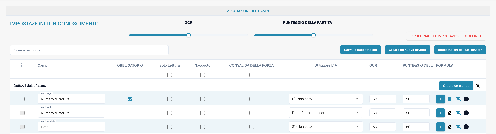

# Campi

I campi definiscono i dati raccolti per un tipo di documento e il modo in cui vengono controllati. Apri il tipo di documento nelle impostazioni, quindi i relativi campi.

<figure><figcaption>
Vista dei campi del tipo di documento Fattura. L’etichetta Punteggio della partita indica Match Score. L’etichetta CONVALIDA DELLA FORZA indica la convalida forzata.
</figcaption></figure>

## Proprietà e riconoscimento

* **Obbligatorio** richiede un valore per la validazione.
* **Sola lettura** impedisce la modifica; **Nascosto** esclude il campo dalla visualizzazione normale.
* La **validazione forzata** richiede un controllo esplicito del campo. Non crea regole di confronto né espressioni regolari; configura separatamente le regole di validazione personalizzate.
* **OCR** imposta una soglia numerica di affidabilità del riconoscimento. Non è un interruttore per attivare OCR.
* **Punteggio di corrispondenza** imposta una soglia numerica di corrispondenza. Non è un testo di riferimento né un elenco di valori.
* L’opzione **IA** controlla l’estrazione richiesta per il campo.

Cerca un campo per nome e controlla la sua riga prima di modificarne le proprietà. Puoi organizzare i gruppi, aggiungere campi e aprire le opzioni di formula o dati anagrafici. Le azioni dipendono dal campo e dai permessi; l’eliminazione dei campi standard può essere limitata.

Salva soltanto le modifiche previste e verifica la validazione su documenti rappresentativi. Le immagini non dimostrano modifiche salvate.

Consulta le [proprietà dei campi](configuring-field-properties-1.md), [validazione e Match Score](setting-validation-and-match-score.md) e i [campi con costi](new-fields-with-charges.md).
