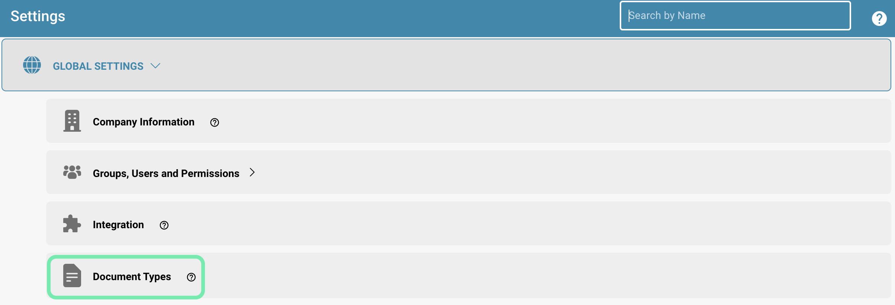
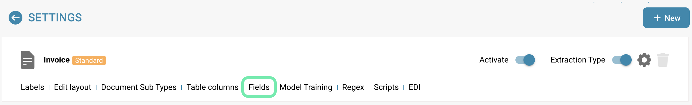
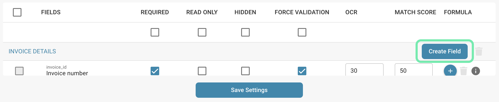
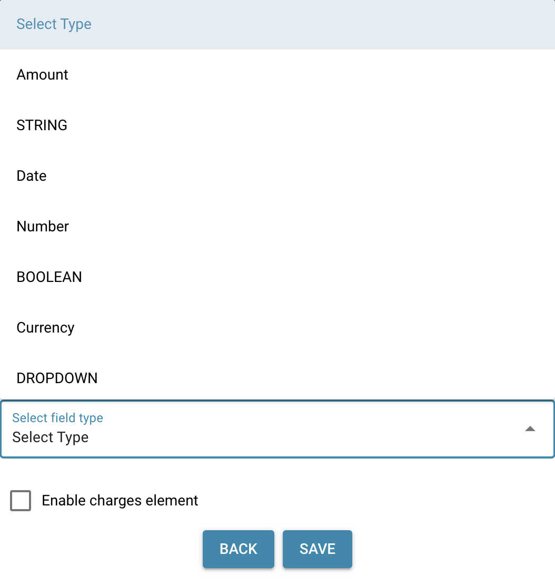
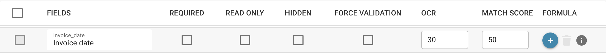
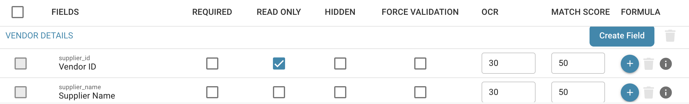
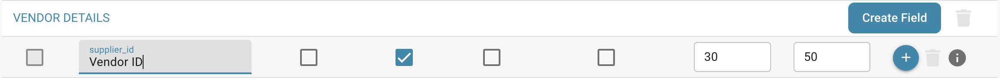
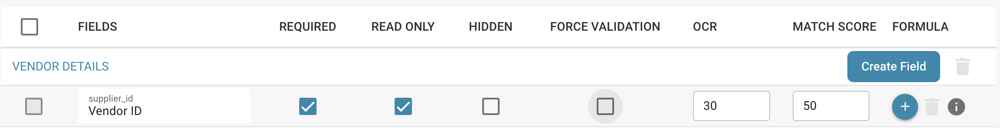

# Aggiungere e modificare i campi

## Ecco i passaggi per aggiungere un nuovo campo o modificare i campi esistenti in DocBits, compresi i dettagli su come accedere alle opzioni di configurazione avanzate:

### Aggiungere un nuovo campo

* Accedi e apri la gestione dei documenti:

<figure><figcaption>
Impostazioni
</figcaption></figure>

<figure><figcaption>
Impostazioni Tipi di documento
</figcaption></figure>

**Aggiungi un nuovo campo:**

* Fai clic sull'opzione "Create Field".

<figure><figcaption></figcaption></figure>

**Configurazione di base:**

<figure><figcaption></figcaption></figure>

* **Name**
  * Scegli un nome significativo e descrittivo.
  * Il nome deve essere univoco.
  * <mark style="color:red;">**Nota:**</mark> **Una volta creato, il nome non può più essere modificato.**
* **Title**
  * È il nome visualizzato del campo.
  * Definisce come il campo appare nell'interfaccia utente.
  * <mark style="color:red;">**Nota:**</mark> **Il titolo può essere modificato in un secondo momento, se necessario.**
*   **Select Field Type**

    * Scegli il tipo di campo da un elenco a discesa.
    * I tipi di campo disponibili comprendono diverse opzioni per soddisfare le varie esigenze di inserimento dei dati.
    * <mark style="color:red;">**Nota:**</mark> **Una volta creato, il tipo non può più essere modificato.**

    <figure><figcaption></figcaption></figure>
* **Optional: Enable Charges Element**
  * È possibile selezionare una casella di controllo denominata **Enable Charges Element**.
  * Se è selezionata, devi scegliere un elemento di costo da un elenco a discesa.
  * **Importante:** gli elementi di costo devono essere configurati in precedenza.
    * [Configurazione degli elementi di costo](../../../../../infor-integration-and-configuration/importing-customer-master-data/m3/table-extraction-for-costing-element.md)

**Configurazione avanzata:**

* Qui puoi impostare altre proprietà, come regole di convalida, valori di corrispondenza, modalità di sola lettura, nascondimento e impostazioni OCR.

<figure><figcaption></figcaption></figure>

**Salva:**

* Dopo aver effettuato tutte le configurazioni necessarie, fai clic su "Save" o su un pulsante analogo per creare il nuovo campo.

<figure><figcaption></figcaption></figure>

### Modificare un campo esistente

**Accedi alla modifica del campo:**

* Vai all'elenco dei campi esistenti e trova il campo che desideri modificare.

<figure><figcaption></figcaption></figure>

**Seleziona un campo:**

* Fai clic sul campo desiderato per accedere alle opzioni di modifica.

<figure><figcaption></figcaption></figure>

**Modifica la configurazione:**

* Modifica le proprietà del campo secondo le necessità. Questo può includere la modifica del nome, del tipo di campo, l'aggiunta o la rimozione di regole di convalida, l'impostazione di valori di corrispondenza o la regolazione di altre impostazioni avanzate.

<mark style="color:red;">**Nota:**</mark> se modifichi il **Title** di un campo, devi eliminare e aggiungere nuovamente il campo nel layout builder affinché le modifiche abbiano effetto.

<figure><figcaption></figcaption></figure>

**Salva:**

* Fai clic su "Save" per salvare le modifiche apportate al campo.

<figure><figcaption>
Save Settings
</figcaption></figure>

Grazie ai passaggi per aggiungere nuovi campi e modificare quelli esistenti, oltre all'accesso alle opzioni di configurazione avanzate, puoi massimizzare la flessibilità e l'adattabilità del tuo sistema di elaborazione dei documenti. In questo modo puoi strutturare ed elaborare i tuoi dati esattamente come ti serve.
