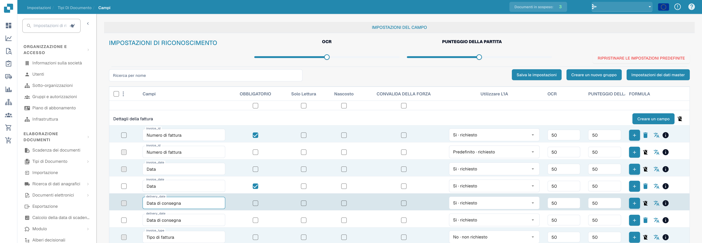
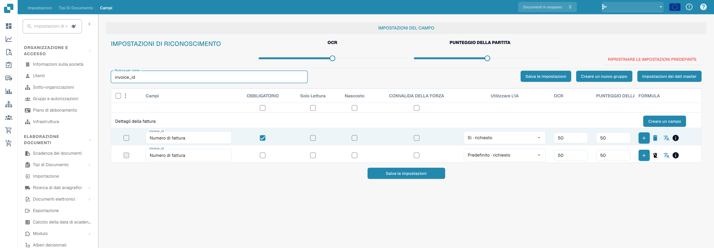

# Configurazione delle proprietà dei campi

Apri **Impostazioni → Tipi di documento → Campi** e seleziona il tipo di documento. Le immagini mostrano Fattura nell’interfaccia italiana; gli identificatori tecnici come `invoice_id` restano invariati.

<figure><figcaption>
Proprietà dei campi: obbligatorio, sola lettura, nascosto e convalida forzata. L’etichetta Punteggio della partita indica Match Score. L’etichetta CONVALIDA DELLA FORZA indica la convalida forzata.
</figcaption></figure>

## Trovare un campo e modificarne le proprietà

1. In **Ricerca per nome** inserisci il nome o l'etichetta del campo. Questo filtra l'elenco, ma non modifica il campo.
2. Trova la riga del campo. Ad esempio, **Numero di fattura** ha il nome tecnico `invoice_id`.
3. Regola i controlli di quella riga, quindi seleziona **Salva le impostazioni**. Lo stesso pulsante di salvataggio è disponibile sopra e sotto la tabella.

<figure><figcaption>
Campi filtrati per invoice_id con soglie OCR e Match Score. L’etichetta Punteggio della partita indica Match Score. L’etichetta CONVALIDA DELLA FORZA indica la convalida forzata.
</figcaption></figure>

| Controllo | A cosa serve |
| --- | --- |
| **Obbligatorio** | Contrassegna le informazioni che devono essere presenti per la convalida. Dopo aver modificato questa impostazione, controlla il risultato della convalida del documento. |
| **Solo lettura** | Mostra un campo senza consentire agli utenti di modificarne il valore. |
| **Nascosto** | Mantiene il campo fuori dalla normale visualizzazione del documento. |
| **Validazione forzata** | Richiede un controllo esplicito del campo. Non crea regole di confronto né espressioni regolari; configura separatamente le regole di validazione personalizzate. |
| **Utilizzare l'IA** | Richiede o interrompe l'estrazione con AI per questo campo. La riga indica se l'estrazione è richiesta. |
| **OCR** | Inserisci la soglia di affidabilità OCR del campo. È un numero, non un interruttore on/off né un'impostazione della lingua. |
| **Punteggio di corrispondenza** | Inserisci la soglia di corrispondenza del campo. È un numero, non un interruttore on/off. |

Gli slider **OCR** e **Punteggio di corrispondenza** in **Impostazioni di riconoscimento** applicano i valori all'intero elenco dei campi. Le caselle di controllo direttamente sotto i titoli delle colonne applicano **Obbligatorio**, **Solo lettura**, **Nascosto** o **Validazione forzata** all'intero elenco. Controlla le righe interessate prima di selezionare **Salva le impostazioni**. **Ripristina valori predefiniti** ripristina la configurazione dei campi; usalo solo se intendi sostituire le tue modifiche.

## Altri controlli in questa vista

- **Creare un nuovo gruppo** e **Creare un campo** aggiungono un gruppo o un campo. Vedi [Aggiungere e modificare i campi](adding-and-editing-fields.md).
- **Impostazioni dei dati master** apre la [configurazione dei dati anagrafici](master-data-settings.md).
- Le caselle di controllo all'estrema sinistra selezionano i campi. Il menu adiacente offre **Riassegnare il gruppo di campo** per i campi selezionati.
- Il pulsante più **FORMULA** apre l'editor di formule per quel campo. L'icona **info** mostra le informazioni sul campo. L'icona di eliminazione non è disponibile per i campi standard.

Per maggiori informazioni su convalida e corrispondenza, vedi [Impostare convalida e Match Score](setting-validation-and-match-score.md).
