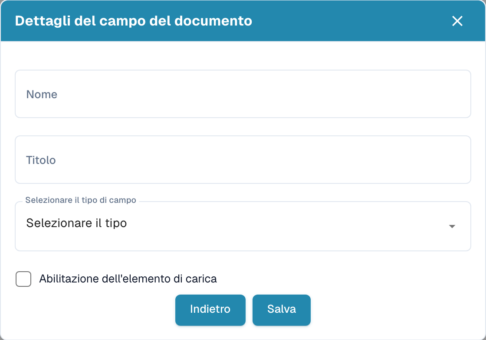
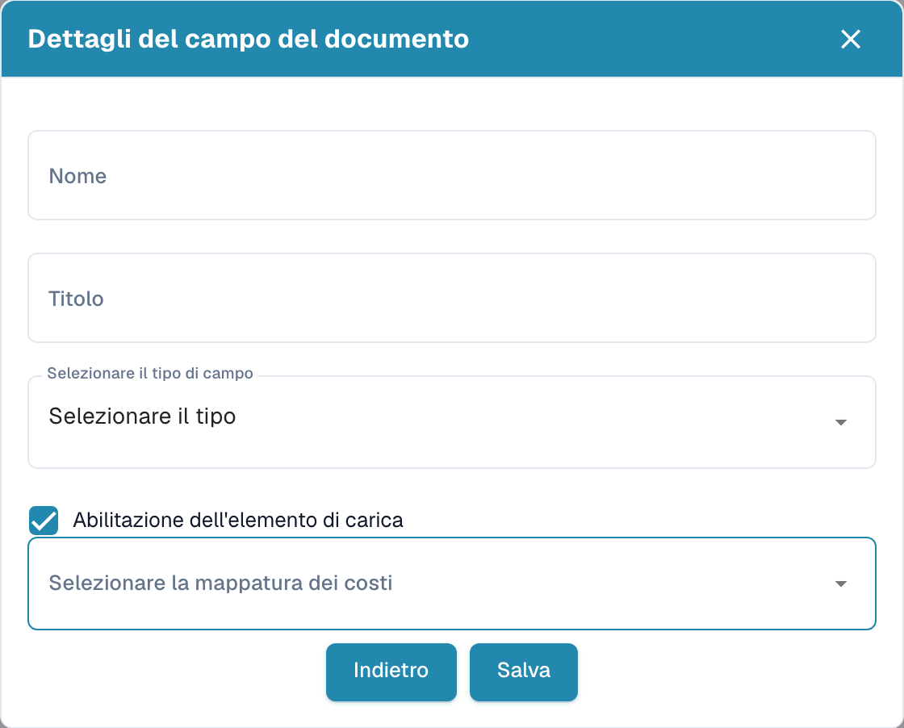

# Creare campi con costi aggiuntivi

Nelle impostazioni, aprire il tipo di documento e i relativi campi. Nel gruppo previsto, scegliere la creazione di un campo.

<figure><figcaption>
Dettagli del campo prima della creazione di un nuovo campo.
</figcaption></figure>

1. Inserire un nome tecnico e un titolo leggibile.
2. Selezionare il tipo di dato.
3. Attivare l’opzione dei costi aggiuntivi per visualizzare la selezione della mappatura dei costi.
4. Scegliere la mappatura prevista per questi costi. Le opzioni dipendono dalla configurazione dell’organizzazione.

<figure><figcaption>
Bozza di campo con l’opzione dei costi aggiuntivi attiva.
</figcaption></figure>

L’esempio è una bozza non salvata. Il salvataggio crea il campo; tornare indietro se non si desidera crearlo. Verificare poi separatamente obbligatorietà, convalida forzata, OCR e Match Score nell’elenco dei campi.
