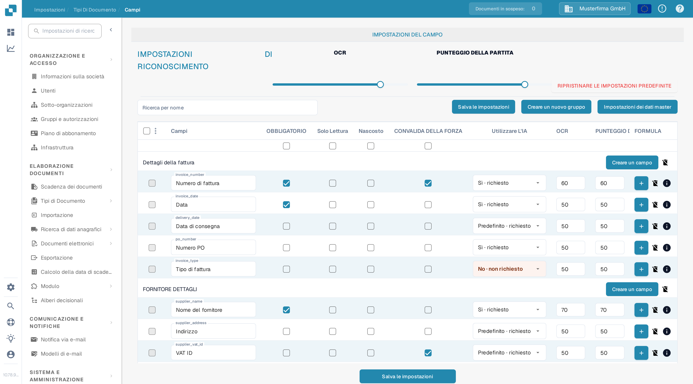
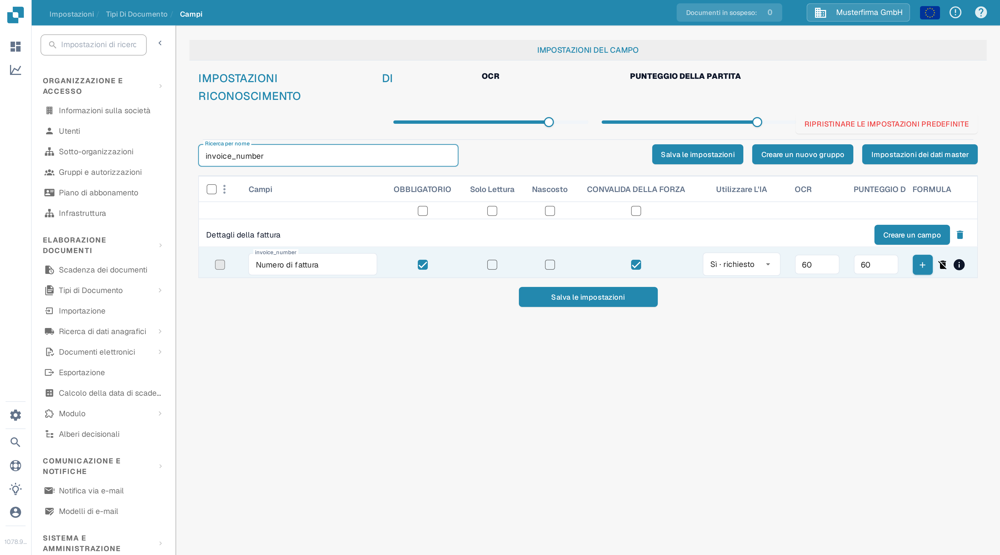

# Impostazioni di Convalida e Punteggio della Partita

In **Campi** puoi impostare le soglie di convalida e di riconoscimento di un tipo di documento. Questa pagina usa **Fattura** in un'organizzazione di prova della documentazione. Spiega l'attuale casella **CONVALIDA DELLA FORZA** e i controlli **PUNTEGGIO DELLA PARTITA**.

## Aprire le impostazioni dei campi

1. Vai a **Impostazioni → Tipi di Documento → Fattura → Campi**.
2. Usa **Ricerca per nome** per trovare un campo, ad esempio `invoice_id` (mostrato come **Numero fattura**).
3. Controlla la riga del campo prima di modificare un'impostazione. **OBBLIGATORIO**, **Solo Lettura**, **Nascosto** e **CONVALIDA DELLA FORZA** sono caselle di controllo separate.

<figure><figcaption>
I controlli di riconoscimento compaiono sopra l'elenco dei campi.
</figcaption></figure>

## CONVALIDA DELLA FORZA

Seleziona **CONVALIDA DELLA FORZA** nella riga del campo per applicare a quel campo una convalida più rigorosa. La casella è separata da **OBBLIGATORIO**: contrassegnare un campo come obbligatorio non seleziona automaticamente CONVALIDA DELLA FORZA. La casella può non essere disponibile quando un campo è nascosto o di sola lettura. Dopo aver modificato la configurazione del campo, fai clic su **Salva le impostazioni**.

Le istruzioni precedenti suggerivano di inserire qui limiti numerici o espressioni regolari. L'attuale tabella Campi non mostra un editor di regole nella cella CONVALIDA DELLA FORZA. Per le regole specifiche di un campo, consulta [Configurazione delle Proprietà del Campo](configuring-field-properties-1.md).

## PUNTEGGIO DELLA PARTITA

**PUNTEGGIO DELLA PARTITA** è una soglia numerica, non un valore di riferimento fisso. Il cursore **PUNTEGGIO DELLA PARTITA** in **IMPOSTAZIONI DI RICONOSCIMENTO** applica il proprio valore alle righe dei campi del tipo di documento; per un valore individuale usa l'input **PUNTEGGIO DELLA PARTITA** della singola riga di campo. Nell'organizzazione di prova, il cursore e `invoice_id` mostrano entrambi **50**. Verifica i campi interessati, poi fai clic su **Salva le impostazioni**.

<figure><figcaption>
Cerca un campo per verificarne la casella CONVALIDA DELLA FORZA e il valore PUNTEGGIO DELLA PARTITA.
</figcaption></figure>

**OCR** è una soglia di riconoscimento separata, accanto a PUNTEGGIO DELLA PARTITA. **RIPRISTINARE LE IMPOSTAZIONI PREDEFINITE** reimposta le configurazioni; usalo solo se intendi scartare le tue soglie personalizzate. Per le altre opzioni dei campi, consulta la panoramica di [Campi](README.md).
