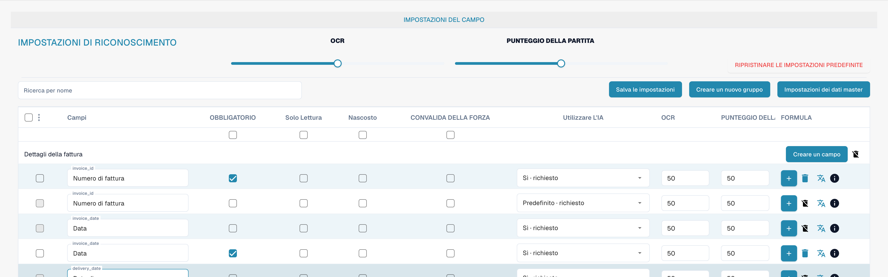
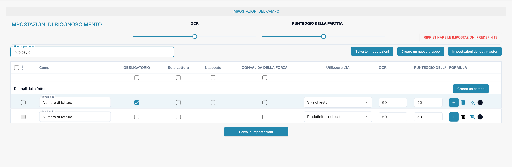

# Convalida e punteggio di corrispondenza

Obbligatorietà, convalida forzata, OCR e Match Score sono proprietà diverse di un campo. Consultare i campi del tipo di documento per verificarle.

<figure><figcaption>
Colonne separate per convalida forzata, OCR e Match Score. L’etichetta Punteggio della partita indica Match Score. L’etichetta CONVALIDA DELLA FORZA indica la convalida forzata.
</figcaption></figure>

## Convalida forzata

La convalida forzata richiede una verifica esplicita del campo. Da sola non crea un’espressione regolare né una regola di confronto. Le regole di convalida personalizzate si configurano separatamente.

<figure><figcaption>
Convalida e riconoscimento configurati separatamente per ogni campo. L’etichetta Punteggio della partita indica Match Score. L’etichetta CONVALIDA DELLA FORZA indica la convalida forzata.
</figcaption></figure>

## OCR e Match Score

OCR definisce la soglia di riconoscimento del campo. Match Score è una soglia numerica di corrispondenza; non è un testo di riferimento né un selettore del valore da confrontare.

<figure><figcaption>
Numero di fattura filtrato con convalida forzata e Match Score. L’etichetta Punteggio della partita indica Match Score. L’etichetta CONVALIDA DELLA FORZA indica la convalida forzata.
</figcaption></figure>

Verificare il comportamento con documenti rappresentativi prima di salvare le impostazioni. L’obbligatorietà di un campo non sostituisce la convalida forzata.

L’etichetta italiana Punteggio della partita indica Match Score: è una traduzione inesatta del punteggio di corrispondenza. La voce Convalida della forza indica la convalida forzata.
