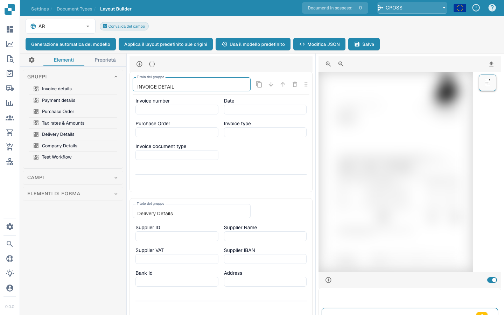

# Gestore dei layout

<figure><figcaption></figcaption></figure>

#### Panoramica

Il Layout Manager consente agli amministratori di configurare e modificare visivamente il layout dei tipi di documenti impostando le proprietà per vari campi e gruppi di dati all'interno di un documento. Questa interfaccia aiuta a garantire che i modelli di estrazione e i punti di immissione manuale dei dati si allineino esattamente con la struttura del documento scansionato o caricato in Docbits.

#### Componenti principali

1. **Gruppi e Campi**:
   * **Gruppi**: unità organizzative all'interno di un tipo di documento che classificano i campi correlati (ad esempio, Dettagli fattura, Dettagli pagamento). Questi possono essere espansi o compressi e disposti in modo da rispecchiare il raggruppamento logico nel documento reale.
   * **Campi**: punti dati individuali all'interno di ciascun gruppo (ad esempio, numero di fattura, termini di pagamento). Ogni campo può essere personalizzato per il modo in cui i dati vengono acquisiti, visualizzati ed elaborati.
2. **Properties Panel**:
   * Questo pannello visualizza le proprietà del campo o gruppo selezionato, consentendo una configurazione dettagliata, come:
     * **Label**: l'etichetta visibile per il campo nell'interfaccia utente.
     * **Nome campo**: l'identificatore tecnico utilizzato all'interno del sistema.
     * **Larghezza elemento in percentuale**: Determina la larghezza del campo in relazione al layout del documento.
     * **Tab Index**: controlla l'ordine di tabulazione per la navigazione.
     * **Esegui script su modifica**: se eseguire uno script quando cambia il valore del campo.
     * **Visualizza etichetta a sinistra**: se l'etichetta viene visualizzata a sinistra del campo o sopra di esso.
     * **Is Textarea**: specifica se il campo deve essere un'area di testo, in grado di ospitare quantità maggiori di testo.
     * **Seleziona tipo di modello**: opzione per selezionare quale tipo di modello gestirà l'estrazione di questo campo.
     * **Lunghezza campo**: lunghezza massima dei dati da accettare in questo campo.
     * **Parole chiave vietate**: parole chiave non consentite nel campo.
3. **Template Preview**:
   * Mostra un'anteprima in tempo reale di come apparirà il documento in base alla configurazione del layout corrente. Ciò aiuta a garantire che il layout corrisponda alla struttura effettiva del documento ed è vitale per testare e perfezionare l'impostazione dell'elaborazione del documento.



