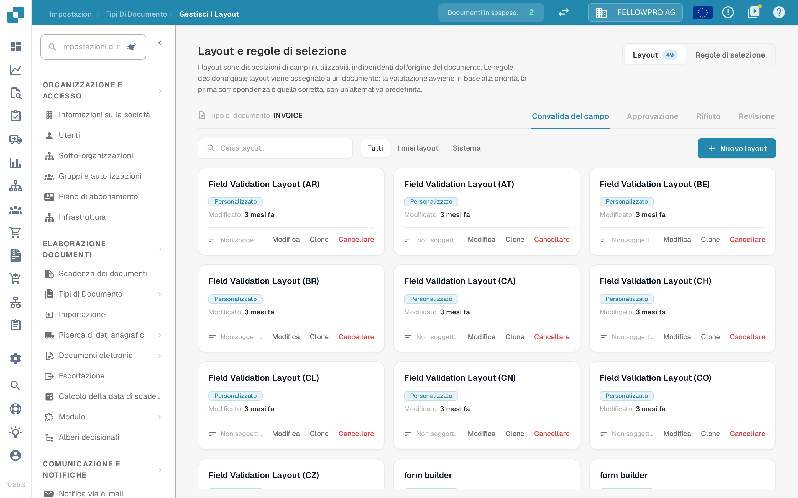

# Gestore dei layout

<figure><figcaption>Il gestore dei layout per il tipo di documento Invoice.</figcaption></figure>

Il **gestore dei layout** determina l'aspetto di un tipo di documento per chi convalida, approva, rifiuta e revisiona i documenti: quali campi e gruppi compaiono sullo schermo, in quale ordine e come si comporta ogni campo. Ogni tipo di documento ha i propri layout.

La pagina si apre come **Layout e regole di selezione**: i layout sono disposizioni di campi riutilizzabili, indipendenti dall'origine del documento, e le regole decidono quale layout viene assegnato a un documento.

#### Schermate e tipi di layout

Convalida, approvazione, rifiuto e revisione sono schermate distinte e ciascuna ha i propri layout, le proprie regole e il proprio layout predefinito: una regola di approvazione non modifica mai la schermata di convalida. Per cambiare schermata usare le schede **Convalida del campo**, **Approvazione**, **Rifiuto** e **Revisione**.

#### Schede di layout

Nella scheda **Layout** ogni layout della schermata selezionata è rappresentato da una scheda. La scheda mostra il nome del layout, se appartiene alla propria organizzazione (**Personalizzato**) o è il layout predefinito di sistema, quando è stato modificato l'ultima volta e se una regola di selezione lo utilizza. **Modifica** apre il layout nel Layout Builder, **Clone** lo copia con il nome scelto e **Cancellare** lo rimuove: il layout predefinito di sistema può solo essere consultato, non modificato né eliminato. **Nuovo layout** chiede un nome e apre il Layout Builder sul nuovo layout vuoto. Il filtro sopra le schede alterna tra **Tutti**, **I miei layout** e **Sistema**.

#### Il Layout Builder

**Modifica** apre il [Layout Builder](navigating-the-layout-manager.md):

* **Struttura**, **Campi** ed **Elementi** a sinistra: il layout sotto forma di albero, ogni campo del tipo di documento con un contatore dei campi già inseriti, e i gruppi e gli elementi del modulo da trascinare sull'area di lavoro.
* L'**area di lavoro** al centro mostra il layout così come lo vede l'utente. **Layout principale** e **Tabella** alternano la pagina e una tabella delle righe, mentre **Documento** apre il documento di esempio accanto.
* Il pannello **Proprietà** a destra segue l'elemento selezionato; le sue impostazioni sono raggruppate in visualizzazione, comportamento, valori ed elenchi, automazione, bordi e spaziatura.

**Salva** nell'intestazione memorizza il layout. Per le altre azioni dell'intestazione vedere [Salvare e Applicare le Modifiche](save-and-apply-changes.md).

#### Quale layout riceve un documento

La scheda **Regole di selezione** di ogni schermata contiene le regole che scelgono il layout: vengono valutate per priorità, prevale la prima corrispondenza e si applica un'alternativa predefinita quando nessuna regola corrisponde. Vedere [Regole di selezione del layout](layout-selection-rules.md).
