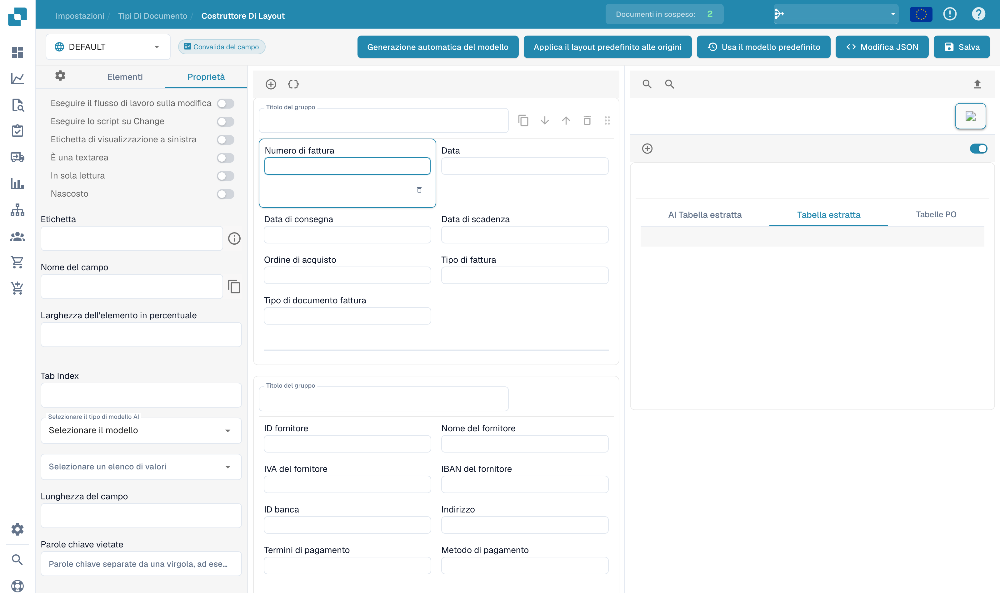

# Configurare le proprietà di un campo

Aprire un layout esistente nel generatore e selezionare un campo nell’anteprima. Il pannello delle proprietà presenta i comandi dell’elemento selezionato.

<figure><figcaption>
Proprietà di un campo nel generatore di layout.
</figcaption></figure>

Verificare etichetta, nome tecnico, larghezza percentuale e ordine di tabulazione. A seconda dell’elemento, è possibile configurare anche sola lettura, visibilità, posizione dell’etichetta, testo su più righe o esecuzione di un workflow o script quando cambia il valore.

Selezionare il modello di IA o l’elenco di valori appropriato, se disponibile per il campo. Lunghezza e parole vietate aggiungono vincoli. I nomi tecnici e i nomi delle origini configurate non cambiano con la lingua dell’interfaccia.

Controllare l’anteprima dopo ogni modifica. Salvare le modifiche previste e verificare la convalida con documenti rappresentativi. Le regole di convalida e le soglie di riconoscimento del tipo di documento si configurano separatamente.
