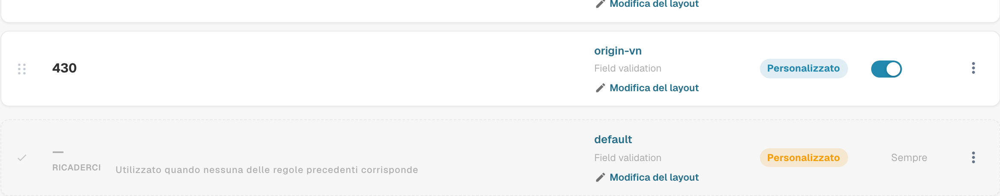
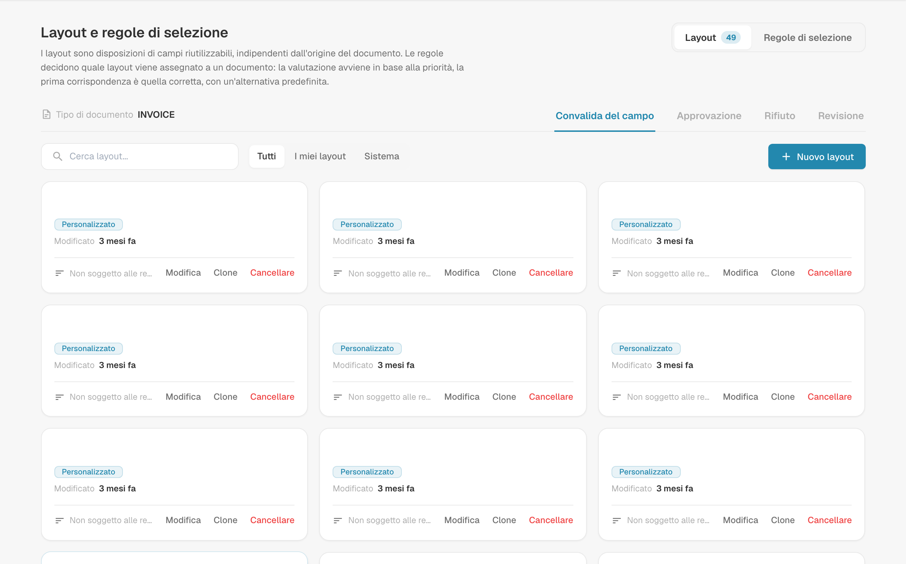
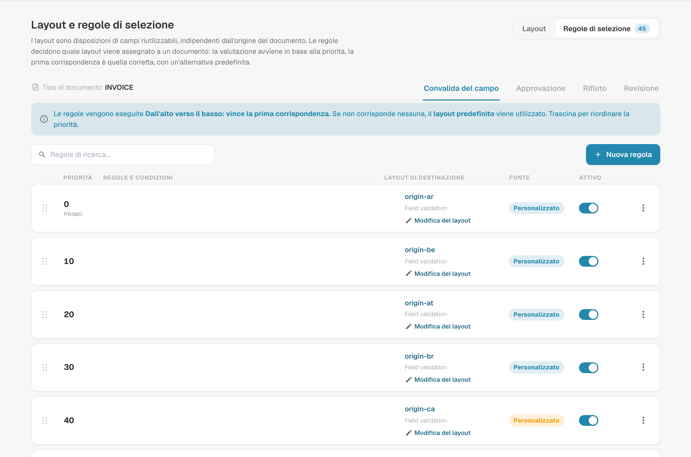
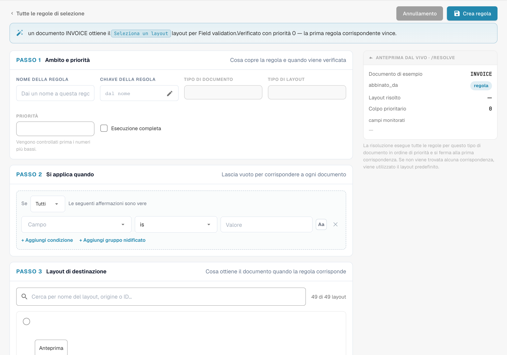
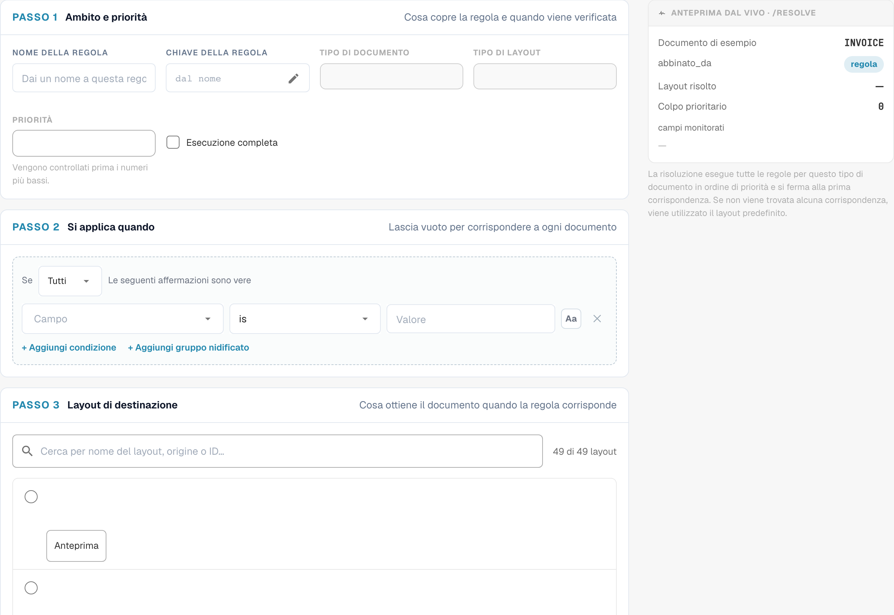

# Regole di selezione del layout

## Panoramica

Un **Disposizione** stabilisce quali campi e gruppi vede un utente — e in quale ordine — nelle schermate di **convalida**, **approvazione**, **rifiuto** e **revisione** di un documento. I layout si progettano nel [Layout Manager](README.md).

Tradizionalmente DocBits sceglieva il layout in base all'**origine** del documento: il paese o la regione ricavati dalle impostazioni della lingua del documento, ad esempio `DE` o `US`. Ogni origine aveva la propria copia del layout e nient'altro poteva influenzare la scelta.

Con le **regole di selezione del layout**, i layout diventano elementi riutilizzabili e indipendenti dall'origine, e sono le **regole** a decidere quale layout riceve un documento:

> *Quando* il documento soddisfa una condizione, *allora* riceve questo layout. Le regole vengono verificate dall'alto verso il basso; **vince la prima regola che corrisponde**. Se nessuna regola corrisponde, viene utilizzato il **layout predefinito**.

L'origine resta disponibile, ma come una condizione tra le tante. Una regola può altrettanto bene considerare il fornitore, l'importo, lo stato del documento, il metodo di estrazione o qualsiasi campo dell'intestazione.

### Problemi che risolvono

| Esigenza | Layout classici basati sull'origine | Con le regole di selezione |
| --- | --- | --- |
| Le fatture di un fornitore richiedono campi aggiuntivi (progetto, numero doganale) | impossibile senza una nuova origine | regola *Supplier ID is 20723* → layout "Fattura con campi progetto" |
| I documenti DE, AT e CH devono avere lo stesso aspetto | tre copie dello stesso layout da mantenere | un solo layout, una regola per origine (o un gruppo ANY) che punta ad esso |
| Le fatture elettroniche richiedono una schermata più semplice dei PDF scansionati | non possibile | regola *Extraction Method is ELECTRONIC_DOCUMENT* → layout "Fattura elettronica" |
| Le fatture di importo elevato richiedono più campi nella schermata di approvazione | non possibile | regola di approvazione *Total Amount greater than 10000* → layout "Approvazione importi elevati" |
| Il secondo approvatore deve vedere una schermata diversa dal primo | tipo di layout separato "seconda approvazione" | regola di approvazione *Document Status is Pending second approval* → layout "Seconda approvazione" |

## Attivare i layout basati su regole

I layout basati su regole vengono attivati **per tipo di documento** da un **amministratore dell'organizzazione**.

1. Andare su **Impostazioni → Impostazioni globali → Tipi di documento**.
2. Fare clic sull'icona **impostazioni** (ingranaggio) sulla scheda del tipo di documento.
3. Aprire **Gestisci i layout** e attivare l'interruttore.

<figure><figcaption>
L'interruttore Manage Layouts nelle impostazioni aggiuntive di un tipo di documento
</figcaption></figure>

Il collegamento **Disposizione** sulla scheda del tipo di documento ora apre **Layout e regole di selezione**.

### Cosa succede quando si attiva

DocBits converte i layout esistenti basati sull'origine in regole — una sola volta, per questo tipo di documento e per ciascuna schermata:

* Il layout dell'origine **DEFAULT** diventa il **layout predefinito** (il fallback).
* Ogni layout di un'origine specifica diventa una regola **"Layout for XX"** con la condizione *Document Origin is XX*, che punta a quel layout. Queste regole ricevono priorità a passi di 10 (ad esempio 2000, 2010, 2020 …), così è possibile collocare le proprie regole prima, in mezzo o dopo di esse.

<figure><figcaption>
Layout di riserva alla fine dell’elenco delle regole di selezione. Il nome della schermata Field validation resta in inglese nel prodotto. L’etichetta RICADERCI indica il layout di riserva (fallback).
</figcaption></figure>

Nei layout stessi non viene eliminato né modificato nulla. Subito dopo l'attivazione ogni documento riceve quindi esattamente il layout che riceveva prima. Il comportamento cambia solo quando si aggiungono o si modificano delle regole.

**Disattivando** la funzione, il tipo di documento torna subito alla selezione basata sull'origine. Le regole vengono conservate ma non utilizzate, e tornano a essere efficaci se si riattiva l'interruttore.

## La schermata Layouts & Selection Rules

<figure><figcaption>
Panoramica dei layout e delle regole di selezione. Il nome della schermata Field validation resta in inglese nel prodotto.
</figcaption></figure>

* **Layouts / Selection rules** (in alto a destra) consentono di passare dall'elenco dei layout all'elenco delle regole. I numeri indicano quanti ce ne sono.
* **Field Validation / Approval / Reject / Review** cambiano la **schermata**. Ogni schermata ha i propri layout, le proprie regole e il proprio layout predefinito — una regola di approvazione non modifica mai la schermata di convalida.
* Nella scheda **Disposizione** è possibile creare, modificare, clonare ed eliminare layout. Ogni scheda indica se una regola utilizza il layout ("Not targeted by rules" se nessuna lo fa). Filtrare con **All / My layouts / System**; i layout di sistema sono forniti con DocBits e possono essere visualizzati e clonati, ma non modificati.


La prima e la seconda approvazione condividono i layout e le regole **Approvazione**. Per assegnare alla seconda fase di approvazione una schermata propria, aggiungere una regola di approvazione con la condizione *Document Status is Pending second approval* — vedere l'[esempio](#schermate-diverse-per-la-prima-e-la-seconda-approvazione).


## Come viene scelto un layout

Ogni volta che un documento viene aperto, e di nuovo dopo il salvataggio, DocBits decide il suo layout per la schermata corrente:

1. Le **regole attive** della schermata vengono verificate in ordine di **priorità** (prima il numero più basso). **Vince la prima regola la cui condizione è vera** e viene utilizzato il suo layout.
2. Se nessuna regola corrisponde, viene utilizzato il **layout predefinito**.
3. Se non esiste nemmeno un layout predefinito, DocBits ripiega sulla classica scelta basata sull'origine.

Le regole il cui layout è stato eliminato o è vuoto vengono saltate.

### Un esempio pratico

Regole della schermata **Convalida del campo**:

| Priorità | Regola | Condizione | Layout |
| --- | --- | --- | --- |
| 5 | Fatture del fornitore di esempio | *Supplier ID is HP0000278* | Fattura con campi progetto |
| 10 | Fatture elettroniche | *Extraction Method is ELECTRONIC_DOCUMENT* | Fattura elettronica |
| 2020 | Layout for DE | *Document Origin is DE* | Field Validation Layout (DE) |
| — | Layout predefinito | — | Field Validation Layout (Base) |

Quale layout riceve ciascun documento:

| Documento | Fornitore | Estrazione | Origine | Layout | Motivo |
| --- | --- | --- | --- | --- | --- |
| 1 | HP0000278 | fattura elettronica | DE | Fattura con campi progetto | la priorità 5 corrisponde per prima; le regole successive non vengono verificate |
| 2 | 10040 | fattura elettronica | DE | Fattura elettronica | la priorità 5 non corrisponde, la 10 sì |
| 3 | 10040 | PDF scansionato | DE | Field Validation Layout (DE) | corrisponde solo la regola di origine |
| 4 | 10040 | PDF scansionato | US | Field Validation Layout (Base) | nessuna regola corrisponde → predefinito |

**L'ordine conta**: collocare le regole specifiche (un solo fornitore) sopra quelle generali (un solo paese).

### Quando un utente modifica un campo che le regole considerano

Il layout viene sempre scelto in base ai valori **correnti** del documento. Se un utente corregge, ad esempio, il fornitore nella schermata di convalida, DocBits sceglie di nuovo il layout dopo il salvataggio e la schermata può passare a un altro layout. Nessun dato va perso: un campo che non fa parte del nuovo layout mantiene il proprio valore; semplicemente non viene mostrato finché non si applica di nuovo un layout che lo contiene.

## Gestire le regole di selezione

<figure><figcaption>
Regole di selezione con i nomi configurati nascosti. Il nome della schermata Field validation resta in inglese nel prodotto.
</figcaption></figure>

Ogni riga mostra la **priorità** (la prima riga è contrassegnata da **FIRST**), il **nome e la chiave della regola** con le sue **condizioni**, il **layout di destinazione**, il badge dell'**origine** e un interruttore **Attivo**.

| Attività | Come |
| --- | --- |
| Creare una regola | **Nuova regola** |
| Modificare una regola | Fare clic sulla riga |
| Cambiare l'ordine | Trascinare la maniglia a sinistra della riga verso l'alto o verso il basso. Il nuovo ordine viene salvato subito. |
| Disattivare una regola | Interruttore **Attivo**. Le regole inattive vengono ignorate. |
| Duplicare o eliminare | Menu **⋮** della riga |
| Cercare una regola | **Search rules…** |

Il badge dell'**origine** indica da dove proviene una regola: le regole **Sistema** sono fornite con DocBits. Modificarne una crea una copia per la propria organizzazione, mostrata come **Personalizzato**; l'originale resta intatta e può essere ripristinata. Le regole create dall'utente sono **Personalizzato**.

### Il layout predefinito

L'ultima riga, contrassegnata da **RICADERCI** e **is_default**, è il layout predefinito: viene utilizzata ogni volta che nessuna regola sopra corrisponde e non ha condizioni. Viene creata quando si attiva la funzione (a partire dal layout dell'origine DEFAULT).


Per usare un altro layout di fallback, creare una regola **senza alcuna condizione** e assegnarle il numero di priorità più alto, in modo che venga verificata per ultima. Corrisponde a ogni documento a cui non corrisponde nessuna regola precedente, prima di arrivare al layout predefinito.


## Creare una regola

Fare clic su **Nuova regola** nella scheda Selection rules della schermata che si desidera modificare.

<figure><figcaption>
Ambito, condizioni e layout di destinazione della regola. Il nome della schermata Field validation resta in inglese nel prodotto.
</figcaption></figure>

La frase in alto riassume la regola man mano che viene costruita — "When header.supplier_id = HP0000278, an INVOICE document gets the Field Validation Layout (Base) layout for Field validation. Checked at priority 5 — the first matching rule wins."

### Passaggio 1 — Scope & priority

| Impostazione | Cosa fa |
| --- | --- |
| **Nome della regola** | Mostrato nell'elenco delle regole. Descrivere il caso aziendale: "Fatture del fornitore di esempio", "Fatture elettroniche", "Approvazione importi elevati". |
| **Chiave della regola** | Generata dal nome; resta invariata se si rinomina la regola. |
| **Tipo di documento** / **Tipo di layout** | Il tipo di documento e la schermata a cui si riferisce la regola. Ricavati dal punto in cui si è fatto clic su **Nuova regola**. |
| **Priorità** | I numeri più bassi vengono verificati per primi. Lasciare degli intervalli (5, 10, 20 …) per poter inserire regole in seguito. |

### Passaggio 2 — Applies when

La condizione che un documento deve soddisfare. È possibile utilizzare:

* **attributi del documento**: Document Origin, Extraction Method, Document Status, Sub Document Type,
* **campi dell'intestazione**: Supplier ID, Total Amount, Currency, Purchase Order e ogni altro campo del tipo di documento,
* un **percorso JSON personalizzato** (Advanced).

Le colonne della tabella non sono disponibili: il layout viene scelto una sola volta per l'intero documento.

Lasciare vuoto il passaggio per far corrispondere tutti i documenti a questa priorità. Il funzionamento delle condizioni — ALL / ANY, gruppi nidificati, tutti gli operatori, valori vuoti, maiuscole/minuscole — è spiegato in [Condizioni delle regole (Applies when)](../rule-conditions-applies-when.md).

### Passaggio 3 — Target layout

Fare clic sul layout che il documento deve ricevere. L'elenco mostra i propri layout e i layout di sistema della schermata selezionata. Un layout non può essere eliminato finché una regola punta ancora ad esso.

### Anteprima in tempo reale · /resolve

Il pannello a destra mostra cosa fa la regola per un documento di esempio che ha i valori delle condizioni:

| Riga | Significato |
| --- | --- |
| **Documento di esempio** | I valori utilizzati per l'anteprima, ricavati dalle condizioni |
| **matched_by** | `rule` se ha corrisposto una regola, altrimenti il layout predefinito |
| **Layout risolto** | Il layout che riceverebbe il documento di esempio |
| **Priorità della regola corrispondente** | La priorità della regola che ha corrisposto |
| **watched_fields** | I campi da cui dipende la scelta del layout. Quando un utente ne modifica uno, il layout viene scelto di nuovo. |

Fare clic su **Crea regola** (o **Salva la regola** in modifica) per salvare. **Annullamento** riporta all'elenco delle regole.

## Esempi

### Campi aggiuntivi per un fornitore

Schermata **Convalida del campo** · priorità **5** · *Supplier ID is HP0000278* · destinazione *Fattura con campi progetto* (un clone del layout standard con i campi aggiuntivi progetto e centro di costo).

### Un layout per più paesi

Schermata **Convalida del campo** · priorità **100** · **Una qualsiasi delle condizioni**: *Document Origin is Deutsch*, *Document Origin is Austria*, *Document Origin is Switzerland* · destinazione *Fattura DACH*. Disattivare le regole migrate "Layout for AT" e "Layout for CH" se puntano a copie più vecchie.

### Una schermata più semplice per le fatture elettroniche

Schermata **Convalida del campo** · priorità **10** · *Extraction Method is ELECTRONIC_DOCUMENT* · destinazione *Fattura elettronica* (senza i campi legati all'OCR).

### Una schermata di approvazione più rigorosa per importi elevati

Schermata **Approvazione** · priorità **10** · *Total Amount greater than 10000* · destinazione *Approvazione importi elevati* (con centro di costo, responsabile del budget e numero di contratto).

### Schermate diverse per la prima e la seconda approvazione

Schermata **Approvazione** · priorità **5** · *Document Status is Pending second approval* · destinazione *Second Approval Layout*. I documenti nella prima fase di approvazione non corrispondono e ricevono il layout predefinito di Approval.

<figure><figcaption>
Bozza non salvata di una regola di selezione del layout. Il nome della schermata Field validation resta in inglese nel prodotto.
</figcaption></figure>

### Una schermata di rifiuto speciale per alcuni fornitori

Schermata **Rifiuta** · priorità **10** · *Supplier ID is one of* `10040, 10041` · destinazione *Rifiuto con codici motivo*.

## Best practice

* **Prima le regole specifiche, poi quelle generali.** Regole per fornitore sopra le regole per paese, regole per paese sopra il layout predefinito.
* **Lasciare intervalli di priorità** (5, 10, 20 …) in modo che le nuove regole si inseriscano senza rinumerare.
* **Basare le condizioni su campi affidabili.** Fornitore e origine vengono impostati presto e cambiano raramente. Le condizioni su campi che gli utenti modificano spesso fanno cambiare layout alla schermata mentre lavorano.
* **Clonare, non ripartire da zero.** Clonare il layout standard e adattarlo, così tutti i layout mantengono la stessa struttura di base.
* **Controllare l'anteprima in tempo reale** e aprire un documento reale di ogni tipo dopo aver modificato le regole.
* **Mantenere un layout predefinito sensato** per ogni schermata, in modo che nessun documento resti senza layout.

## Risoluzione dei problemi

| Sintomo | Cosa controllare |
| --- | --- |
| Un documento riceve il layout sbagliato | Corrisponde prima una regola precedente. Esaminare le regole sopra di essa, oppure il **Priorità della regola corrispondente** nell'anteprima. |
| Viene usato il layout predefinito anche se una regola dovrebbe corrispondere | La regola è **Attivo**? La condizione corrisponde al valore esatto (maiuscole/minuscole, spazi)? La regola si trova nella scheda della **schermata** giusta? |
| Il layout cambia mentre un utente lavora | È stato modificato un campo in **watched_fields**. Basare la regola su un campo più stabile. |
| Un layout non può essere eliminato | Una regola punta ancora ad esso. Cambiare prima la destinazione di quella regola o eliminarla. |
| Non viene mostrato alcun layout | Nessuna regola ha corrisposto, non esiste un layout predefinito e per questa schermata non esiste un layout basato sull'origine. Aggiungere una regola senza condizione come catch-all. |
| Dopo l'attivazione non è cambiato nulla | Comportamento previsto: l'attivazione riproduce la precedente scelta basata sull'origine. Aggiungere le proprie regole. |
| La seconda approvazione mostra il layout della prima approvazione | Aggiungere una regola Approval su *Document Status is Pending second approval* sopra le altre regole Approval. |

## Correlati

* [Condizioni delle regole (Applies when)](../rule-conditions-applies-when.md)
* [Regole di convalida personalizzate](../custom-validation-rules.md)
* [Regole di trasformazione](../transformation-rules.md)
* [Navigare nel Layout Manager](navigating-the-layout-manager.md)
