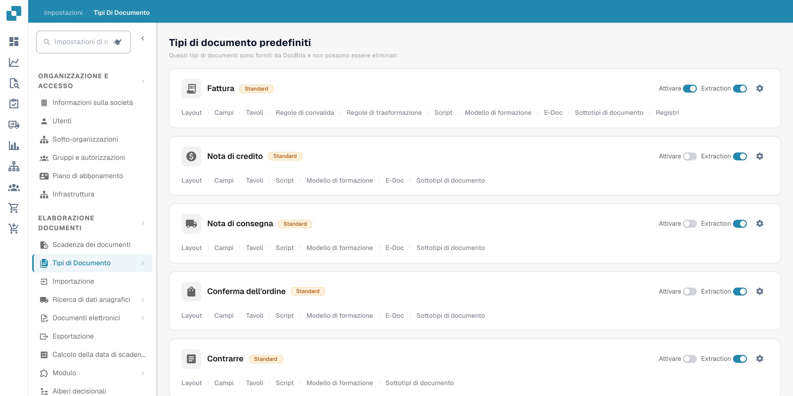
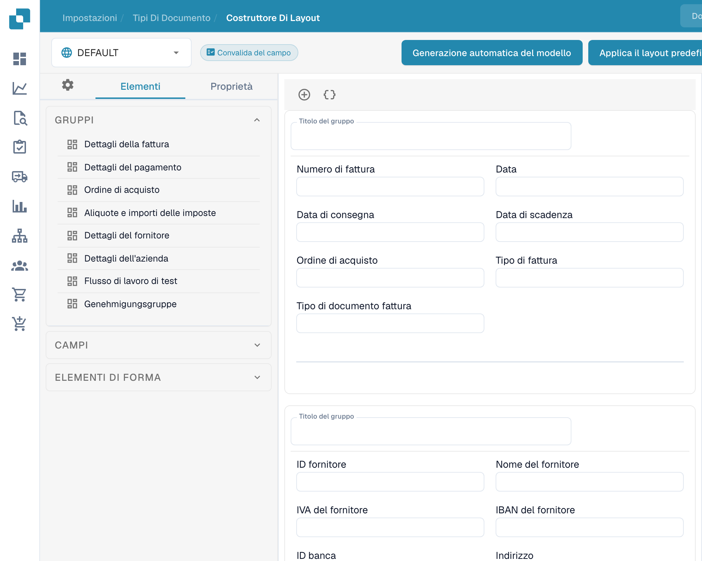
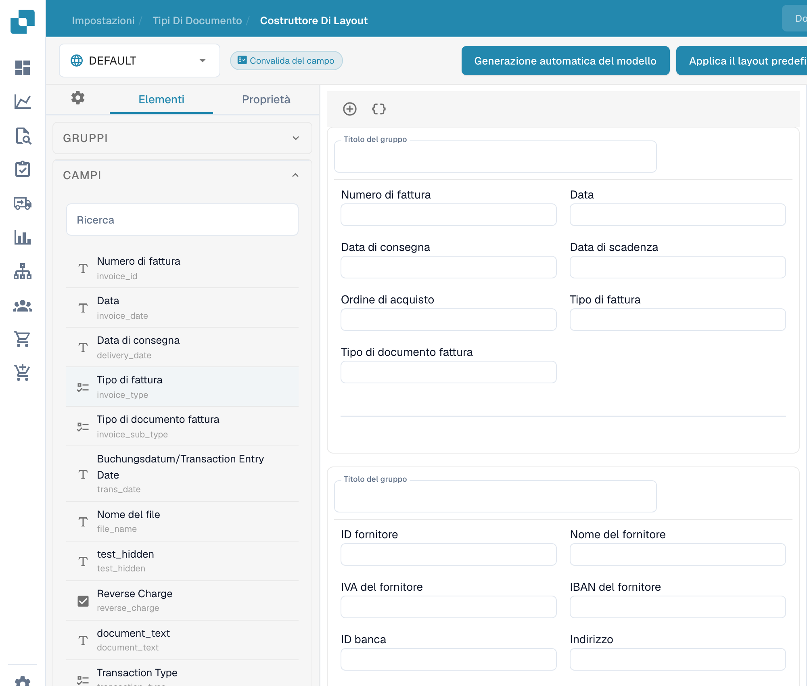
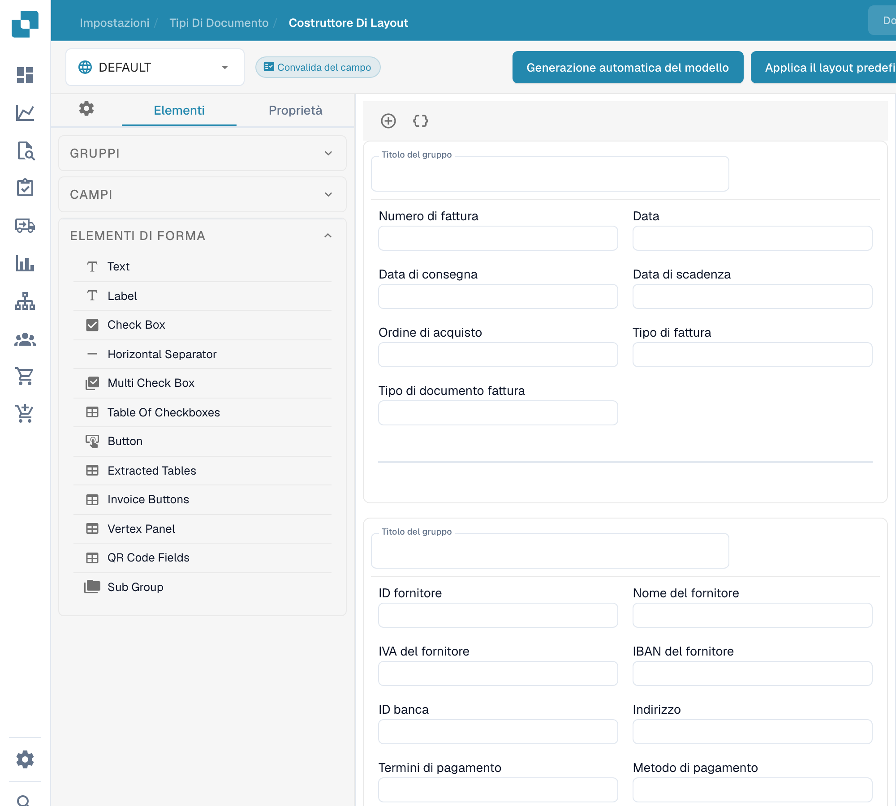

# Navigare nel Layout Builder

Usa il **Costruttore di layout** per disporre i campi e i gruppi che gli utenti vedono in un documento. Questa guida utilizza il layout **Fattura** in inglese in un'organizzazione sandbox.

## Aprire il layout Invoice

1. Vai su **Settings → Document Types**.
2. Trova **Fattura** e seleziona **Layout** nella sua scheda. Il Layout Builder si apre per quel tipo di documento.
3. Controlla il selettore del layout in alto a sinistra. L'esempio seguente mostra **DEFAULT**.

<figure><figcaption>
Accesso ai tipi di documento dalle impostazioni. Le etichette Tavolo/Tavoli si riferiscono a tabelle di dati.
</figcaption></figure>

## Trovare gruppi e campi

Il pannello **Elementi** a sinistra ha tre sezioni. **Gruppi** elenca le sezioni del documento; l'area di lavoro centrale ne mostra la disposizione attuale. Seleziona un campo nell'area di lavoro e apri **Proprietà** per modificarne le impostazioni di visualizzazione. Per le opzioni disponibili, vedi [Configurazione delle proprietà dei campi](configuring-field-properties.md).

<figure><figcaption>
Elementi e gruppi di un layout esistente.
</figcaption></figure>

Apri **Campi** per trovare i campi del documento disponibili. Usa la casella di ricerca quando l'elenco è lungo, quindi trascina il campo nel gruppo desiderato nell'area di lavoro. I campi già inseriti nel layout possono risultare non disponibili nell'elenco.

<figure><figcaption>
Campi disponibili nel generatore di layout.
</figcaption></figure>

Apri **Elementi di forma** per i controlli visivi come Text, Label, Check Box, separatore, Button e Sub Group. Trascina l'elemento che ti serve nell'area di lavoro, quindi controlla le sue **Proprietà**.

<figure><figcaption>
Elementi di modulo nel generatore di layout. I nomi degli elementi di modulo restano in inglese.
</figcaption></figure>

## Disporre e salvare

- Seleziona il titolo di un gruppo nell'area di lavoro per modificarlo. Il **+** sopra l'area di lavoro aggiunge un gruppo; l'icona con le parentesi graffe accanto apre il modulo JSON avanzato del gruppo.
- Passa il mouse su un gruppo per le azioni copia JSON, sposta su, sposta giù, elimina e maniglia di trascinamento. Per riordinare i campi, trascinali all'interno di un gruppo o tra gruppi diversi.
- Seleziona un campo nell'area di lavoro per aprire **Proprietà**. La sua icona di eliminazione lo rimuove da questo layout. Per configurare convalida, OCR o corrispondenza, usa le [impostazioni dei campi](../fields/configuring-field-properties-1.md) separate.
- Dopo le modifiche, seleziona **Salva** nella barra superiore. Prima di usare le altre azioni della barra superiore, comprese la generazione dei template, i template predefiniti e l'applicazione di un layout alle origini, vedi [Salvare e applicare le modifiche](save-and-apply-changes.md).
