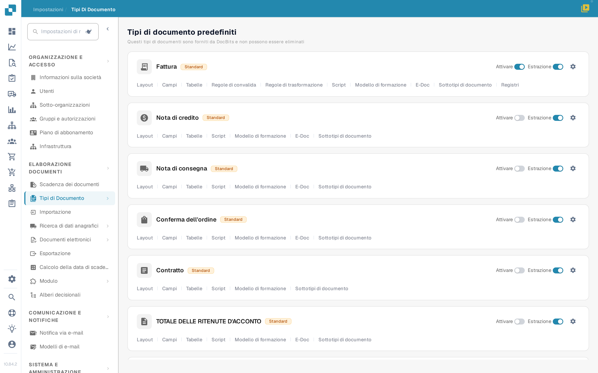
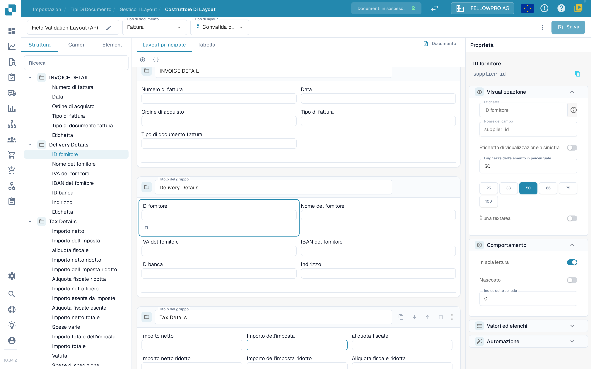
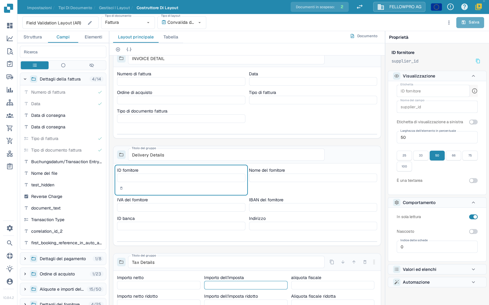
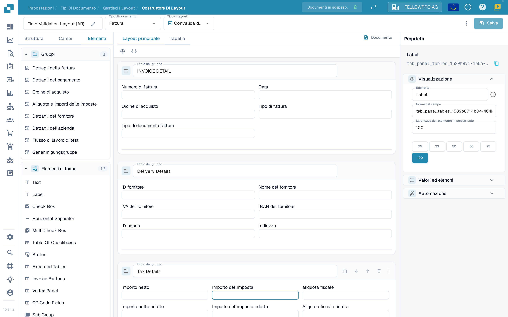

# Navigare il Layout Manager

Usa il **Layout Manager** per disporre i gruppi e i campi che gli utenti vedono in un documento. Le schermate di questa pagina mostrano l'interfaccia in italiano.

## Aprire il layout della fattura

1. Vai su **Impostazioni → Tipi di documento**.
2. Trova **Fattura** e seleziona **Layout** sotto il suo nome. Il Layout Manager si apre per quel tipo di documento.
3. L'intestazione mostra il nome del layout (modificabile con la matita), il **Tipo di documento** e il **Tipo di layout**. Usa **Tipo di layout** per passare a un altro layout dello stesso tipo di documento.

<figure><figcaption>
Apri <strong>Layout</strong> dalla scheda Fattura.
</figcaption></figure>

## Lavorare con le tre schede del pannello

Il pannello a sinistra ha tre schede: **Struttura**, **Campi** ed **Elementi**. All'apertura il Layout Manager mostra **Campi**.

**Struttura** presenta il layout come un albero, nello stesso ordine in cui i gruppi e i campi compaiono nel documento. Espandi un gruppo con la freccetta per vedere i campi che contiene; il nome tecnico del campo compare nel pannello **Proprietà**. La casella **Ricerca** filtra l'albero e, selezionando una riga, viene selezionato lo stesso elemento nell'area di lavoro.

<figure><figcaption>
L'albero della struttura, l'area di lavoro e il pannello <strong>Proprietà</strong>.
</figcaption></figure>

**Campi** elenca tutti i campi disponibili per il tipo di documento, raggruppati per gruppo di appartenenza. Il contatore accanto al nome di un gruppo indica quanti dei suoi campi sono già inseriti nel layout, per esempio **4/14**. I tre pulsanti sotto la casella di ricerca sono solo icone e filtrano l'elenco: mostrano tutti i campi, soltanto quelli non ancora utilizzati oppure soltanto quelli nascosti. Ogni riga riporta l'etichetta del campo; un segno di spunta verde a destra contrassegna i campi già presenti nel layout, che appaiono in grigio.

<figure><figcaption>
Filtra i campi e riconosci quelli già inseriti dal segno di spunta.
</figcaption></figure>

**Elementi** contiene i blocchi da trascinare nell'area di lavoro: **Gruppi**, con i gruppi di questo layout, ed **Elementi di forma**, con Text, Label, Check Box, Horizontal Separator, Multi Check Box, Table Of Checkboxes, Button, Extracted Tables, Invoice Buttons, Vertex Panel, QR Code Fields e Sub Group. I nomi degli elementi di forma restano in inglese nel prodotto.

<figure><figcaption>
Le sezioni <strong>Gruppi</strong> ed <strong>Elementi di forma</strong>.
</figcaption></figure>

## Inserire e disporre gli elementi

- Trascina un campo da **Campi**, oppure un elemento da **Elementi**, nel gruppo in cui deve comparire. I campi già inseriti hanno un segno di spunta nella scheda **Campi**.
- Trascina un campo all'interno di un gruppo o da un gruppo all'altro per riordinarlo.
- Il **+** sopra l'area di lavoro aggiunge un gruppo vuoto; l'icona JSON accanto crea un gruppo a partire da una definizione JSON.
- Nell'intestazione di un gruppo puoi rinominarlo in **Titolo del gruppo**, copiarne il JSON, spostarlo in alto o in basso oppure eliminarlo. Usa la maniglia di trascinamento a destra dell'intestazione per spostare il gruppo.
- Seleziona un campo nell'area di lavoro per aprirne le proprietà a destra. La piccola barra degli strumenti che compare sotto il campo selezionato lo rimuove dal layout.

## Il pannello Proprietà

Il pannello a destra è sempre aperto e segue l'elemento selezionato. Le sue impostazioni sono raccolte in **Visualizzazione**, **Comportamento**, **Valori ed elenchi** e **Automazione**. **Visualizzazione** contiene l'etichetta, il tipo di campo e la **Larghezza dell'elemento in percentuale**, che scegli tra i valori predefiniti 25, 33, 50, 66, 75 e 100 percento. Per le singole opzioni, vedi [Configurazione delle proprietà dei campi](configuring-field-properties.md).

Le impostazioni di convalida, OCR e corrispondenza appartengono al campo stesso, non al layout: configurale nelle [impostazioni dei campi](../fields/configuring-field-properties-1.md) separate.

## Anteprima e salvataggio

L'area di lavoro mostra il layout come apparirà nel documento. Usa le schede **Layout principale** e **Tabella** per passare dalla pagina alla tabella delle voci, e **Documento** per aprire il documento di esempio accanto all'area di lavoro. Vedi [Usare l'anteprima del template](using-the-template-preview.md).

Al termine, seleziona **Salva** nell'intestazione. Per le altre azioni dell'intestazione, comprese la generazione dei template, i template predefiniti e l'applicazione di un layout alle origini, vedi [Salvare e applicare le modifiche](save-and-apply-changes.md).
