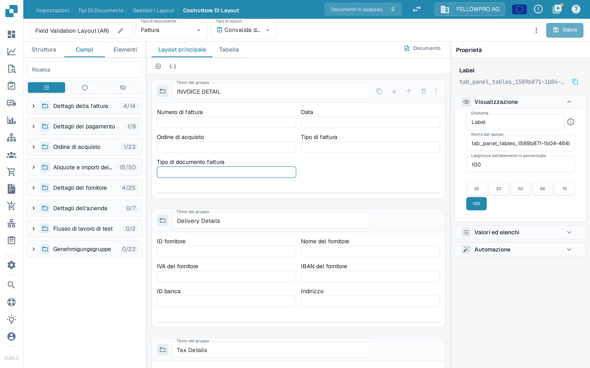
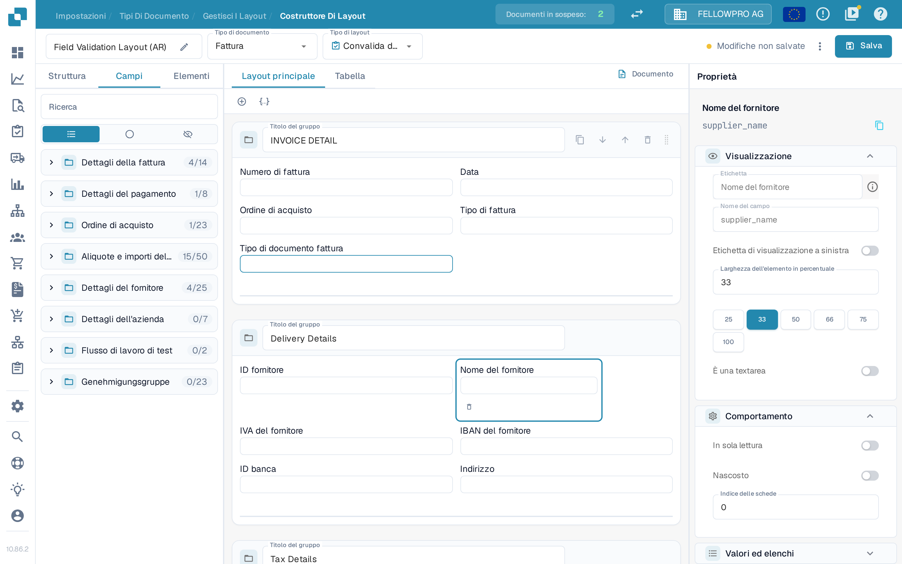
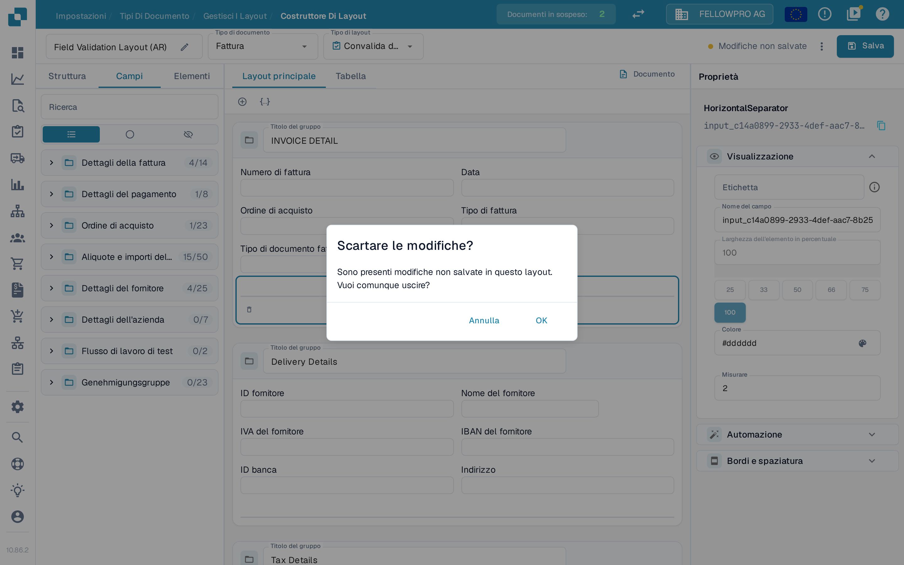
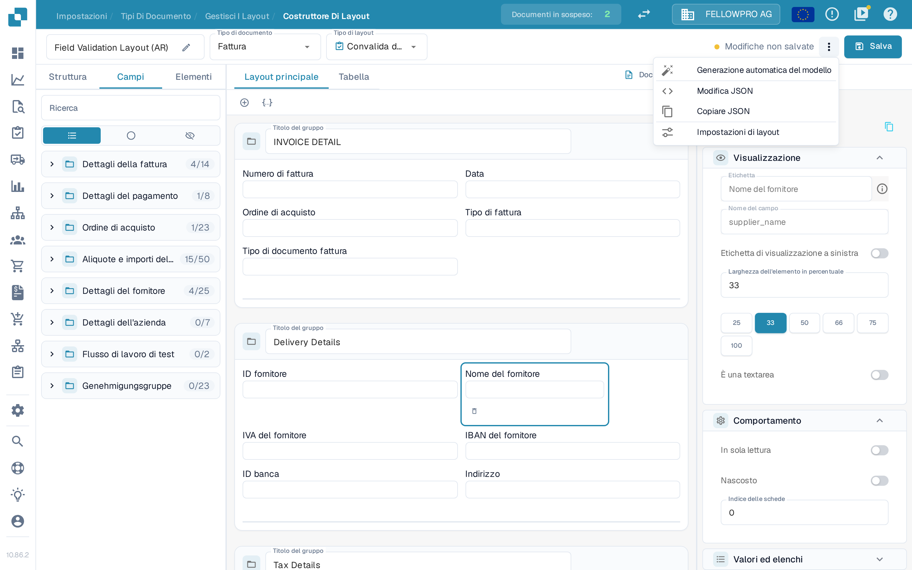

# Salvare e Applicare le Modifiche

Le modifiche apportate nel Layout Builder non hanno effetto finché non vengono salvate. Il salvataggio associa il layout al tipo di documento, in modo che i nuovi documenti lo utilizzino.

## Salvare le modifiche

Dopo aver modificato il layout, selezionare **Salva** in alto a destra nell'intestazione.

<figure><figcaption>Il pulsante **Salva** si trova in alto a destra nel Layout Builder.</figcaption></figure>

Mentre si lavora, l'intestazione mostra lo stato delle modifiche:

- Un pulsante **Salva** senza alcun messaggio accanto indica che il layout non è stato modificato.
- **Modifiche non salvate** compare non appena si modifica il layout. Selezionare **Salva** per conservarle.

<figure><figcaption>L'indicazione **Modifiche non salvate** compare finché il layout non è stato salvato.</figcaption></figure>

Dopo un salvataggio riuscito, l'indicazione viene sostituita dall'orario dell'ultimo salvataggio. Selezionare di nuovo **Salva** non comporta rischi: se dall'ultimo salvataggio non è cambiato nulla, non viene scritto nulla.

Se si esce dal Layout Builder con modifiche non salvate, DocBits chiede **Scartare le modifiche?**. Selezionare **Annulla** per restare e salvare, oppure **OK** per uscire senza salvare.

<figure><figcaption>Conferma mostrata quando si esce con modifiche non salvate.</figcaption></figure>

## Altre azioni dell'intestazione

Il menu a tre puntini accanto a **Salva** raccoglie le restanti azioni sul layout:

- **Generazione automatica del modello**: crea un layout automaticamente a partire dai campi del tipo di documento.
- **Modifica JSON**: modifica direttamente la definizione del layout in formato JSON.
- **Copiare JSON**: copia la definizione del layout negli appunti.
- **Impostazioni di layout**: apre le impostazioni generali del layout.

**Generazione automatica del modello** sostituisce il layout esistente: verificare quindi prima quale layout è aperto. **Modifica JSON** è destinata agli utenti esperti e andrebbe usata solo conoscendo il formato del modello.

<figure><figcaption>Le azioni disponibili nel menu a tre puntini.</figcaption></figure>

## Applicare le modifiche

Una volta salvato, il layout viene utilizzato dal flusso di lavoro di elaborazione dei documenti per quel tipo di documento:

- I nuovi documenti elaborati con questo tipo di documento utilizzano il layout aggiornato.
- I documenti già elaborati mantengono il layout con cui sono stati acquisiti.

## Testare le modifiche

Dopo il salvataggio, aprire un documento di quel tipo di documento e verificare che i campi e i gruppi compaiano come previsto. Se manca qualcosa, tornare nel Layout Builder, correggere il layout e salvare di nuovo.
