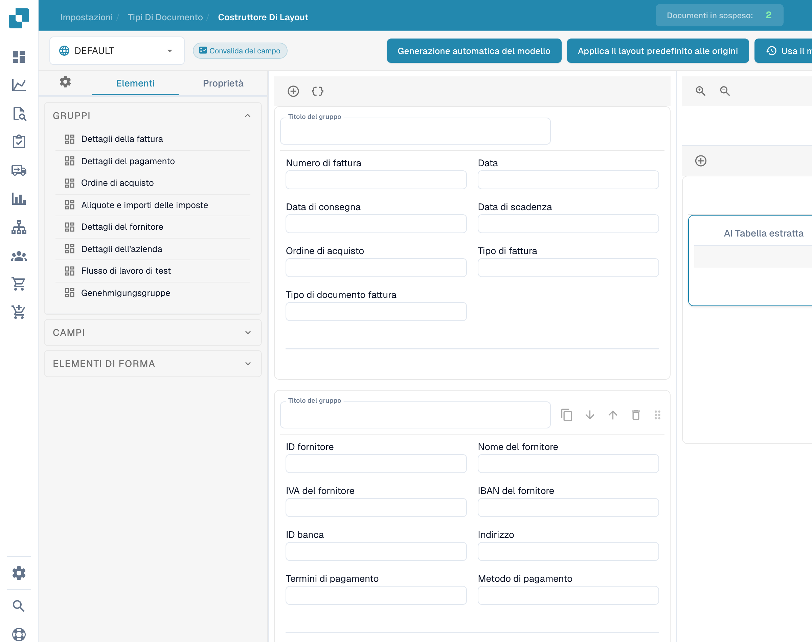

# Usare l’anteprima del modello

L’anteprima del generatore consente di esaminare la disposizione di gruppi, campi e tabelle di un layout esistente.

<figure><figcaption>
Anteprima di un modello nel generatore di layout.
</figcaption></figure>

Aprire il tipo di documento e il layout previsti. Consultare gli elementi disponibili e selezionare un campo per aprirne le proprietà e verificare etichette, larghezze e visibilità.

Il selettore dell’origine consente di consultare il contesto configurato. I nomi delle origini restano invariati. L’esempio non dimostra un layout appena salvato né la sua applicazione ad altre origini.

Salvare le modifiche previste e verificare la vista del documento risultante.
