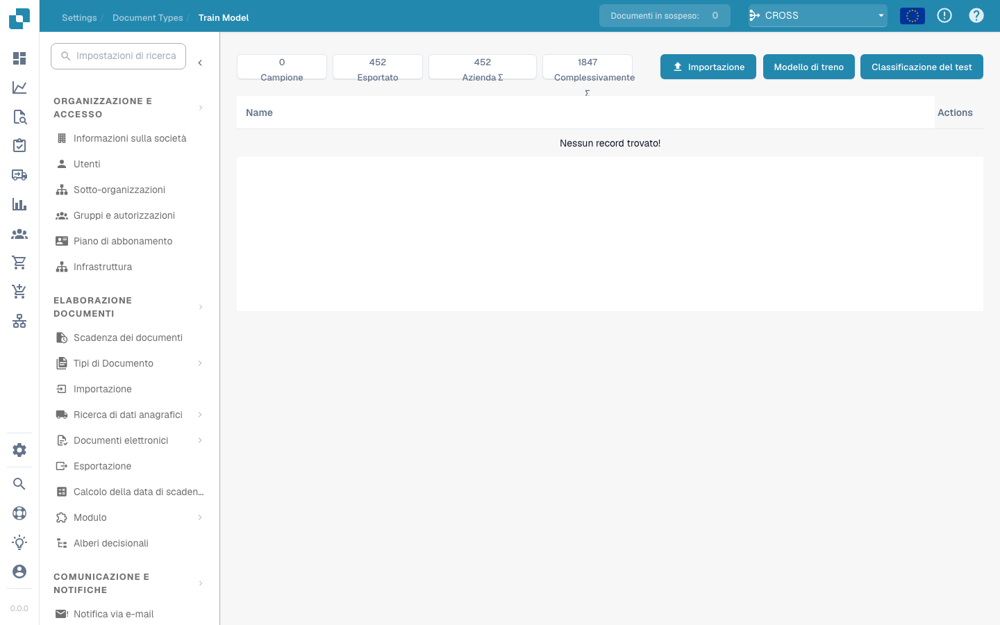

# Addestramento del Modello

<figure><figcaption></figcaption></figure>

#### Panoramica

L'addestramento del modello consente agli amministratori di supervisionare e gestire l'addestramento dei modelli di machine learning specifici per ogni tipo di documento. Fornendo un'interfaccia strutturata per l'importazione di dati di esempio, l'addestramento dei modelli e il test delle loro prestazioni, Docbits garantisce che le sue capacità di estrazione dati migliorino continuamente nel tempo.

#### Funzionalità Chiave e Opzioni

1. **Panoramica delle Metriche**:

* **Campione**: Numero di documenti di esempio utilizzati per l'addestramento.
* **Esportati**: Numero di documenti che sono stati esportati con successo dopo il processo.
* **Σ Aziendale**: Numero totale di documenti specifici dell'azienda elaborati.
* **Σ Complessivo**: Numero totale di documenti elaborati in tutte le categorie.

2. **Opzioni di Addestramento e Test**:

* **Importa**: Consente agli amministratori di importare nuovi set di dati di addestramento che sono tipicamente campioni strutturati di documenti che dovrebbero essere riconosciuti dal sistema.
* **Addestra Modello**: Avvia il processo di addestramento utilizzando i dati importati per migliorare le capacità di riconoscimento ed estrazione del sistema.
* **Test di Classificazione**: Consente di testare il modello per valutarne le prestazioni nella classificazione e nell'estrazione dei dati da documenti nuovi o non visti.

3. **Pulsanti di Azione**:

* **Crea Campo**: Aggiunge nuovi campi dati che il modello dovrebbe riconoscere ed estrarre.
* **Azioni**: Questo menu a discesa può includere opzioni come visualizzare dettagli, modificare configurazioni o eliminare dati di addestramento.


