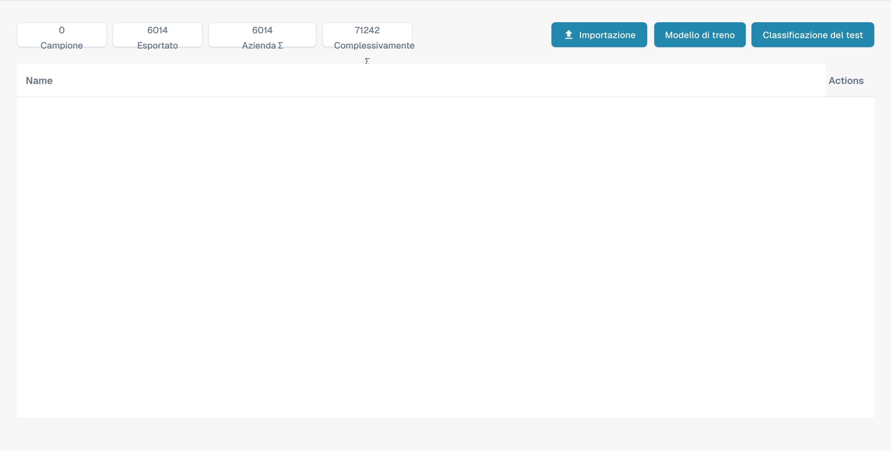

# Addestramento del modello

Questa vista consente di gestire gli esempi e verificare la classificazione per ogni tipo di documento. Non è l’editor dei campi di estrazione.

<figure><figcaption>
Panoramica dell’addestramento del modello in italiano. Modello di treno è una traduzione errata del comando di addestramento; Name e Actions restano in inglese.
</figcaption></figure>

## Contatori e comandi

La parte superiore indica esempi, documenti esportati e contatori aziendali e globali. Considerare il loro ambito quando si interpretano i valori.

* L’importazione consente di aggiungere esempi di addestramento.
* Il comando di addestramento avvia l’addestramento del modello di classificazione.
* Il test di classificazione consente di verificare la classificazione di nuovi documenti.

Questa vista non crea campi: usare le impostazioni dei campi del tipo di documento. Le immagini non dimostrano un addestramento eseguito né risultati di un test di classificazione. Alcune etichette possono restare in inglese o avere una traduzione inesatta nel prodotto.

Nell’interfaccia, il comando di addestramento è attualmente etichettato erroneamente Modello di treno. Il significato previsto è Addestra il modello.
