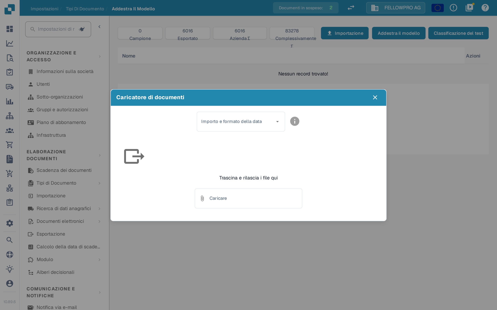

# Importazione dei dati: addestramento del modello

## Preparare, importare e controllare documenti campione

<figure><figcaption>
Preparare, importare e controllare documenti campione
</figcaption></figure>

Scegli documenti campione rappresentativi, prepara le opzioni di importazione disponibili e controlla lo stato dell'importazione. Solo i campioni importati con successo sono pronti per il successivo addestramento. Risolvi gli errori di importazione prima del passaggio successivo e mantieni i documenti di test indipendenti separati dal set di dati di training.

Prepara documenti rappresentativi dei formati, delle lingue e dei tipi che l’organizzazione deve elaborare. Usa soltanto i formati accettati dalla tua installazione. Evita i duplicati e separa i documenti di addestramento da quelli riservati alla valutazione.

## Accedere all’importazione

Nelle impostazioni del tipo di documento interessato, apri l’addestramento del modello e la funzione di importazione.

<figure><figcaption>
Comandi di importazione, addestramento e test del modello. Non è stato eseguito alcun addestramento o test: questa vista non mostra un risultato di accuratezza. La colonna Name resta in inglese nella versione illustrata.
</figcaption></figure>

## Scegliere formato e file

Seleziona il formato degli importi e delle date corrispondente ai file, poi scegli i documenti da importare. Per esempio, `1.234,56` e `1,234.56` usano separatori diversi; una data come `05/06/2026` deve essere interpretata secondo il formato selezionato.

<figure><figcaption>
Modulo di importazione vuoto con formato degli importi e delle date. Il titolo della finestra è Caricatore di documenti. Nessun file è stato selezionato o caricato e nessun addestramento è stato avviato.
</figcaption></figure>

Controlla la selezione prima di avviare l’importazione. Attendi la fine dell’elaborazione e verifica gli errori e il tipo di documento assegnato. Correggi gli esempi classificati o estratti in modo errato prima di usarli per l’addestramento.

## Addestrare e valutare

Dopo aver controllato i dati, usa **Addestra il modello** secondo le funzioni e i permessi della tua versione. Valuta poi il risultato su un campione separato: aggiungere documenti non garantisce di per sé una maggiore accuratezza. Vedi [Testare il modello](testing-the-model.md).

Le immagini mostrano i comandi disponibili e un modulo vuoto: non è stato caricato alcun file, non è stato avviato alcun addestramento e non sono state misurate prestazioni durante questa verifica.
