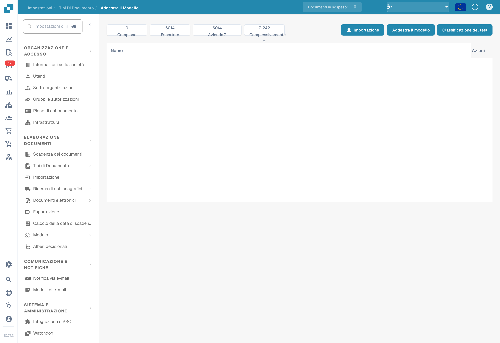

# Test del modello

Il test deve misurare i risultati su documenti rappresentativi non usati per l’addestramento. Prepara le risposte attese per ciascuno: tipo di documento e, per valutare l’estrazione, valori dei campi.

## Eseguire il test

1. Apri l’addestramento del tipo di documento da valutare.
2. Scegli il test di classificazione quando disponibile; nella versione illustrata il pulsante è denominato **Classificazione del test**.
3. Seleziona il campione e avvia la valutazione con le opzioni offerte.
4. Attendi il completamento e registra risultati ed errori. Un errore tecnico o un test incompleto non equivale a una classificazione corretta.

<figure><figcaption>
Comandi di importazione, addestramento e test del modello. Non è stato eseguito alcun addestramento o test: questa vista non mostra un risultato di accuratezza. La colonna Name resta in inglese nella versione illustrata.
</figcaption></figure>

## Interpretare i risultati

Confronta le previsioni con le risposte attese e analizza gli errori per tipo e formato. Se calcoli accuratezza, precisione, richiamo o punteggio F1, indica anche la dimensione del campione e le categorie valutate. Non attribuire al prodotto metriche che la tua versione non visualizza: puoi calcolarle separatamente dai risultati esportati o rilevati.

Le regole di classificazione e di estrazione sono impostazioni distinte dall’addestramento. Verificane l’effetto se intervengono nell’elaborazione; non modificare una regola soltanto per nascondere un errore nel campione di test.

## Correggere e ripetere

Correggi i dati di addestramento, le relative etichette o le impostazioni effettivamente disponibili nella tua installazione, poi addestra nuovamente il modello se necessario. Ripeti il test con lo stesso protocollo e mantieni un campione indipendente. Documenta versione, dati, risultati e regressioni. Un buon risultato sul campione non garantisce le stesse prestazioni su tutti i documenti futuri.
