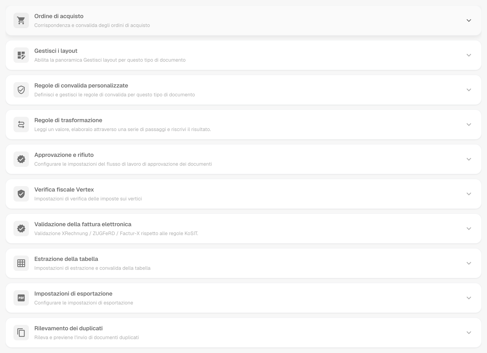
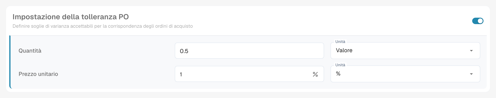
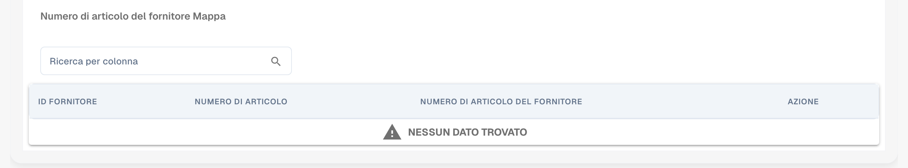
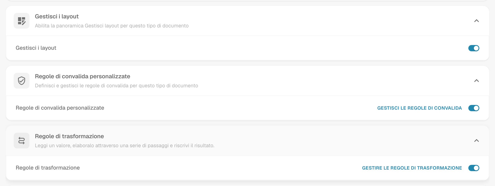
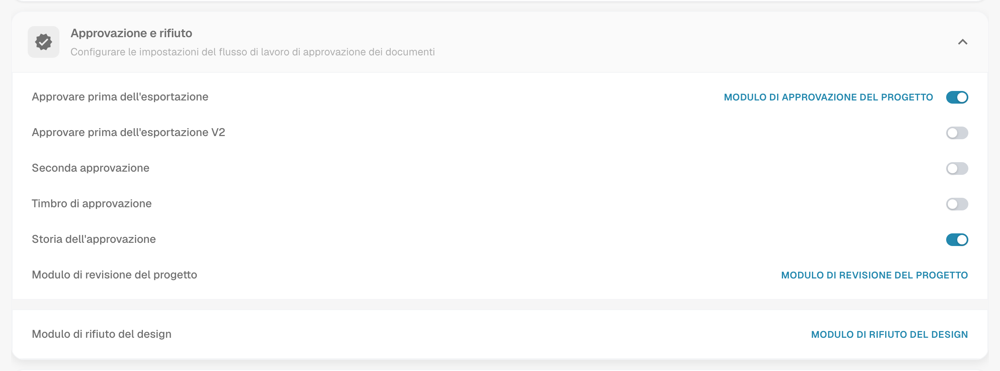
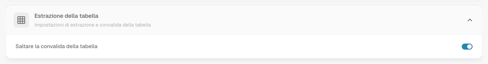
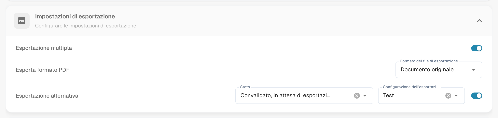
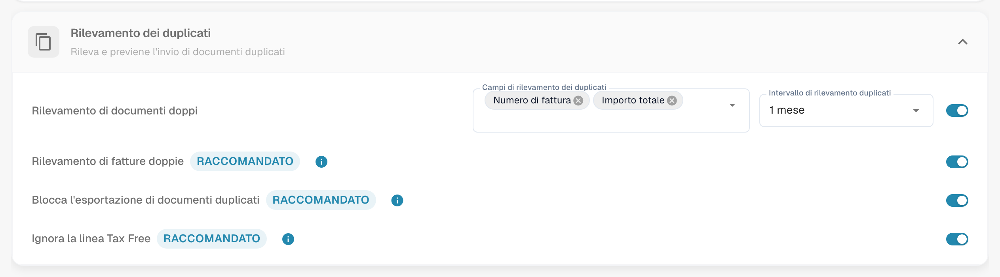

# Altre impostazioni

## Panoramica

**Altre impostazioni** contiene le opzioni che appartengono a un singolo tipo di documento, ad esempio la fattura. Un'impostazione che attivi qui si applica solo a quel tipo di documento. La pagina è composta da schede comprimibili, una per ogni argomento. Apri una scheda per vedere le sue impostazioni.

<figure><figcaption>
Le schede della pagina Altre impostazioni, tutte compresse.
</figcaption></figure>

## Come accedere

1. Naviga su **Impostazioni** → **Impostazioni globali** → **Tipi di Documento**.
2. Seleziona il tipo di documento e fai clic su **Altre impostazioni**.

La breadcrumb in cima alla pagina mostra **Impostazioni / Tipi di Documento / Altre impostazioni**. L'Assistente Impostazioni sul lato destro della pagina spiega le impostazioni della scheda aperta.

| Scheda | Cosa imposti qui |
| ------ | ---------------- |
| Ordine di acquisto | Corrispondenza PO, tolleranze, esportazione delle righe PO, numeri di articolo del fornitore |
| Gestisci i layout | Interruttore per la panoramica Gestisci i layout |
| Regole di convalida personalizzate | Le tue regole di convalida per questo tipo di documento |
| Regole di trasformazione | Regole che leggono un valore, lo modificano in più passaggi e lo riscrivono |
| Approvazione e rifiuto | Flusso di approvazione e moduli di revisione e di rifiuto |
| [Verifica fiscale Vertex](vertex-tax-verification.md) | Progetta il modulo per la verifica fiscale Vertex |
| Validazione della fattura elettronica | Convalida delle fatture XRechnung, ZUGFeRD e Factur-X |
| Estrazione della tabella | Salta la convalida delle tabelle estratte |
| Impostazioni di esportazione | Esportazione multipla, formato PDF, esportazione alternativa |
| Rilevamento dei duplicati | Rileva e blocca i documenti duplicati |

## Ordine di acquisto

La scheda **Ordine di acquisto** (**Corrispondenza e convalida degli ordini di acquisto**) controlla come i documenti di questo tipo vengono abbinati agli ordini di acquisto.

<figure><figcaption>
La scheda Ordine di acquisto con le sue opzioni.
</figcaption></figure>

* [**Ordine di acquisto**](purchase-order/purchase-order.md): Attiva o disattiva se il documento deve essere elaborato nello schermo di corrispondenza degli ordini di acquisto. Puoi anche specificare su quale quantità si basa la corrispondenza.
* [**Lato server di corrispondenza PO**](purchase-order/purchase-order-matching-rules.md): Esegue la corrispondenza con il set di regole configurabile. **Configurare le regole di corrispondenza degli ordini di acquisto** apre la [pagina delle regole](purchase-order/purchase-order-matching-rules.md).
* [**Tabella PO nel generatore di layout**](purchase-order/po-table-in-layout-builder.md): Abilita l'inclusione di tabelle degli ordini di acquisto nel generatore di layout per layout di documenti personalizzati.
* [**Controllo automatico degli aggiornamenti dell'OP**](purchase-order/auto-check-for-po-updates.md): Mostra un indicatore visivo nello schermo di corrispondenza degli ordini di acquisto quando un ordine di acquisto è stato aggiornato, invitando gli utenti a ricaricare.
* **Aggiornamento automatico dei dati PO**: Aggiorna automaticamente i dati PO quando sono disponibili nuovi dati. Questo interruttore appartiene a **Controllo automatico degli aggiornamenti dell'OP**.
* [**Stato della linea PO consumata**](purchase-order/consumed-po-line-status.md): Applica un codice colore alle righe degli ordini di acquisto nello schermo di corrispondenza.
* [**Calcolo del prezzo unitario dell'OP**](purchase-order/calculate-po-unit-price.md): Calcola il prezzo unitario dell'OP utilizzando l'importo netto e la quantità, invece di estrarlo.
* [**Esportazione di righe PO non corrispondenti**](purchase-order/export-not-matched-po-lines.md): Quando disabilitata, vengono esportate solo le righe abbinate. Quando abilitata, tutte le righe degli ordini di acquisto vengono esportate, anche se non sono abbinate.
* **Ignorare le linee già abbinate**: Salta le righe che sono già state abbinate durante un nuovo processo di corrispondenza.
* [**Aggiorna lo stato dell'ordine di acquisto del documento**](purchase-order/update-document-purchase-order-status.md): Aggiorna la colonna Stato PO sulla dashboard ogni volta che lo stato dell'ordine di acquisto cambia.
* [**Consenti esportazione automatica per linee di ordine di acquisto non abbinabili**, **Corrispondenza automatica ed esportazione visibili a** e **Utilizzare l'importo netto delle linee per il totale corrispondente visibile a**](purchase-order/auto-match-and-export-options.md): Decidono chi vede le scorciatoie Auto Match & Export e quali documenti possono essere esportati automaticamente.

### Vedere le regole di corrispondenza come diagramma

Le regole di corrispondenza degli ordini di acquisto sono più di un elenco. DocBits può disegnare l'insieme di regole attivo come diagramma di flusso. Vedi in quale ordine le regole vengono tentate e dove si interrompe la corrispondenza.

1. Nella scheda **Ordine di acquisto** attiva **Lato server di corrispondenza PO** e fai clic su **Configurare le regole di corrispondenza degli ordini di acquisto**.
2. Fai clic su **Insieme di regole rappresentato come un diagramma** nella parte superiore della pagina. Il diagramma si apre in un pannello accanto alle regole.

<figure><figcaption>
L’insieme di regole rappresentato come un diagramma. Cinque stadi, dall’alto verso il basso.
</figcaption></figure>

Leggi il diagramma dall'alto verso il basso. DocBits tenta gli stadi in questo ordine: **Single match validation**, **Multi match validation**, **Total match validation**, **Single mismatch validation** e **Fallback logic**. Ogni stadio ha fino a tre passaggi: **Exact match for all rules**, **Tolerance-based match** e **Package criteria**. Una freccia verde significa che è stata trovata una corrispondenza e l'elaborazione si interrompe. Una freccia rossa significa nessuna corrispondenza, quindi DocBits prosegue con il passaggio successivo. Alla fine il risultato è **Corrispondenza trovata** oppure **Nessuna corrispondenza trovata**.

Sotto il diagramma il pannello elenca **Regole per priorità, per fase**. Per ogni regola vedi le colonne che confronta, la tolleranza e le opzioni **Corrispondenza automatica**, **Abbinamento manuale** e **Ricaderci**.

<figure><figcaption>
Sotto il diagramma: le regole di ogni stadio con le colonne che confrontano.
</figcaption></figure>

**Esempio.** Una riga della fattura ha numero articolo 4711, quantità 10 e prezzo unitario 10.40. La riga dell'ordine di acquisto ha numero articolo 4711, quantità 10 e prezzo unitario 10.00. La tolleranza per il prezzo unitario è 5 %.

* Il passaggio **1.1 Exact match for all rules** non riesce, perché 10.40 non è 10.00. La freccia rossa porta al passaggio successivo.
* Il passaggio **1.2 Tolerance-based match** riesce. La differenza è 4 %, quindi rientra nel 5 %. La freccia verde porta a **Corrispondenza trovata** e l'elaborazione si interrompe.

Nel diagramma questo è il percorso 1.1, poi 1.2, poi **Corrispondenza trovata**. Per il percorso seguito da un singolo documento vedi [Touchless Intelligence: Diagnosi dell'abbinamento ordini](../../../../touchless-po-matching-diagnosis.md). Per tutti i dettagli della pagina delle regole vedi [Regole di Corrispondenza degli Ordini di Acquisto](purchase-order/purchase-order-matching-rules.md).

### Impostazione della tolleranza PO

<figure><figcaption>
Tolleranza per quantità e prezzo unitario.
</figcaption></figure>

L'[**Impostazione della tolleranza PO**](purchase-order/purchase-order-tolerance-settings-additional-purchase-order-tolerance.md) ti consente di impostare livelli di tolleranza per quantità e prezzo unitario, in modo che piccole discrepanze non vengano segnalate come non corrispondenti. Per ogni valore scegli l'importo e l'unità, ovvero un **Valore** assoluto oppure una percentuale (**%**). Il blocco contiene anche l'[**Impostazione della tolleranza PO aggiuntiva**](purchase-order/purchase-order-tolerance-settings-additional-purchase-order-tolerance.md#impostazione-per-configurare-le-ulteriori-impostazioni-di-tolleranza-per-gli-ordini-di-acquisto) per spedizione, spese e tasse, e gli [**Stati di disabilitazione dell'OP**](purchase-order/purchase-order-disable-statuses.md).


Quando l'attributo del tipo di documento `CUSTOM_RANGE_FOR_PO_TOLERANCE` è attivo, le tolleranze di prezzo unitario e quantità provengono da queste impostazioni del tipo di documento e non dal set di regole. Il diagramma delle regole nella [pagina delle regole di corrispondenza PO](purchase-order/purchase-order-matching-rules.md) mostra una nota quando questo accade.


### Numero di articolo del fornitore Mappa

<figure><figcaption>
Il Numero di articolo del fornitore Mappa.
</figcaption></figure>

Il [**Numero di articolo del fornitore Mappa**](purchase-order/supplier-item-number-map-admin-documentation.md) associa i numeri di articolo del fornitore ai tuoi numeri di articolo interni, in modo che le righe corrispondano anche quando il fornitore usa i propri numeri. Cerca per colonna per trovare una voce.

## Gestisci i layout, Regole di convalida personalizzate e Regole di trasformazione

Tre schede si trovano direttamente sotto la scheda Ordine di acquisto:

* **Gestisci i layout** attiva la panoramica Gestisci i layout per questo tipo di documento. Vedi il [Layout Manager](../layout-manager/README.md).
* **Regole di convalida personalizzate** attiva le tue regole di convalida. **Gestisci le regole di convalida** le apre. Vedi [Regole di convalida personalizzate](../custom-validation-rules.md).
* **Regole di trasformazione** attiva le regole di trasformazione. **Gestire le regole di trasformazione** le apre. Vedi [Regole di trasformazione](../transformation-rules.md).

<figure><figcaption>
Le tre schede con i loro interruttori.
</figcaption></figure>

## Approvazione e rifiuto

La scheda **Approvazione e rifiuto** contiene il flusso di approvazione e i moduli che gli utenti vedono quando rivedono o rifiutano un documento.

<figure><figcaption>
La scheda Approvazione e rifiuto.
</figcaption></figure>

* **Approvare prima dell'esportazione**: I documenti devono essere approvati prima di poter essere esportati. **Modulo di approvazione del progetto** apre il **Costruttore di layout** per la schermata di approvazione.
* **Approvare prima dell'esportazione V2**: Attiva l'Approvazione V2, che supporta l'uso di campi dinamici al posto di quelli statici.
* **Seconda approvazione**: Aggiunge un ulteriore livello di approvazione.
* [**Timbro di approvazione**](approval/approval-stamp.md): Aggiunge un timbro al documento quando viene approvato.
* [**Storia dell'approvazione**](approval/approval-history.md): Mostra la storia dell'approvazione nella schermata di approvazione e nella convalida dei campi.
* **Modulo di revisione del progetto**: Configura il layout del modulo di revisione con il **Costruttore di layout**.
* **Modulo di rifiuto del design**: Configura il layout del modulo di rifiuto con il **Costruttore di layout**.

Per il **Costruttore di layout** vedi il [Layout Manager](../layout-manager/README.md).

## Verifica fiscale Vertex

La scheda **Verifica fiscale Vertex** contiene **Verifica fiscale del vertice di progettazione**. Apre il Costruttore di layout per il modulo che gli utenti vedono quando DocBits confronta l'imposta del fornitore con l'imposta calcolata da Vertex. Vedi [Verifica fiscale Vertex](vertex-tax-verification.md) per l'integrazione, la tolleranza e il risultato.

## Validazione della fattura elettronica

La scheda **Validazione della fattura elettronica** attiva la convalida delle fatture elettroniche in arrivo e ti permette di decidere se il fornitore viene informato quando una fattura viene rifiutata. Vedi [Validazione della fattura elettronica](../../../document-processing/e-documents/validation-rules.md).

## Estrazione della tabella

<figure><figcaption>
La scheda Estrazione della tabella.
</figcaption></figure>

* **Saltare la convalida della tabella**: Salta la convalida standard dei dati della tabella. Usala quando è richiesta una gestione flessibile dei dati o quando alcuni passaggi di convalida possono essere saltati per migliorare le prestazioni.

## Impostazioni di esportazione

<figure><figcaption>
La scheda Impostazioni di esportazione.
</figcaption></figure>

* **Esportazione multipla**: Consente di esportare un documento più di una volta.
* **Esporta formato PDF**: **Formato del file di esportazione** imposta il formato PDF utilizzato quando si esportano i documenti, ad esempio **Documento originale**.
* [**Esportazione alternativa**](purchase-order/alternate-export.md): Imposta un'esportazione alternativa per uno stato del documento scelto. Scegli lo **Stato** e la **Configurazione dell'esportazione** che viene eseguita per quello stato, quindi attiva l'impostazione.

## Rilevamento dei duplicati

<figure><figcaption>
La scheda Rilevamento dei duplicati.
</figcaption></figure>

La scheda contiene **Rilevamento di documenti doppi** con i campi che decidono cosa conta come duplicato e l'intervallo in cui i documenti vengono confrontati, oltre alle opzioni **Rilevamento di fatture doppie**, **Blocca l'esportazione di documenti duplicati** e **Ignora la linea Tax Free**. Tutte e tre portano l'etichetta **Raccomandato**. Vedi [Rilevamento dei duplicati](duplicate-document-handling.md) per sapere come viene gestito un documento segnalato.
