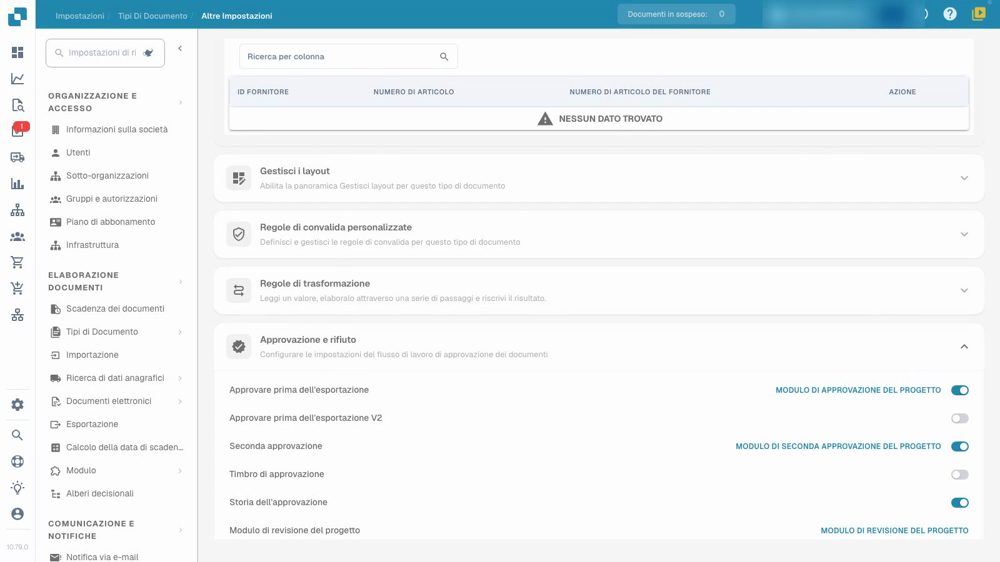
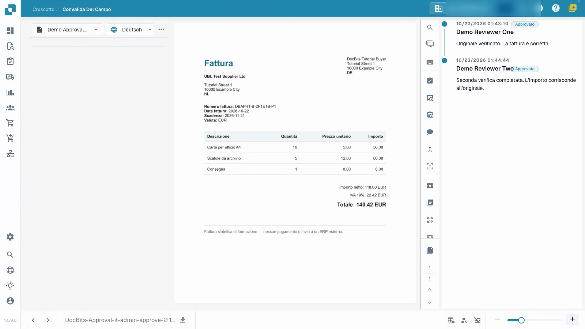

# Configurare e testare le approvazioni delle fatture

Questo video mostra la configurazione e il test delle approvazioni.


Configurare e testare le approvazioni delle fatture


[Guarda il video con i sottotitoli](https://docbits-videos.fra1.cdn.digitaloceanspaces.com/settings-assistant/invoice-approval-admin/v2/it.html)

Viene mostrata l'applicazione reale; la formulazione delle opzioni può dipendere dalla versione distribuita.

Configura l'approvazione per il tipo di documento utilizzato dal tuo processo. Identifica i verificatori previsti e decidi se hai bisogno di una seconda revisione indipendente. Il video utilizza un tipo di test separato, fatture sintetiche e account di verifica temporanei senza privilegi amministrativi; il suo presentatore è fittizio.

## Configura il tipo di documento

Apri **Impostazioni → Tipi di Documento**, seleziona il tipo previsto e apri **Altre impostazioni → Approvazione e rifiuto**. Scegli le impostazioni di cui il tuo processo ha bisogno, quindi ricarica la pagina per controllare cosa è stato salvato.

| Impostazione | Scopo |
| --- | --- |
| Approvare prima dell'esportazione | Richiedi una decisione di approvazione prima che il documento proceda all'esportazione. |
| Seconda approvazione | Aggiungi una seconda fase di approvazione al processo configurato. |
| Storia dell'approvazione | Mantieni le decisioni registrate disponibili per la revisione. |
| Timbro di approvazione | Configura un segno su un documento approvato; vedi la guida separata sui timbri. |

L'opzione V2 aggiuntiva e gli editor dei moduli sono impostazioni separate. Questo tutorial utilizza moduli di approvazione standard preparati.

## Testa con i ruoli previsti

1. Assegna al primo e al secondo verificatore gruppi separati e l'accesso previsto ai documenti assegnati. In questo esempio, il primo account ha l'autorizzazione di approvazione di prima fase e il secondo account ha l'autorizzazione di seconda fase. Un interruttore da solo non assegna una persona né concede tale autorizzazione.
2. Usa il primo normale account di verifica per controllare la fattura assegnata e già convalidata, aggiungi una nota e dai la prima approvazione. Verifica che il documento salvato attenda ancora la seconda approvazione. Controlla che questo account non possa eseguire la seconda fase quando le sue autorizzazioni lo vietano.
3. Assegna la fattura in attesa all'altro verificatore autorizzato. Usa quel secondo normale account di verifica per controllarla e dare la seconda approvazione con una nota separata.
4. Riapri la cronologia e verifica entrambi i diversi verificatori, orari e note. Rifiuta anche una fattura di test separata con un motivo e verifica quella decisione dopo aver ricaricato.

<figure><figcaption>
Impostazioni di approvazione salvate nel proprio tipo di test.
</figcaption></figure>

<figure><figcaption>
Due verificatori distinti ed entrambe le note salvate.
</figcaption></figure>

## Verifica il risultato

Mantieni la prima approvazione, la seconda approvazione in sospeso e il rifiuto come risultati diversi. Conferma che i valori della fattura rimangono invariati dopo ogni decisione. In questo esempio, il canale di test attende il recupero dei dati e non ha una destinazione ERP esterna. Lo stato tecnico `pending_data_fetch`, quando visualizzato, significa in attesa del recupero dei dati. La cronologia delle approvazioni da sola non dimostra un trasferimento ERP.

Testa i ruoli configurati, l'assegnazione e il percorso decisionale completo prima di applicare il processo ai documenti reali in produzione.

## Pagine correlate

- [Gruppi, utenti e autorizzazioni](../../../groups-users-and-permissions/README.md)
- [Cronologia approvazioni](approval-history.md)
- [Timbro di approvazione](approval-stamp.md)
