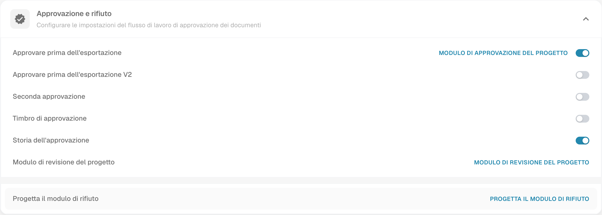

# Storia dell'approvazione

## Impostazione

Apri **Impostazioni → Tipi di documenti**, scegli l’ingranaggio del tipo interessato e individua **Approvazione e rifiuto → Storia dell’approvazione**. Valuta il processo e le autorizzazioni prima di cambiare il controllo.

<figure><figcaption>
Approvazione e rifiuto con Storia dell’approvazione e Timbro di approvazione. Le azioni MODULO DI APPROVAZIONE DEL PROGETTO e Modulo di revisione del progetto traducono erroneamente la progettazione come progetto. L’immagine mostra impostazioni, non decisioni di approvazione; nessun controllo è stato modificato.
</figcaption></figure>

## Consultare le decisioni

Nella schermata di approvazione del documento, usa l’accesso alla cronologia disponibile nella versione in uso. Controlla autore della decisione, data e ora, esito ed eventuali commenti effettivamente registrati. La cronologia dipende dalle decisioni presenti per quel documento; l’attivazione del controllo non dimostra che sia stata eseguita un’approvazione.

Interpreta l’esito usando il testo e la legenda della vista, senza affidarti soltanto al colore. Questa verifica non ha creato approvazioni o rifiuti e non ha riprodotto una cronologia di decisioni. Le vecchie immagini esterne non più raggiungibili sono state sostituite dal contesto nativo delle impostazioni.
