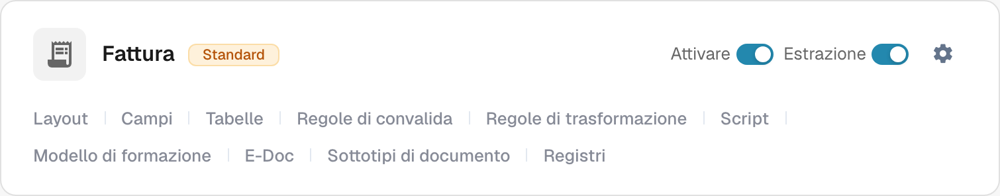
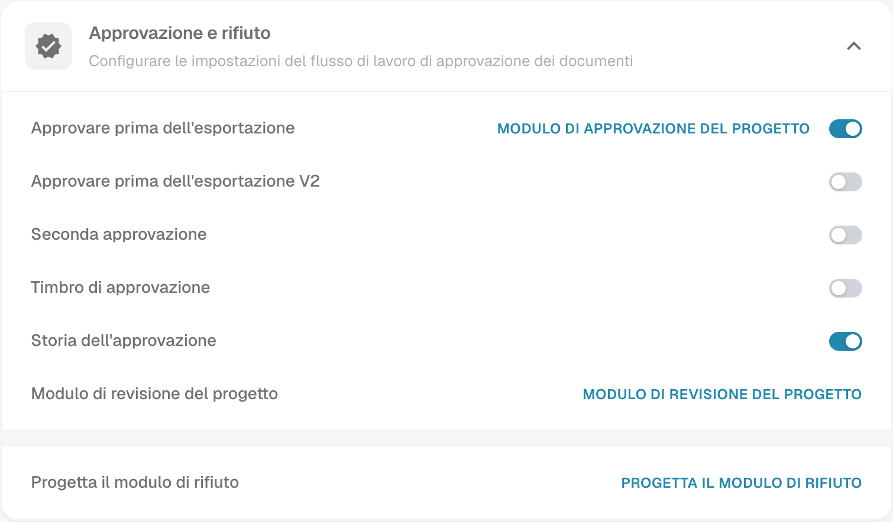

# Timbro di approvazione

Un timbro di approvazione è un'annotazione nel flusso di approvazione quando l'opzione è attivata per quel tipo di documento. Aiuta il revisore a verificare chi ha approvato un documento e quando. Verificare l'annotazione e il risultato PDF con una fattura di prova nel flusso di lavoro effettivamente utilizzato dall'organizzazione.

## Trovare l'opzione

1. Con un account amministratore, aprire **Tipi di Documento** nelle impostazioni di amministrazione. Trovare il tipo di documento da configurare, ad esempio **Fattura**, e selezionare l'**icona dell'ingranaggio** sulla relativa scheda. L'ingranaggio apre **Altre impostazioni** per quel tipo di documento.

   <figure><figcaption>
Scheda Fattura reale in Dev in italiano. L'ingranaggio apre Altre impostazioni; nessun controllo è stato modificato.
</figcaption></figure>

   **Attivare** controlla la disponibilità del tipo di documento e **Estrazione** la modalità di estrazione. I collegamenti in fondo alla scheda aprono aree distinte: **Layout**, **Campi**, **Tabelle**, **Regole di convalida**, **Regole di trasformazione**, **Script**, **Modello di formazione**, **E-Doc**, **Sottotipi di documento** e **Registri**. I collegamenti disponibili dipendono dai moduli e dalle impostazioni del tipo. Per trovare il timbro, utilizzare l'ingranaggio.

2. In **Altre impostazioni**, espandere **Approvazione e rifiuto**. Individuare **Timbro di approvazione** accanto ad **Approvare prima dell'esportazione**, **Seconda approvazione** e **Storia dell'approvazione**. L'immagine mostra l'impostazione esistente del timbro **disattivata**; nella propria organizzazione lo stato può essere diverso. Non mostra un documento approvato.

   <figure><figcaption>
Vista reale di Approvazione e rifiuto in Dev in italiano. Gli stati dei controlli sono stati soltanto letti.
</figcaption></figure>

   **Approvare prima dell'esportazione**, **Approvare prima dell'esportazione V2**, **Seconda approvazione** e **Storia dell'approvazione** sono impostazioni del flusso separate dal timbro. I collegamenti di progettazione aprono gli editor dei rispettivi moduli di approvazione, revisione o rifiuto. Non è necessario aprire questi editor per consultare l'impostazione del timbro.

3. Modificare **Timbro di approvazione** solo dopo aver concordato nell'organizzazione come funzionano le approvazioni e le esportazioni. **La modifica dell'interruttore salva immediatamente l'impostazione.** Conservare una registrazione dello stato precedente per poter verificare l'effetto su una fattura di prova.

## Verificare un'approvazione

Inviare una fattura sintetica di questo tipo di documento attraverso il flusso di approvazione configurato. Nel passaggio di approvazione di quel flusso, approvarla con un account di test autorizzato. Riaprire il documento approvato e verificare che l'annotazione contenga il nome e la data previsti. Esaminare anche il PDF scaricato che il proprio flusso di lavoro utilizza effettivamente. Se il timbro è assente, controllare il tipo di documento, lo stato di approvazione, l'impostazione e la configurazione di esportazione.

Un timbro di approvazione è separato da **Seconda approvazione** e **Storia dell'approvazione**. L'attivazione di una di queste opzioni non dimostra che le altre siano configurate. Le azioni di download disponibili nel cruscotto e il formato di esportazione IDM dipendono dall'ambiente e non sono stati verificati per questa pagina; questa guida quindi non promette etichette specifiche nel menu di download né un output IDM automatico.

Le due acquisizioni mostrano viste reali di Dev in italiano. Nessun interruttore è stato modificato e nessun documento è stato approvato o esportato durante questa verifica. Il risultato finale con timbro richiede una fattura sintetica approvata dedicata alla prova.

## Risultati della traduzione dell'applicazione

Nella vista italiana attuale il controllo sulla scheda si chiama **Estrazione**. Le etichette della sezione sono **Approvazione e rifiuto**, **Timbro di approvazione** e **Storia dell'approvazione**, come nelle immagini. Il collegamento **MODULO DI APPROVAZIONE DEL PROGETTO** apre l'editor del modulo di approvazione: non è l'interruttore del timbro. I collegamenti **MODULO DI REVISIONE DEL PROGETTO** e **PROGETTA IL MODULO DI RIFIUTO** aprono gli altri editor. Le etichette sono riportate come compaiono nell'interfaccia, così da poter individuare il controllo corretto.
