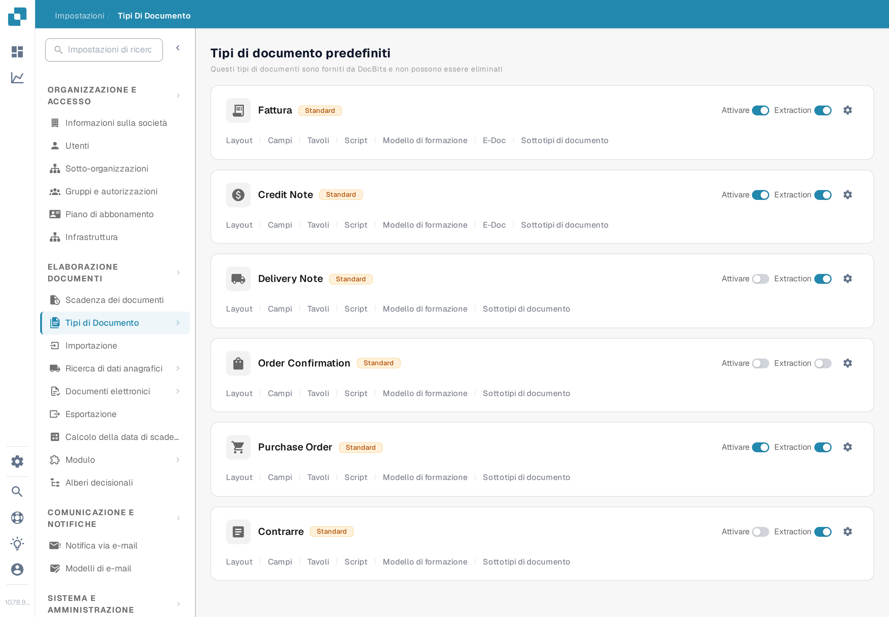
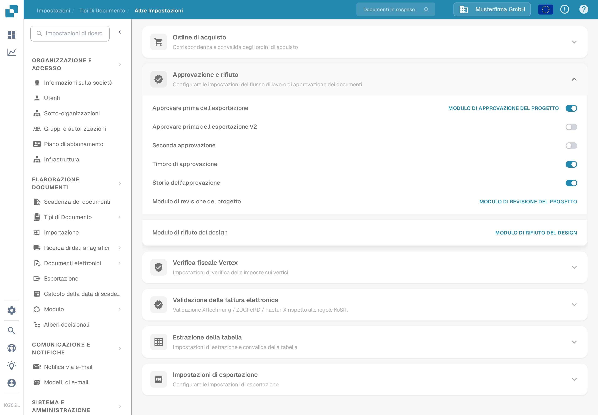

# Timbro di approvazione

Un timbro di approvazione è un'annotazione aggiunta durante l'approvazione del documento quando l'opzione è attivata per quel tipo di documento. È utile quando un revisore deve vedere chi ha approvato un documento e quando. La pagina precedente mostrava sei screenshot di un'interfaccia più vecchia e trattava il timbro, l'esportazione IDM e le opzioni di download PDF come se fossero già stati verificati insieme. Verificare ogni risultato nel proprio flusso di lavoro prima di farci affidamento.

## Trovare l'opzione

1. Con un account amministratore, aprire **Impostazioni → Tipi di Documento**. Trovare il tipo di documento da configurare, ad esempio **Fattura**, e selezionare l'**icona dell'ingranaggio** sulla relativa scheda. L'ingranaggio apre **Altre Impostazioni** per quel tipo di documento; **Layout** e **Campi** aprono editor diversi.

   <figure><figcaption>
Aprire l'ingranaggio sul tipo di documento interessato.
</figcaption></figure>

2. In **Altre Impostazioni**, espandere la sezione **Approvazione e rifiuto**. Individuare l'interruttore **Timbro di approvazione** accanto ad **Approvare prima dell'esportazione V2**, **Seconda approvazione** e **Storia dell'approvazione**. Lo screenshot mostra l'organizzazione di esempio (Musterfirma GmbH) con il timbro **disattivato**. Non mostra un documento timbrato.

   <figure><figcaption>
Verificare l'impostazione Timbro di approvazione per il tipo di documento selezionato.
</figcaption></figure>

3. Attivare l'interruttore solo dopo aver concordato nell'organizzazione come funzionano le approvazioni e le esportazioni. Conservare una registrazione dell'impostazione precedente per poter verificare l'effetto su una fattura di prova.

## Verificare un'approvazione

Inviare una fattura sintetica di questo tipo di documento attraverso il flusso di approvazione configurato. Nella schermata **Pronta per l'approvazione**, approvarla con un account di test autorizzato. L'attuale client web DocBits controlla l'opzione Timbro di approvazione durante l'approvazione e aggiunge un'annotazione con il nome di chi ha approvato e la data. Riaprire il documento approvato ed esaminare l'annotazione e il PDF scaricato che il proprio flusso di lavoro utilizza effettivamente. Se il timbro è assente, controllare il tipo di documento, lo stato di approvazione, l'impostazione e la configurazione di esportazione.

Un timbro di approvazione è separato da **Seconda approvazione** e **Storia dell'approvazione**. L'attivazione di una di queste opzioni non dimostra che le altre siano configurate. Le azioni di download disponibili nel cruscotto e il formato di esportazione IDM dipendono dall'ambiente e non sono stati verificati per questa pagina; questa guida quindi non promette etichette specifiche nel menu di download né un output IDM automatico.

I due nuovi screenshot sono stati verificati visivamente nella sandbox di prova in italiano. Nessun interruttore è stato modificato e nessun documento è stato approvato o esportato durante questa verifica; lo stato finale timbrato richiede una fattura sintetica approvata dedicata.

## Risultati della traduzione dell'applicazione

Durante l'acquisizione degli screenshot nell'interfaccia italiana sono emerse queste etichette dell'applicazione, riportate qui alla lettera come risultati della traduzione da segnalare (la documentazione non le corregge): i nomi dei tipi di documento **Credit Note**, **Delivery Note**, **Order Confirmation**, **Purchase Order** e **Customs Declaration** restano in inglese nell'elenco dei tipi di documento, così come la voce **Extraction**; nella pagina Altre Impostazioni la sezione si chiama **Approvazione e rifiuto** e i relativi interruttori sono **Approvare prima dell'esportazione V2**, **Seconda approvazione**, **Timbro di approvazione** e **Storia dell'approvazione**, ma alcune voci della stessa sezione mostrano testi tecnici in inglese non tradotti (ad esempio "MODULO DI APPROVAZIONE DEL PROGETTO" per Approve before export).
