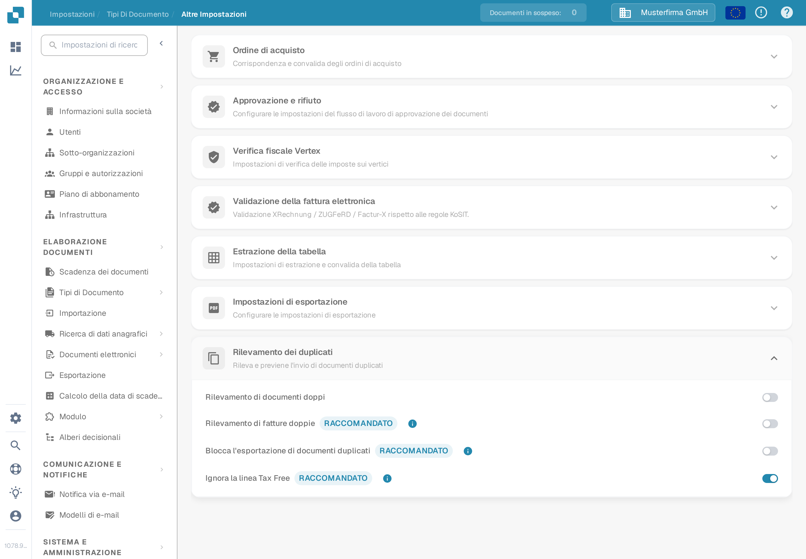
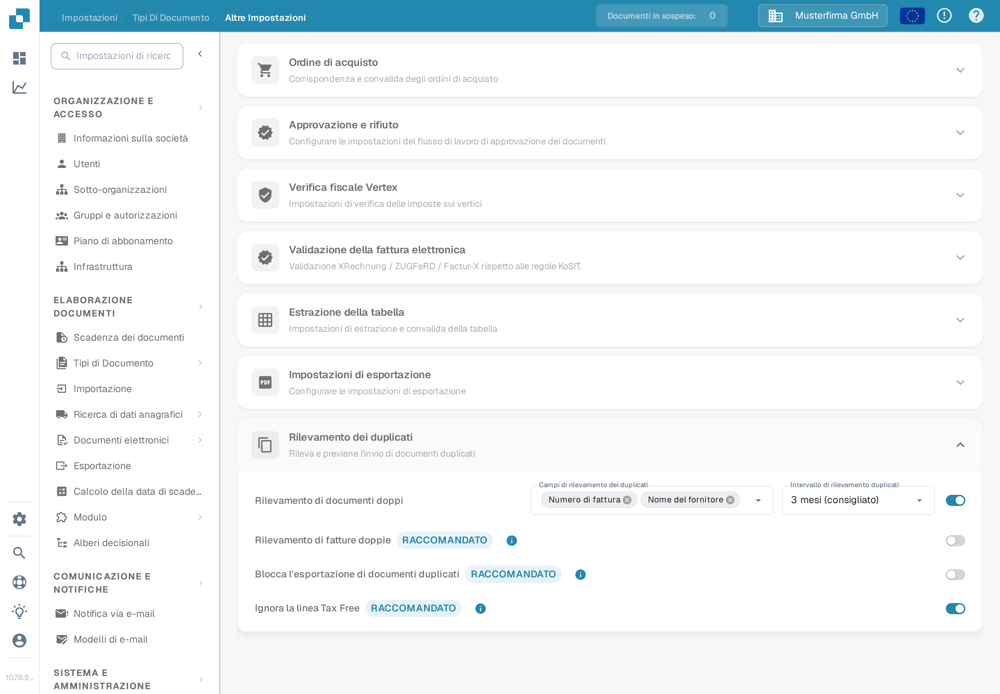
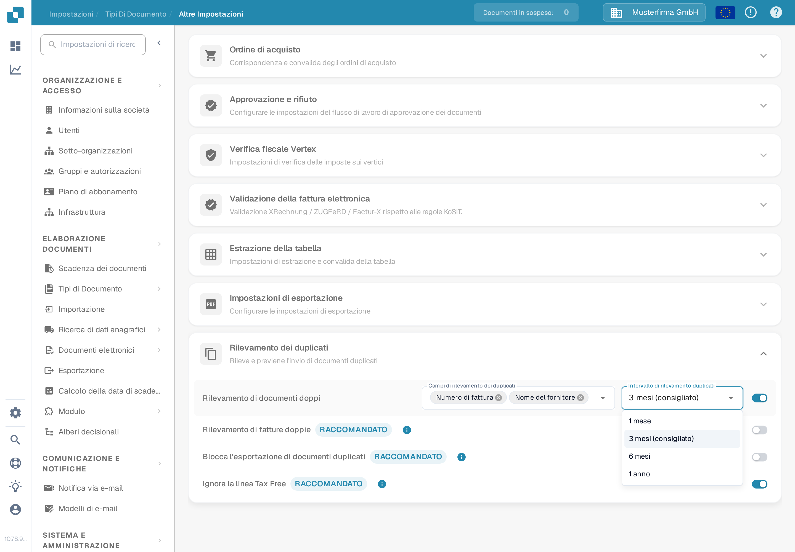

# Rilevamento dei duplicati

Usa **Rilevamento dei duplicati** per contrassegnare i documenti che corrispondono a un altro documento in base ai campi selezionati entro un intervallo di tempo scelto. Le opzioni appartengono a ciascun tipo di documento.

## Aprire le impostazioni

1. Apri **Impostazioni → Tipi di Documento**.
2. Sul tipo di documento che vuoi configurare, seleziona **Impostazioni**.
3. In **Altre impostazioni**, apri **Rilevamento dei duplicati**.

<figure><figcaption>
Le impostazioni della fattura mostrano quattro interruttori separati. I selettori di campo e di intervallo compaiono quando il rilevamento è attivato.
</figcaption></figure>

## Scegliere cosa conta come duplicato

1. Attiva **Rilevamento di documenti doppi**. Compaiono i selettori **Campi di rilevamento dei duplicati** e **Intervallo di rilevamento duplicati**.
2. Seleziona i campi che devono corrispondere. Per una fattura puoi scegliere **Nome del fornitore** e **Numero di fattura**. Scegli campi che distinguono i documenti nel tuo processo.
3. Scegli un intervallo: **1 mese**, **3 mesi (consigliato)**, **6 mesi** o **1 anno**. Un intervallo più lungo controlla un periodo di date più ampio e può richiedere più tempo per il caricamento.

Ogni modifica viene salvata quando la effettui; in questa sezione non esiste un pulsante di salvataggio separato. Se disattivi il rilevamento, i selettori di campo e di intervallo vengono nascosti.

<figure><figcaption>
Attiva il rilevamento prima di selezionare i campi di confronto e l'intervallo di tempo.
</figcaption></figure>

<figure><figcaption>
Nel menu, l'intervallo di tre mesi è contrassegnato come consigliato.
</figcaption></figure>

Per la **Fattura**, questa sezione offre anche **Rilevamento di fatture doppie**, **Blocca l'esportazione di documenti duplicati** e **Ignora la linea Tax Free**. Sono interruttori separati: attiva solo il comportamento necessario al tuo processo fatturario. Gli interruttori aggiuntivi non sono mostrati per gli altri tipi di documento.

## Esaminare un documento contrassegnato

Quando DocBits trova una corrispondenza, la riga del documento nel **Cruscotto** mostra un'icona di duplicato. Seleziona l'icona per confrontare i record corrispondenti nel pannello laterale. L'icona appare solo quando esiste una corrispondenza.

Quando apri un documento contrassegnato, l'avviso di duplicato offre **Visualizza duplicato**, **Procedi comunque** e, se il documento non è già stato archiviato, **Archivia**. Esamina i record corrispondenti prima di scegliere un'azione. Consulta la [guida del Cruscotto](../../dashboard/README.md) per l'elenco dei documenti.
