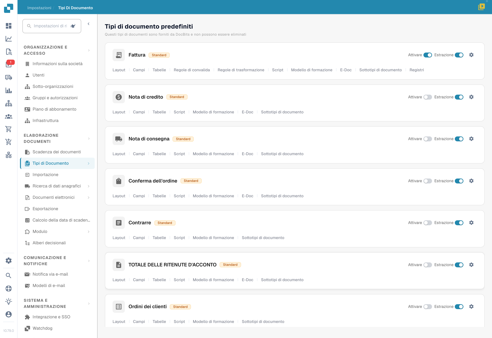
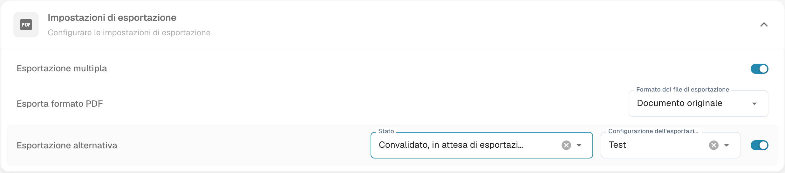

# Esportazione alternativa

L’esportazione alternativa rende disponibile una configurazione di esportazione aggiuntiva quando il documento soddisfa lo stato configurato. **Stato è una condizione di disponibilità, non lo stato assegnato dopo l’esportazione.**

## Aprire le impostazioni

Apri **Impostazioni → Tipi di documenti**, scegli l’ingranaggio del tipo interessato e individua **Impostazioni di esportazione → Esportazione alternativa**.

<figure><figcaption>
Tipi di documento con ingranaggi e accesso a Campi. Contrarre è la traduzione errata del tipo Contratto nella versione illustrata. Nessun interruttore è stato modificato.
</figcaption></figure>

<figure><figcaption>
Impostazioni di esportazione con Esportazione alternativa e Stato. Stato definisce quando l’opzione è disponibile, non lo stato dopo l’esportazione. Il valore selezionato è troncato; la configurazione mostrata è un esempio esistente. Nessuna esportazione è stata eseguita.
</figcaption></figure>

## Preparare la configurazione

Predisponi la configurazione di esportazione richiesta, selezionala nell’impostazione alternativa e scegli lo stato del documento per il quale deve essere proposta. Usa gli stati realmente presenti nel selettore della tua installazione; un elenco di un’altra versione non è un catalogo universale.

Consulta [Esportazione](../../../../document-processing/export.md) per le configurazioni. Se la configurazione deve essere usata soltanto come alternativa, verifica anche che non venga eseguita dal normale percorso automatico.

## Verificare il risultato

Su un documento di prova nello stato previsto, controlla la disponibilità dell’opzione nell’abbinamento degli ordini e la configurazione selezionata. Il menu e l’esito di un’esportazione non sono stati riprodotti durante la verifica delle immagini. Un’opzione disponibile non certifica l’accettazione del documento da parte del sistema destinatario.
