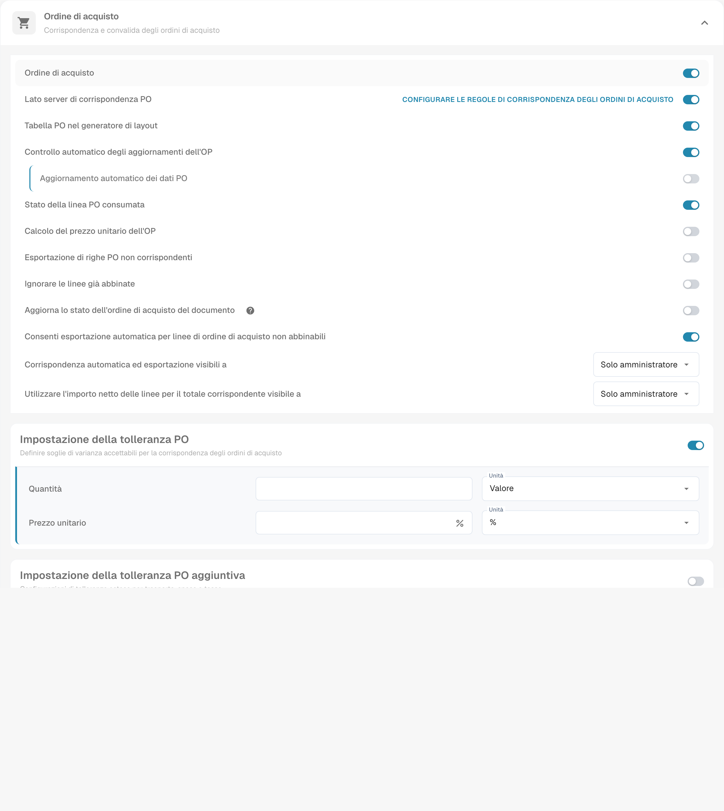

# Calcolare il prezzo unitario del PO

## **Panoramica**

Puoi scegliere di calcolare automaticamente il **prezzo unitario** di ogni riga dell'ordine di acquisto a partire dall’**importo** e dalla **quantità** della riga, invece di utilizzare il prezzo unitario presente nell'ordine di acquisto. Questo è particolarmente utile quando il prezzo unitario nell'ordine di acquisto (in Infor ERP / SAP) differisce dal prezzo sul documento. Tali discrepanze possono verificarsi se uno sconto viene applicato al prezzo unitario nell'ordine di acquisto, mentre il documento applica lo sconto solo all'importo netto.

## Aprire il controllo

Apri **Impostazioni → Tipi di documenti**, scegli l’ingranaggio del tipo interessato e individua **Calcolo del prezzo unitario dell’OP** nella sezione dell’ordine di acquisto. Esamina l’effetto prima di cambiare il controllo.

<figure><figcaption>
Parte superiore delle impostazioni dell’ordine di acquisto con Calcolo del prezzo unitario dell’OP e tolleranze. I valori privati sono mascherati. L’immagine non documenta le sezioni inferiori; nessun controllo è stato modificato.
</figcaption></figure>

## Come viene calcolato il prezzo

Una volta attivata l'impostazione, il prezzo unitario di una riga dell'ordine di acquisto viene calcolato come:

**`Prezzo unitario = Importo riga ÷ Quantità × Prezzo unitario per`**

dove l'**importo della riga** viene scelto così:

| La riga dell'ordine di acquisto contiene                                                      | Importo della riga utilizzato          |
| -------------------------------------------------------------------------------------------- | ------------------------------------ |
| un **importo netto** (`extended_amount`) maggiore di 0 e non superiore al totale della riga   | l'importo netto                       |
| nessun importo netto, o un importo netto superiore al totale della riga                       | il **totale** della riga (`total_amount`) |
| nessun importo positivo, o nessuna quantità positiva                                         | non viene calcolato nulla, il prezzo PO rimane |

Perché l'importo netto viene considerato prima: i feed ERP (Infor BODs) inviano l'importo netto della riga come `extended_amount` e riportano **tasse e oneri aggiuntivi** in `total_amount`. Dividere un totale comprensivo di tasse per la quantità dà un prezzo unitario lordo, e ogni fattura che è prezzata al netto risulta quindi come _prezzo unitario sottostimato_ anche se è corretto. Esempio numerico: quantità 9, importo netto 879,84, totale 954,63 (8,5% di tasse) — il prezzo basato sul netto è 97,76 e corrisponde alla fattura; il prezzo basato sul totale sarebbe 106,07.

Se l’importo netto supera il totale della riga, l’implementazione usa il totale come valore di ripiego. Verifica i dati e le convenzioni dell’integrazione per interpretare questa situazione. Un `Prezzo unitario per` pari a 0 o vuoto viene considerato come 1.


Il prezzo calcolato viene scritto nell'istantanea dell'ordine di acquisto memorizzata nel documento, ed è **ricalcolato ogni volta che il documento viene abbinato** (Auto PO Match, abbinamento manuale, abbinamento al salvataggio). Un documento che è stato abbinato prima della modifica dell'impostazione acquisisce quindi il nuovo prezzo al suo prossimo abbinamento — non è necessario ricaricare l'ordine di acquisto.


## Esempio:

In questo caso, il prezzo unitario (senza lo sconto) viene estratto dal documento, mentre l'ordine di acquisto nell'ERP memorizza il prezzo unitario con lo sconto applicato. Questo provoca una discrepanza nel prezzo unitario. Con l'impostazione attivata, il prezzo unitario viene invece preso dall'importo della riga e dalla quantità, il che può spiegare o ridurre una differenza dovuta alla base di prezzo. La concordanza non è garantita: controlla anche quantità, base di prezzo, arrotondamenti e tolleranze.

## Impostazioni correlate

* [Regole di abbinamento dell'ordine di acquisto](purchase-order-matching-rules.md) — le regole confrontano il prezzo unitario **effettivo**, che è questo prezzo calcolato quando l'impostazione è attiva.
* [Impostazioni di tolleranza dell'ordine di acquisto](purchase-order-tolerance-settings-additional-purchase-order-tolerance.md) — quanto può discostarsi il prezzo della fattura dal prezzo calcolato.

Esempio con quantità 9 e base prezzo 1: 879,84 ÷ 9 × 1 = 97,76 di prezzo unitario netto. Il totale 954,63 comprensivo di imposta all’8,5% dà 106,07. Per una fattura a prezzi netti, confrontare il prezzo unitario netto.

La cattura mostra l’impostazione esistente. Non sono stati eseguiti calcoli né abbinamenti durante questa verifica.
