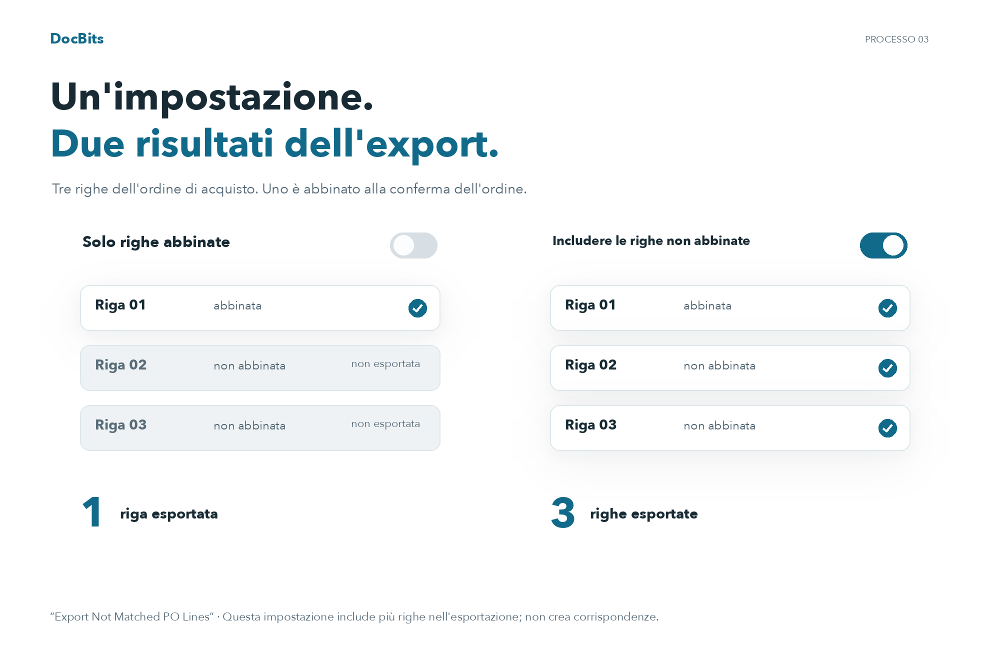

# Esporta righe di PO non corrispondenti

## Comprendere l'ambito dell'esportazione con tre righe di ordine di acquisto

<figure><picture><source srcset="../../../../../../.gitbook/assets/intro-process-03-po-export-it-dark-20261029.png" media="(prefers-color-scheme: dark)"></picture><figcaption>
Comprendere l&#x27;ambito dell&#x27;esportazione con tre righe di ordine di acquisto
</figcaption></figure>

In questo esempio, l'ordine di acquisto ha tre righe e solo una è abbinata a una riga di conferma dell'ordine. Con "Export Not Matched PO Lines" disattivato, viene esportata solo la riga dell'ordine di acquisto abbinata. Con l'opzione attivata, vengono incluse anche le due righe dell'ordine di acquisto senza corrispondenza. Ciò non crea corrispondenze aggiuntive.

## **Dove Trovarlo**

Vai su **Impostazioni → Impostazioni Generali → Tipi di Documento → Ulteriori Impostazioni → Sezione Ordine di Acquisto → Esporta Righe di PO Non Corrispondenti**. Attiva il pulsante per abilitare questa impostazione.

## **Come Funziona**

* **Quando disabilitato**, il sistema esporta solo le righe dell'ordine di acquisto che sono abbinate a una riga di conferma d'ordine. Le righe dell'ordine di acquisto non abbinate non saranno incluse nell'esportazione.
* **Quando abilitato**, il sistema esporta tutte le righe dell'ordine di acquisto, anche se non sono abbinate a una riga di conferma d'ordine.

Ad esempio, se un ordine di acquisto ha **tre righe**, ma il fornitore invia una **conferma d'ordine con solo una riga**, abbini quella riga a una riga dell'ordine di acquisto. Le due righe dell'ordine di acquisto rimanenti non abbinate saranno:

* **Escluse dall'esportazione** se l'impostazione è disabilitata.
* **Incluse nell'esportazione** se l'impostazione è abilitata.
