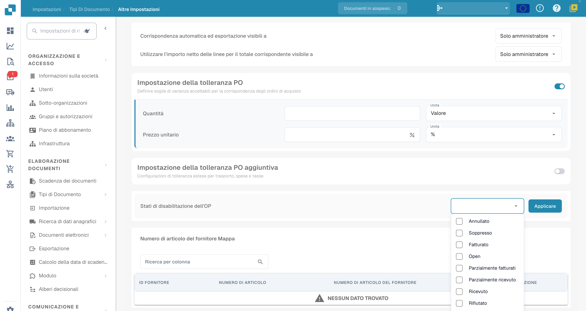

# Stati di disabilitazione dell'OP

## Ambito

Questa impostazione esclude dall’abbinamento gli ordini di acquisto negli stati selezionati. Riguarda l’idoneità dell’ordine per il matching: non costituisce da sola un blocco generale dei pagamenti, dell’approvazione o dell’esportazione della fattura.

## Configurazione

Apri **Impostazioni → Tipi di documenti**, scegli l’ingranaggio del tipo interessato e individua **Ordine di acquisto → Stati di disabilitazione dell’OP**. Esamina gli stati disponibili e seleziona quelli previsti dal processo aziendale. Salva soltanto dopo aver verificato la scelta.

<figure><figcaption>
Selettore Stati di disabilitazione dell’OP con otto opzioni visibili. Open resta in inglese; le altre opzioni mostrate sono Annullato, Soppresso, Fatturato, Parzialmente fatturati, Parzialmente ricevuto, Ricevuto e Rifiutato. Nessuno stato è stato selezionato o applicato.
</figcaption></figure>

## Controllo dell’effetto

Verifica su documenti di prova l’idoneità degli ordini esclusi e degli ordini ammessi. La disponibilità degli stati può dipendere dalla versione e dall’integrazione. Non dedurre dalla sola schermata che una fattura sia stata fermata o che un pagamento sia impedito. Durante questa verifica non è stato eseguito un abbinamento.
