# Regole di Corrispondenza degli Ordini di Acquisto

## Configurare regole di abbinamento e tolleranze

Il percorso apre il tipo di documento fattura, controlla la versione pubblicata e crea un clone come bozza inattiva. Spiega tipi di regola, priorità nella fase di abbinamento, colonne, quantità di riferimento, modalità e calcoli delle tolleranze. Viene salvata solo la bozza del tutorial; versione attiva e tolleranze globali restano invariate. Il calcolo al cinque per cento è un esempio e non cambia la tolleranza attiva.



[Guarda il video con i sottotitoli](https://docbits-videos.fra1.cdn.digitaloceanspaces.com/settings-assistant/po-matching-rules-admin/v3/it.html)

## Introduzione: Ordini di Acquisto e Gestione delle Regole PO

La corrispondenza degli Ordini di Acquisto (PO) è un processo critico per garantire la coerenza tra gli Ordini di Acquisto (PO) e le corrispondenti fatture in entrata o ricevute di merci. Un insieme solido di regole è essenziale per ottenere un alto tasso di corrispondenza automatica, prevenire frodi e garantire pagamenti corretti.

Questa pagina di configurazione viene utilizzata per definire e gestire le regole che determinano _come_ le righe dell’ordine di acquisto vengono abbinate al documento in entrata corrispondente (Fattura, Conferma d’Ordine).


**Prerequisito:** le regole di corrispondenza sono utilizzate solo quando **Lato server di corrispondenza PO** è attivato per il tipo di documento (Impostazioni → Tipi di Documento → Altre impostazioni → Ordine di acquisto). Con l’interruttore disattivato, DocBits esegue la corrispondenza con il suo matcher integrato (quantità, prezzo unitario, numero articolo, numero ordine di acquisto) e ignora il set di regole.


***

## Come Accedere

1. Navigare su **Impostazioni** → **Impostazioni globali** → **Tipi di Documento**, selezionare il tipo di documento e cliccare su **Altre impostazioni**.
2. Nella scheda **Ordine di acquisto** attivare **Lato server di corrispondenza PO**.
3. Cliccare su **Configurare le regole di corrispondenza degli ordini di acquisto** accanto all’interruttore.

<figure>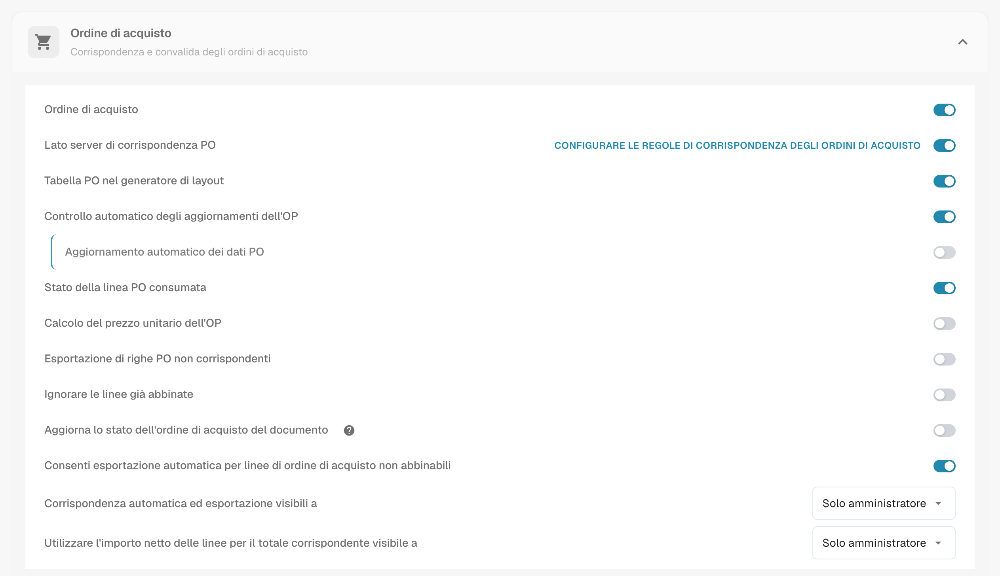<figcaption>
La scheda Ordine di acquisto. <strong>Configurare le regole di corrispondenza degli ordini di acquisto</strong> si trova accanto a <strong>Lato server di corrispondenza PO</strong>.
</figcaption></figure>

## La pagina in sintesi

<figure>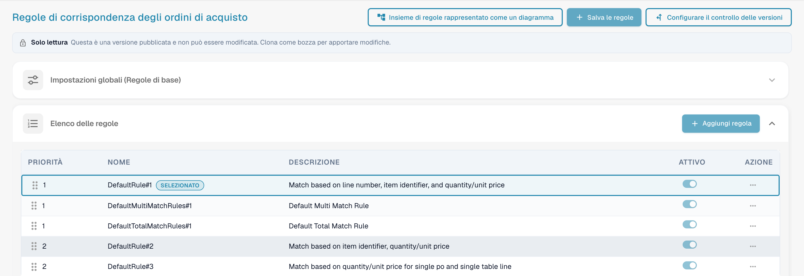<figcaption>
La pagina Regole di corrispondenza degli ordini di acquisto.
</figcaption></figure>

In alto la pagina ha tre pulsanti:

* **Insieme di regole rappresentato come un diagramma** apre un diagramma di flusso del set di regole attivo. Vedi Insieme di regole rappresentato come un diagramma.
* **Salva le regole** salva le modifiche nella bozza che stai modificando.
* **Configurare il controllo delle versioni** apre la cronologia delle versioni. Vedi Versioni e bozze.

Sotto i pulsanti compare un avviso **Solo lettura** quando visualizzi una versione pubblicata: *Questa è una versione pubblicata e non può essere modificata. Clona come bozza per apportare modifiche.* Sotto di esso si trovano la scheda **Impostazioni globali (Regole di base)** e l’**Elenco delle regole**. Seleziona una regola nell’elenco per configurarla nell’area **Configurazione delle regole** sotto l’elenco.

***

## Impostazioni Globali (Regole Base)

Queste impostazioni stabiliscono il quadro che si applica a tutte le regole di corrispondenza:

<figure>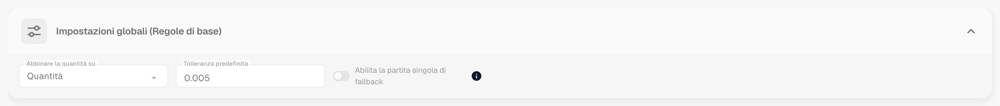<figcaption>
La scheda Impostazioni globali (Regole di base), aperta.
</figcaption></figure>

* **Impostazione:** Corrispondenza quantità su
  * **Scopo:** Definisce quale quantità della riga dell’ordine di acquisto viene confrontata con la riga del documento — ad esempio la quantità ordinata o la **quantità aperta della fattura** (ordinata meno già fatturata), che è la scelta usuale per le fatture.
  * **Valori Validi:** Quantità o altri campi quantità disponibili nel sistema, a seconda della struttura dati (es. un campo quantità normalizzato alternativo).
  * **Dipendenza:** Determina la base per tutte le regole di corrispondenza che includono la quantità nei criteri di confronto.
* **Impostazione:** Tolleranza predefinita (Tolleranza Standard)
  * **Scopo:** Definisce quanto un valore numerico sul documento può discostarsi dal valore dell’ordine di acquisto e comunque essere considerato una corrispondenza. Compensa le differenze di arrotondamento. Si applica a **ogni colonna numerica** con l’opzione "Consenti tolleranza" abilitata — quantità così come prezzo unitario.
  * **Valore Valido:** Un numero decimale. Se viene interpretato come un **valore assoluto** (0.005 = una deviazione fino a 0.005 nella quantità o prezzo confrontati) o come una **percentuale** (0.5 = 0.5 % del valore confrontato) è impostato dal **tipo di tolleranza** del set di regole (`value` o `percent`; i nuovi set di regole usano `value`). Le tolleranze per singolo articolo (vedi [Impostazioni di Tolleranza](purchase-order-tolerance-settings-additional-purchase-order-tolerance.md)) sovrascrivono la tolleranza standard per quell’articolo.
  * **Dipendenza:** Si applica alle regole che utilizzano campi numerici per la corrispondenza e hanno l’opzione "Consenti tolleranza" abilitata.
* **Impostazione:** Abilita la partita singola di fallback
  * **Scopo:** Quando è abilitata, l’ultima riga dell’ordine di acquisto rimasta senza corrispondenza viene abbinata automaticamente anche se il numero della bolla di consegna è diverso. La corrispondenza viene contrassegnata come non corrispondente per la tua verifica.
  * **Valori Validi:** Attivato o disattivato. Il valore predefinito è disattivato.

***

## Elenco Regole

L’Elenco delle regole mostra tutte le regole di corrispondenza disponibili e gestisce il loro ordine di esecuzione.

<figure>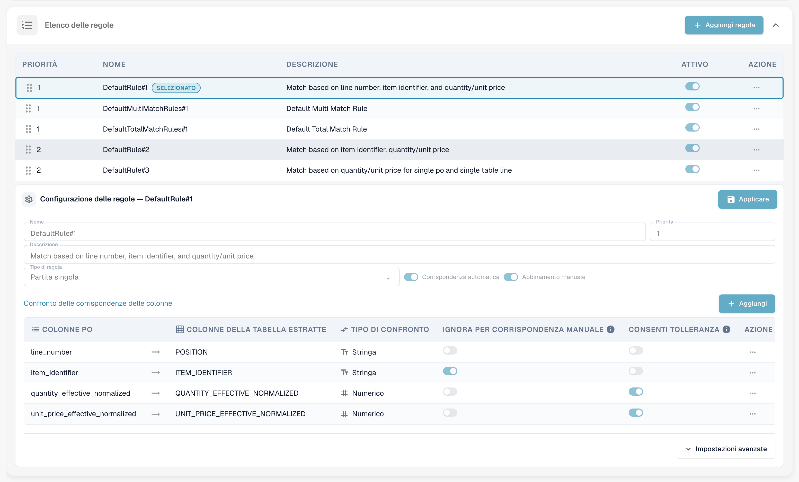<figcaption>
L’Elenco delle regole. La regola selezionata è contrassegnata come <strong>Selezionato</strong>. Una regola può essere disattivata con il suo interruttore <strong>Attivo</strong>.
</figcaption></figure>

#### Struttura ed Esecuzione

* **Priorità:** Questo campo numerico (es. 1, 2, 3) determina la sequenza di esecuzione delle regole. Le regole con un numero di priorità più basso vengono tentate per prime. Questo permette agli amministratori di strutturare una gerarchia, tipicamente iniziando con le regole più specifiche e rigorose (es. corrispondenza sia per numero riga che per numero articolo) e passando a regole più ampie o meno restrittive.
* **Nome & Descrizione:** Fornisce un’identificazione chiara e il contesto della regola, spiegando i criteri principali utilizzati (es. "Regola Standard N. 1: Corrispondenza basata su Numero Riga, ID Articolo e Quantità").
* **Attivo:** Un semplice interruttore che consente di attivare o disattivare immediatamente la regola senza dover eliminare la sua configurazione.

**Flusso di Esecuzione:** Il sistema esegue la corrispondenza in sequenza a cascata. Se una regola (es. Priorità 1) corrisponde con successo a una riga, il processo per quella riga si interrompe. Se non viene trovata corrispondenza, il sistema procede alla regola successiva nella sequenza di priorità (es. Priorità 2). Ogni esecuzione è registrata sul documento; la **Cronologia delle corrispondenze** nella schermata di Corrispondenza Ordine di Acquisto mostra quale regola è stata tentata, quale ha corrisposto e quali sono state saltate e perché.

***

## Configurazione Regola (Impostazioni Dettagliate)

Quest’area di configurazione dettagliata definisce la logica specifica e i criteri per una singola regola.

<figure>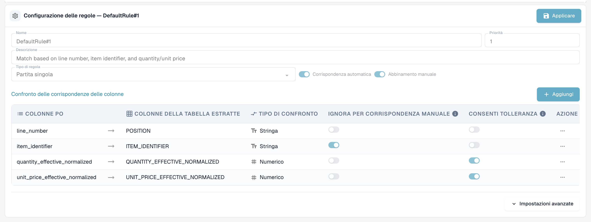<figcaption>
L’area Configurazione delle regole per una regola di partita singola. <strong>Applicare</strong> mantiene le modifiche nella bozza.
</figcaption></figure>

#### Parametri Base

* **Tipo di regola:** Specifica la cardinalità della corrispondenza.

| Tipo di regola       | Cosa fa                                                                                                                                                                                                | Uso tipico                                                                     |
| -------------------- | ------------------------------------------------------------------------------------------------------------------------------------------------------------------------------------------------------ | ------------------------------------------------------------------------------ |
| **Partita singola**     | Una riga dell’ordine di acquisto a una riga del documento. Ogni colonna configurata deve corrispondere (entro la tolleranza dove consentito).                                                          | Il caso standard.                                                              |
| **Partita multipla**      | Diverse righe dell’ordine di acquisto a una riga del documento, o diverse righe del documento a una riga dell’ordine di acquisto. Le quantità sono **sommate**, il prezzo unitario è confrontato come **media**, le altre colonne devono corrispondere. | Consegne frazionate, una riga fattura che copre diverse righe d’ordine.        |
| **Partita sul totale**   | Confronta un **importo** — di solito l’importo netto della riga del documento contro il **totale** dell’ordine di acquisto — e corrisponde all’intero ordine di acquisto in una volta sola.               | Fornitori che fatturano un importo forfettario, fatture di servizi, fatture a riga singola. |

<figure>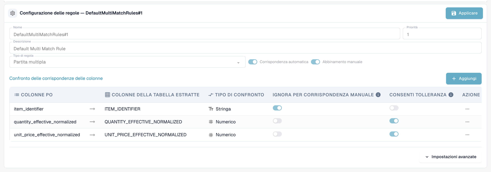<figcaption>
Una regola di partita multipla confronta identificatore articolo, quantità sommata e prezzo unitario medio.
</figcaption></figure>

<figure>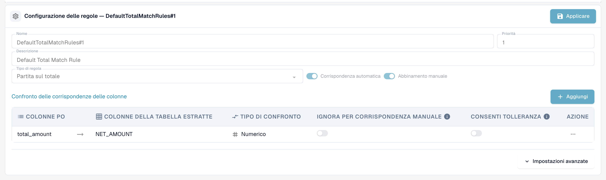<figcaption>
Una regola di partita sul totale confronta un importo, qui l’importo netto con il totale dell’ordine di acquisto.
</figcaption></figure>

* **Corrispondenza automatica:** Se abilitato, il sistema tenterà di applicare questa regola interamente in modo automatico. È richiesta alta affidabilità nei criteri per il processo automatico.
* **Abbinamento manuale:** Se abilitato, questa regola può essere presentata o applicata da un utente durante la fase di riconciliazione manuale, offrendo un set predefinito di criteri di confronto per risolvere le eccezioni.
* **Ricaderci:** Una regola contrassegnata come fallback viene eseguita in una fase successiva, solo per le coppie di righe ancora non abbinate dopo l’esecuzione di tutte le regole regolari. Usala per la regola "più permissiva" che dovrebbe catturare ciò che le regole rigorose hanno mancato.

#### Condizioni di Attivazione

Una regola può avere **condizioni di attivazione** — espressioni che devono essere vere prima che la regola venga eseguita. Se una condizione è falsa, la regola viene **saltata per questo documento** (la cronologia delle corrispondenze la mostra come "non eseguito" con la motivazione). Le espressioni utilizzano i conteggi delle righe che vengono abbinate:

| Espressione               | Significato                                                             |
| ------------------------ | ----------------------------------------------------------------------- |
| `[[count(po_lines)]]`    | numero di righe dell’ordine di acquisto disponibili per la corrispondenza |
| `[[count(table_lines)]]` | numero di righe del documento mappate per la corrispondenza             |

Confrontale con `==`, `!=`, `>`, `>=`, `<`, `<=` e combina più condizioni con `&` (e). Esempi:

* `([[count(po_lines)]] > 1) & ([[count(table_lines)]] > 1)` — solo per documenti con più righe su entrambi i lati (tipico per una regola di partita multipla).
* `([[count(po_lines)]] == 1) & ([[count(table_lines)]] == 1)` — solo per documenti a riga singola contro un ordine a riga singola.
* `([[count(po_lines)]] >= 1) & ([[count(table_lines)]] >= 1)` — ogni volta che c’è qualcosa da abbinare.


Le condizioni di attivazione sono la ragione più comune per cui una regola "non fa nulla". Una regola di partita sul totale con la condizione `[[count(table_lines)]] > 1` non viene mai eseguita per una fattura a riga singola — e una [regola di trasformazione](../../transformation-rules.md) che riduce la fattura a una riga totale produce esattamente un documento di questo tipo. Controlla i conteggi nella cronologia delle corrispondenze prima di modificare la regola stessa.


#### Confronto Colonne (Criteri di Corrispondenza)

Questa è la definizione centrale della logica della regola, specificando quali campi devono corrispondere tra i documenti.

1. Definizione delle Colonne da Confrontare:
   * **Colonne PO:** Il campo estratto dai dati dell’Ordine di Acquisto (es. numero riga).
   * **Colonne della tabella estratte:** Il campo corrispondente estratto o parsato dal documento in entrata (Fattura/Conferma d’Ordine) (es. `POSITION`).
2. **Tipo di confronto:** Definisce la natura della corrispondenza richiesta (es. Tt per confronto Testo/Stringa, richiedendo una corrispondenza esatta carattere per carattere; # per confronto Numerico).
3. **Consenti tolleranza:** Per i campi numerici (quantità, prezzo), attivando questa opzione il sistema applica la Tolleranza Standard Globale definita in precedenza. Se _non_ abilitata per un campo numerico, i valori devono corrispondere esattamente.
4. **Ignora per corrispondenza manuale:** Se selezionato, questo criterio è rilassato durante l’intervento manuale. Utile per campi come descrizioni o riferimenti interni che possono variare leggermente, permettendo all’utente di ignorare piccole discrepanze non critiche.

**Quali colonne possono essere confrontate**

| Colonna                         | Lato documento                           | Lato ordine di acquisto                  | Nota                                                                                                                                                                                                                             |
| ------------------------------- | --------------------------------------- | ---------------------------------------- | -------------------------------------------------------------------------------------------------------------------------------------------------------------------------------------------------------------------------------- |
| Numero riga                     | `POSITION`                              | `line_number`                            | Testo, esatto. Utile solo quando il fornitore stampa i numeri delle righe d’ordine sul documento.                                                                                                                                |
| Identificatore articolo         | `ITEM_IDENTIFIER`                       | `item_identifier`                        | Testo, esatto. Numero articolo o numero articolo fornitore, anche tramite il [Numero di articolo del fornitore Mappa](supplier-item-number-map-admin-documentation.md).                                                           |
| Quantità normalizzata effettiva | `QUANTITY_EFFECTIVE_NORMALIZED`         | `quantity_effective_normalized`          | Numerico. La quantità selezionata da **Corrispondenza quantità su**, convertita nella stessa unità su entrambi i lati (conversione codice unità, quantità "per").                                                                 |
| Prezzo unitario normalizzato effettivo | `UNIT_PRICE_EFFECTIVE_NORMALIZED`       | `unit_price_effective_normalized`        | Numerico. Il prezzo unitario per singola unità dopo sconti e dopo **Prezzo unitario per** — e, se [Calcolo del prezzo unitario dell’OP](calculate-po-unit-price.md) è attivo, il prezzo calcolato dall’importo e quantità della riga d’ordine. |
| Importo netto                   | `NET_AMOUNT`                           | `total_amount`                           | Numerico. Usato dalle regole di partita sul totale.                                                                                                                                                                              |

**Esempio: Regola PO-Match Rigorosa (`DefaultRule#1`)**

Una regola rigorosa tipica combina controlli di identità obbligatori con controlli di valore:

* **Identità Obbligatoria:** Numero Riga e Identificatore Articolo devono corrispondere esattamente (confronto Testo, senza tolleranza).
* **Controlli di Valore:** Quantità Normalizzata Effettiva e Prezzo Unitario Normalizzato Effettivo devono corrispondere (confronto Numerico, tolleranza consentita). Solo se tutti e quattro i criteri sono soddisfatti (con tolleranza per i valori) viene eseguita una corrispondenza automatica.

***

#### Impostazioni avanzate

Fai clic su **Impostazioni avanzate** sotto la tabella delle colonne per aprire altre due opzioni della regola.

<figure>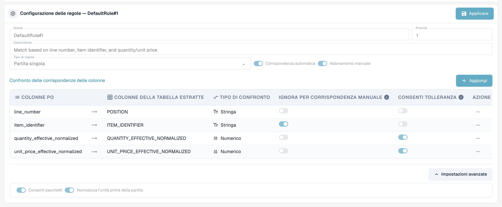<figcaption>
Le Impostazioni avanzate di una regola.
</figcaption></figure>

* **Consenti pacchetti:** Permette alla regola di abbinare righe in cui la quantità e il prezzo unitario differiscono per una dimensione di confezione. Le dimensioni di confezione predefinite sono 10, 20, 100 e 1000. DocBits adatta quindi la quantità e il prezzo unitario del documento alla dimensione della confezione prima di confrontarli. Questa è la fase **Package criteria** di ogni stadio nel diagramma delle regole.
* **Normalizza l’unità prima della partita:** Converte l’unità di misura su entrambi i lati nella stessa unità prima di confrontare la quantità. È attivata per impostazione predefinita.

***

## Insieme di regole rappresentato come un diagramma

**Insieme di regole rappresentato come un diagramma** apre un pannello accanto alle regole. Mostra le regole della versione attiva come diagramma di flusso, così puoi vedere in quale ordine DocBits le tenta e dove si interrompe la corrispondenza.

<figure>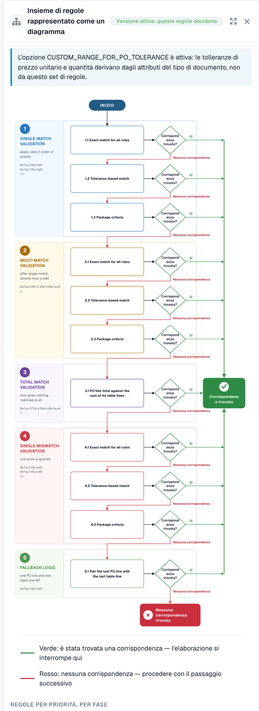<figcaption>
L’insieme di regole rappresentato come un diagramma.
</figcaption></figure>

DocBits percorre cinque stadi dall’alto verso il basso. Ogni stadio ha fino a tre passaggi: **Exact match for all rules**, **Tolerance-based match** e **Package criteria**. Il primo passaggio che trova una corrispondenza termina il processo (freccia verde). Se un passaggio non trova alcuna corrispondenza, DocBits prosegue con il successivo (freccia rossa).

| Stadio | Cosa fa |
| ------ | ------- |
| 1. Single match validation | Applica le regole di partita singola in ordine di priorità. |
| 2. Multi match validation | Viene eseguito dopo la partita singola, per più righe su un lato. |
| 3. Total match validation | Viene eseguito solo quando non ha corrisposto nulla. Confronta il totale dell’ordine di acquisto con la somma delle righe della tabella. |
| 4. Single mismatch validation | Applica di nuovo le regole di partita singola, ignorando il prezzo unitario. |
| 5. Fallback logic | Abbina l’ultima riga dell’ordine di acquisto con l’ultima riga della tabella quando su ogni lato è rimasta esattamente una riga. |

Sotto il diagramma il pannello elenca le regole di ogni stadio per priorità, con le colonne che ciascuna regola confronta. Una nota in alto indica da dove provengono le tolleranze: dal set di regole oppure, quando `CUSTOM_RANGE_FOR_PO_TOLERANCE` è attivo, dalle [impostazioni del tipo di documento](purchase-order-tolerance-settings-additional-purchase-order-tolerance.md).

<figure>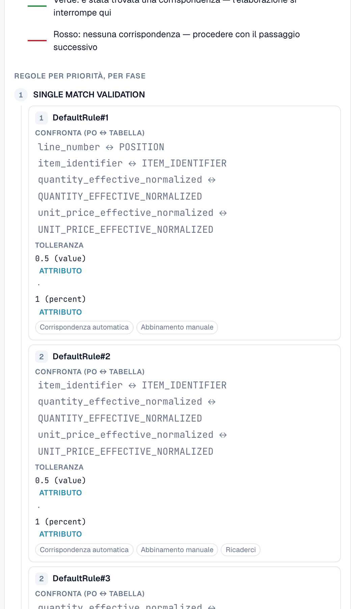<figcaption>
Sotto il diagramma: le regole di ogni stadio con le colonne che confrontano, la tolleranza e le opzioni Corrispondenza automatica, Abbinamento manuale e Ricaderci.
</figcaption></figure>

***

## Il set di regole predefinito

Ogni organizzazione inizia con lo stesso set di regole predefinito. È un buon riferimento quando si costruisce il proprio:

| Regola                     | Tipo / priorità                | Colonne confrontate                                                      | Condizione di attivazione                              |
| -------------------------- | ------------------------------ | ----------------------------------------------------------------------- | ----------------------------------------------------- |
| `DefaultRule#1`            | partita singola, priorità 1       | numero riga, identificatore articolo, quantità (tol.), prezzo unitario (tol.) | sempre                                                |
| `DefaultMultiMatchRules#1` | partita multipla, priorità 1, fallback | identificatore articolo, quantità (tol.), prezzo unitario (tol.)      | `count(po_lines) > 1` e `count(table_lines) > 1`      |
| `DefaultTotalMatchRules#1` | partita sul totale, priorità 1     | importo netto ↔ totale ordine di acquisto (nessuna tolleranza)          | `count(po_lines) >= 1` e `count(table_lines) > 1`     |
| `DefaultRule#2`            | partita singola, priorità 2, fallback | identificatore articolo, quantità (tol.), prezzo unitario (tol.)      | sempre                                                |
| `DefaultRule#3`            | partita singola, priorità 2, fallback | quantità (tol.), prezzo unitario (tol.)                               | `count(po_lines) == 1` e `count(table_lines) == 1`    |

Leggendolo dall’alto verso il basso: prima la regola rigorosa (numero riga e articolo devono essere stampati sul documento), poi i fallback senza il numero riga, infine un’ultima risorsa per documenti a riga singola che confronta solo quantità e prezzo.

***

## Impatto sul Processo di Corrispondenza PO

Il set di regole definito governa direttamente l’efficienza e l’integrità del flusso di lavoro di corrispondenza PO:

* **Prioritizzazione e Fallback:** La Priorità definita assicura che il sistema tenti prima il metodo di corrispondenza più affidabile. Se le regole rigorose e ad alta priorità falliscono, il sistema ricorre a regole più ampie, mirando a minimizzare il numero di eccezioni indirizzate agli utenti.
* **Controllo della Qualità della Corrispondenza:** Regole più severe (che richiedono corrispondenze più esatte e meno tolleranza) producono meno corrispondenze automatiche, ma altamente affidabili. Regole più permissive aumentano il tasso di corrispondenza automatica ma aumentano il rischio di falsi positivi.
* **Gestione delle Eccezioni (Corrispondenza Manuale):** Abilitando regole per la Corrispondenza Manuale, il sistema fornisce opzioni strutturate per gli utenti. Se una transazione non soddisfa i criteri di corrispondenza automatica, diventa un’eccezione. L’utente può quindi tentare di risolvere l’eccezione applicando una regola manuale predefinita, che potrebbe avere criteri più rilassati (es. ignorare una piccola discrepanza testuale come da impostazione "Ignore in Manual Match").

## Cos’altro influenza il risultato

* **Quando la corrispondenza viene eseguita:** durante l’elaborazione del documento, quando un utente clicca su **Abbinamento automatico PO**, e **ad ogni salvataggio** in cui il numero dell’ordine di acquisto è cambiato o non è mai stato cercato prima (per esempio quando i dati anagrafici lo hanno inserito dopo l’elaborazione). Un salvataggio non sovrascrive mai una corrispondenza già esistente.
* Le [**regole di trasformazione**](../../transformation-rules.md) vengono eseguite prima della corrispondenza e possono modificare le righe — e con esse i conteggi delle righe che le condizioni di attivazione osservano. Una regola tabella che ricostruisce le righe mantiene una corrispondenza esistente finché le righe restano le stesse; se sostituisce righe abbinate, la corrispondenza viene eliminata e il nome della regola è mostrato come motivo.
* [**Calcolo del prezzo unitario dell’OP**](calculate-po-unit-price.md) modifica quale prezzo unitario le regole confrontano sul lato ordine di acquisto.
* Le [**impostazioni di tolleranza**](purchase-order-tolerance-settings-additional-purchase-order-tolerance.md) e gli [**stati disabilitati**](purchase-order-disable-statuses.md) decidono quanto è rigoroso il confronto e quali righe dell’ordine di acquisto sono offerte.

## Risoluzione dei problemi

| Sintomo                                                         | Cosa controllare                                                                                                                                                                                   |
| ---------------------------------------------------------------- | ------------------------------------------------------------------------------------------------------------------------------------------------------------------------------------------------- |
| "Nessuna corrispondenza" anche se ogni valore coincide          | Aprire la cronologia delle corrispondenze: quale regola è stata eseguita, su quale colonna ha fallito (la deviazione è mostrata per colonna), la regola è stata saltata da una condizione di attivazione? |
| Prezzo unitario non corrisposto esattamente dell’aliquota fiscale | Il totale dell’ordine di acquisto include l’imposta; attivare [Calcolo del prezzo unitario dell’OP](calculate-po-unit-price.md) (prima importo netto) o confrontare l’importo netto della riga.         |
| Una regola di partita sul totale non viene mai eseguita         | La sua condizione di attivazione richiede più di una riga documento. Impostare `[[count(table_lines)]] >= 1` o non ridurre le righe con una regola di trasformazione.                                |
| Il set di regole non ha alcun effetto                           | **Lato server di corrispondenza PO** è disattivato per il tipo di documento, oppure il set di regole modificato è ancora una bozza — attivare la versione.                                         |

***

## Versioni e bozze

Le regole di corrispondenza sono soggette a versioning. Puoi modificare solo una **bozza**, mentre una versione pubblicata può essere solo visualizzata. Fai clic su **Configurare il controllo delle versioni** per aprire la **Cronologia delle versioni**.

<figure>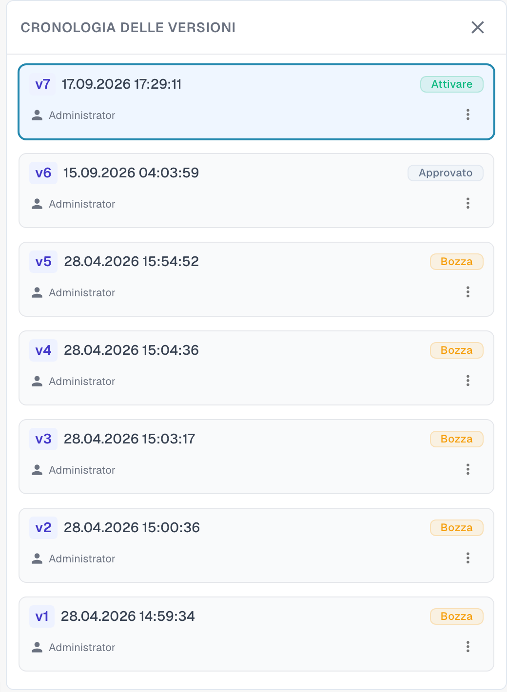<figcaption>
La Cronologia delle versioni con tutte le versioni del set di regole.
</figcaption></figure>

Ogni versione mostra il suo numero, la data e l’ora e il suo stato, ad esempio **Bozza** o **Approvato**. Il menu di una versione offre le azioni disponibili. Per modificare il set di regole predefinito, clonalo prima: apri **Configurare il controllo delle versioni** e scegli **Clona come bozza** dalle opzioni della scheda della versione. Modifica la bozza, fai clic su **Applicare** su ogni regola modificata e su **Salva le regole**. Le regole modificate hanno effetto quando la versione viene attivata.
