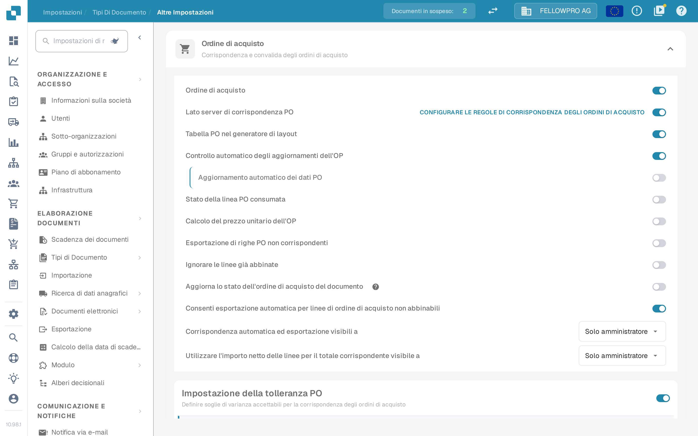

# Ordine di acquisto

## Panoramica

Questa impostazione abilita la sezione [**Abbinamento Ordine di Acquisto**](../../../../../../end-user-and-partner-section/end-user-section/purchase-order-matching/), che diventa accessibile dopo la validazione del documento.

<mark style="color:red;">**Nota**</mark>: Per il tipo di documento **Fattura**, devono essere soddisfatti i seguenti requisiti aggiuntivi:

* L'impostazione **Ordine di acquisto** deve essere abilitata (come descritto in questa pagina)
* La fattura deve essere di tipo **Fattura di acquisto**
* Deve essere presente una **Tabella Estratta**

## Passaggi di attivazione 

1. Vai su **Impostazioni** -> **Impostazioni globali** -> **Tipi di documenti**
2.  Individua la scheda del tipo di documento e apri l'ingranaggio (**Altre impostazioni**).
3.  Apri la sezione **Ordine di acquisto** e attiva **Ordine di acquisto**.

<figure><figcaption>
La sezione <strong>Ordine di acquisto</strong> nelle impostazioni avanzate. Il primo interruttore attiva l'abbinamento degli ordini di acquisto per il tipo di documento, quelli successivi lo rifiniscono.
</figcaption></figure>

## **Funzionalità**

Una volta attivata, la sezione [**Abbinamento Ordine di Acquisto**](../../../../../../end-user-and-partner-section/end-user-section/purchase-order-matching/) diventa disponibile dopo la validazione del documento.

### Quale quantità viene confrontata

La quantità dell'ordine confrontata dall'abbinamento dipende da **Lato server di corrispondenza PO**:

* **Lato server di corrispondenza PO disattivato** – accanto all'interruttore **Ordine di acquisto** compare un elenco con **Quantità**, **Quantità ricevuta** e **Consegna ricevuta Quantità aperta**. DocBits confronta la quantità scelta con il proprio motore di abbinamento.
* **Lato server di corrispondenza PO attivato** – l'abbinamento segue le regole del tipo di documento e la quantità fa parte di quelle regole. Il link **Configurare le regole di corrispondenza degli ordini di acquisto**, a destra della riga, apre le regole.


La cattura è stata eseguita con **Lato server di corrispondenza PO** attivo: l'elenco della quantità non compare quindi in quella schermata, si imposta nelle regole di abbinamento.

