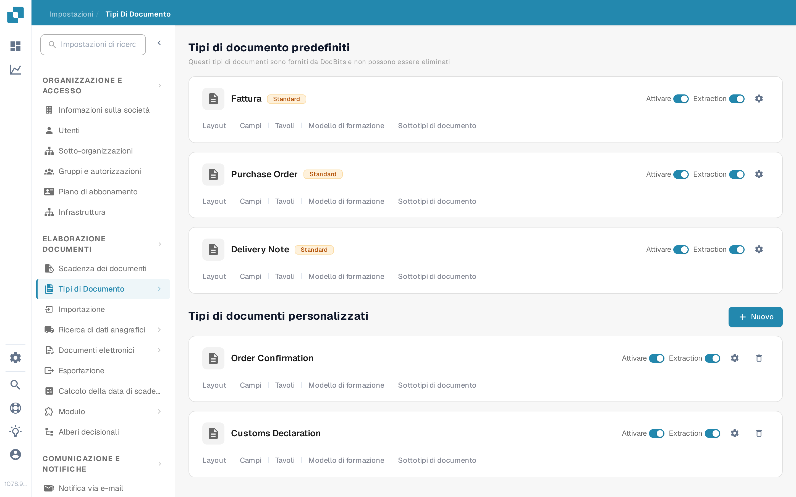
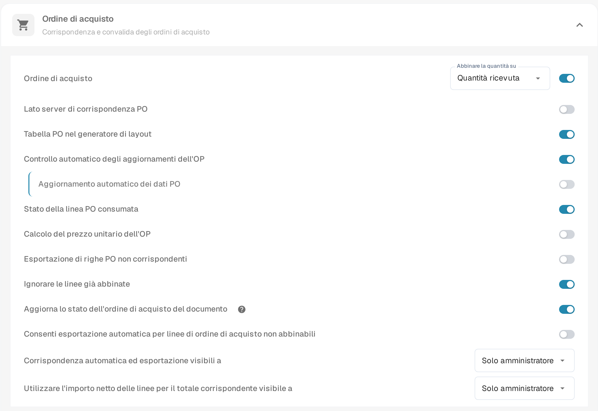
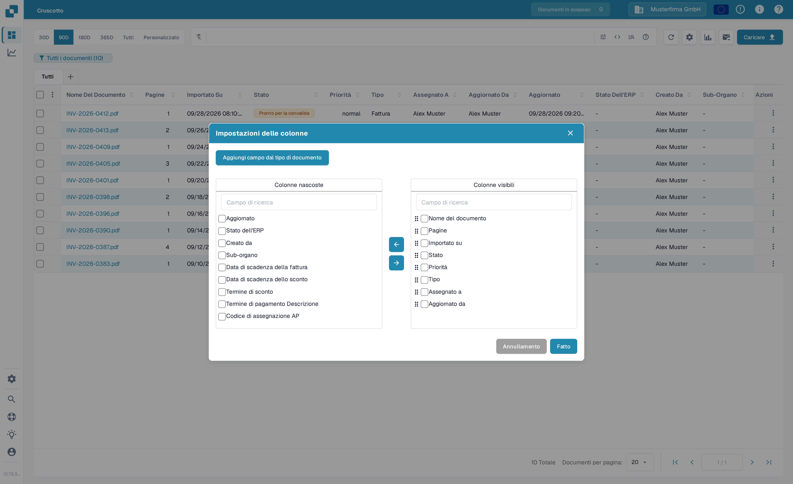
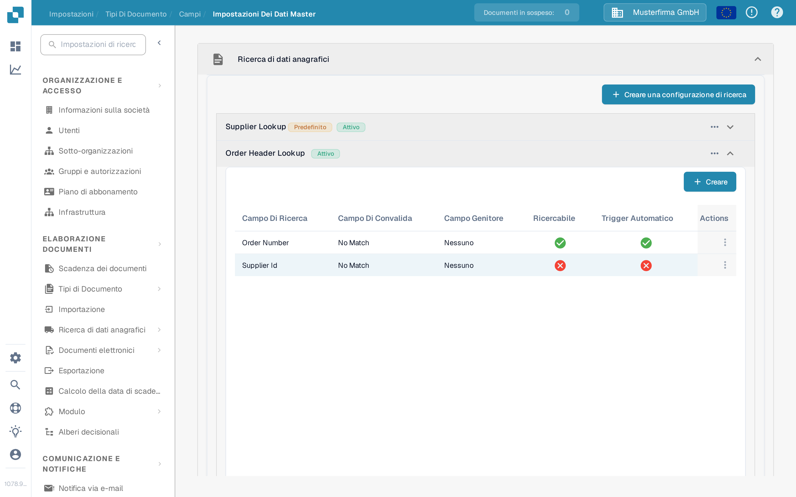

# Aggiornare lo stato dell'ordine di acquisto del documento

Questa impostazione riguarda i tipi di documento che utilizzano ordini di acquisto. Controlla se un documento può ricevere aggiornamenti di stato dall'ordine di acquisto a cui è collegato. L'interruttore si configura per ogni tipo di documento. Per vedere uno stato PO nel cruscotto, il campo corrispondente deve inoltre essere disponibile e visibile come colonna.

Prima di modificare l'impostazione, scegli l'organizzazione e il tipo di documento corretti. Per modificare le impostazioni dei tipi di documento serve l'accesso da amministratore. Un ordine di acquisto deve essere collegato a un documento prima di poter verificare una modifica di stato.

## Attivare l'impostazione

1. Apri **Impostazioni → Elaborazione documenti → Tipi di Documento**.
2. Trova il tipo di documento utilizzato per i documenti collegati all'ordine di acquisto, ad esempio **Fattura**, e seleziona l'ingranaggio sulla sua scheda per aprire **Altre Impostazioni**.
3. Espandi **Ordine di acquisto**. Trova **Aggiorna lo stato dell'ordine di acquisto del documento** e attivalo. L'icona di aiuto nelle vicinanze spiega l'opzione nell'applicazione. La modifica di questo interruttore non cambia le altre impostazioni PO della stessa sezione.

<figure><figcaption>Apri le impostazioni del tipo di documento che utilizzi.</figcaption></figure>

<figure><figcaption>L'interruttore di aggiornamento dello stato nelle impostazioni dell'Ordine di acquisto.</figcaption></figure>

## Mostrare uno stato PO nel cruscotto

1. Torna al cruscotto e seleziona l'ingranaggio sopra la tabella dei documenti.
2. Apri **Impostazioni delle colonne** dal menu delle impostazioni avanzate.
3. Seleziona **Aggiungi campo dal tipo di documento**, scegli il tipo di documento e cerca **Stato PO**. Se quel campo è disponibile, selezionalo, scegli **Aggiungi alle colonne visibili**, quindi seleziona **Fatto**.

La finestra di dialogo delle colonne contiene **Colonne nascoste** e **Colonne visibili**. Usa le frecce per spostare una colonna selezionata tra le due. Vedi [Modificare le colonne del documento](../../../../../../end-user-and-partner-section/end-user-section/dashboard/change-document-columns.md) per la guida completa alle colonne. Se **Stato PO** non è presente per il tipo selezionato, chiedi a un amministratore di controllarne il campo e la configurazione di ricerca; il solo interruttore di visualizzazione non crea un campo mancante.

<figure><figcaption>Scegli quali colonne compaiono nel cruscotto.</figcaption></figure>

## Controllare la ricerca dell'ordine di acquisto

In **Impostazioni → Elaborazione documenti → Tipi di Documento → Campi → Impostazioni Dei Dati Master**, espandi **Ricerca di dati anagrafici**, poi **Order Header Lookup**. Verifica che esista la mappatura del campo PO richiesto e che la ricerca corrispondente abbia **Trigger Automatico** quando serve una ricerca automatica. La schermata seguente mostra l'elenco delle configurazioni; le croci rosse indicano che Trigger Automatico è disattivato per quelle righe di esempio. Non dimostra uno stato PO aggiornato.

<figure><figcaption>Controlla le righe di ricerca reali del tipo di documento.</figcaption></figure>

Per aiuto nella configurazione di una ricerca, vedi [Configurazione dei dati fuzzy con i dati anagrafici](../../../../../setup/document-types/fuzzy-data-configuration-with-master-data.md).

## Verificare con un documento noto

Usa un documento già collegato a un ordine di acquisto di prova. Modifica lo stato di quell'ordine di acquisto tramite il tuo processo consueto, aggiorna il cruscotto e controlla il documento e il campo di stato PO visibile. Se lo stato non si aggiorna, controlla il collegamento PO del documento, la configurazione di ricerca e se il campo corrispondente è stato aggiunto al cruscotto. Non dedurre un aggiornamento riuscito dal solo interruttore.

## Risultati della traduzione dell'applicazione

Questi termini appaiono non tradotti o in modo incoerente nell'interfaccia in italiano (versione 10.78.9.5); vengono citati testualmente e segnalati, non corretti nella documentazione:

1. Nella pagina Tipi di Documento, i nomi dei tipi **Purchase Order**, **Delivery Note**, **Order Confirmation**, **Customs Declaration** e **Freight Letter** e l'intestazione di colonna **Extraction** restano in inglese.
2. Nel cruscotto, l'intestazione di colonna **Sub-organo** è una traduzione errata di "Sub-Org".
3. Nelle impostazioni PO, l'interruttore si chiama **Aggiorna lo stato dell'ordine di acquisto del documento**, mentre l'interruttore di sezione usa anche la formulazione "Controllo automatico degli aggiornamenti dell'OP" con l'abbreviazione **OP** invece di **PO**.
4. In Ricerca di dati anagrafici, i nomi delle configurazioni **Supplier Lookup**, **Order Header Lookup** e **Order Line Lookup** restano in inglese, e l'etichetta predefinita compare come **PredefinitoAttivo**.
