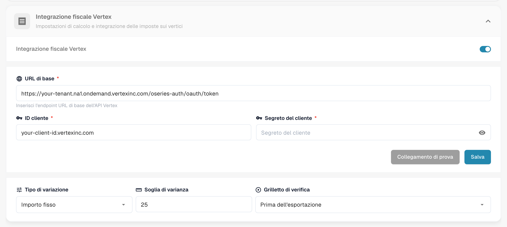
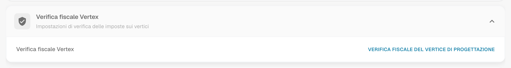
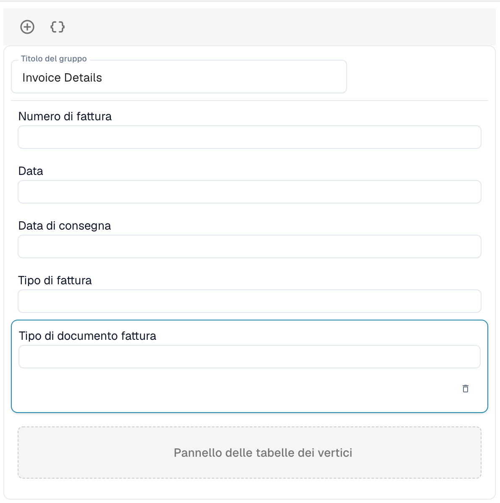

# Verifica fiscale Vertex

La verifica fiscale Vertex confronta l'imposta addebitata da un fornitore su una fattura con l'imposta che Vertex calcola per le stesse righe. DocBits richiede il calcolo a Vertex, mostra entrambi gli importi all'utente e blocca il documento quando l'imposta del fornitore è troppo alta.

## Come funziona

1. Il documento raggiunge il punto di attivazione. Lo scegli nelle impostazioni del modulo: **Prima dell'esportazione** (predefinito) oppure **Prima dell'approvazione**.
2. DocBits invia le righe della fattura a Vertex e riceve l'imposta calcolata.
3. DocBits riscrive il risultato nel documento: l'**Importo della tassa sul vertice** e l'**Aliquota fiscale del vertice** per ogni riga, e i totali di intestazione **Imposta del fornitore** (l'imposta addebitata sulla fattura), **Tassa sui vertici**, il subtotale e la **Varianza**.
4. DocBits confronta l'imposta del fornitore con l'imposta Vertex:

| Situazione | Risultato |
| ---------- | --------- |
| L'imposta del fornitore è superiore all'imposta Vertex **oltre la soglia di varianza** | Il documento viene rifiutato. Il suo stato diventa **IMPOSTA VERTICALE RESPINTA**. |
| L'imposta del fornitore è superiore, ma **entro la soglia** | Il documento viene accettato. |
| L'imposta del fornitore è uguale all'imposta Vertex | Il documento viene accettato. |
| L'imposta del fornitore è **inferiore** all'imposta Vertex | Il documento viene accettato e l'importo mancante viene accantonato. |

Il messaggio del risultato indica gli importi, ad esempio: *Rejected: vendor tax $380.00 exceeds Vertex calculated tax $140.00 by $240.00 (171.4%), above configured threshold of $25.00.*

Gli utenti aprono il risultato dall'icona Vertex nella riga del documento della dashboard. La schermata **Verifica fiscale Vertex** mostra un banner (**Verifica non riuscita** con il messaggio, oppure **Verifica riuscita**), i campi del layout che hai progettato e le tabelle Vertex con l'imposta per ogni riga.


La verifica viene eseguita solo per i tipi di documento che hanno una configurazione di esportazione di tipo **Vertex**. Senza di essa, il documento prosegue senza verifica.


## Configurare l'integrazione

Apri **Impostazioni** → **Modulo** → **Ordini e finanziamenti** e vai alla scheda **Integrazione fiscale Vertex**. La pagina contiene anche le impostazioni per la corrispondenza PO e la contabilizzazione automatica.

<figure><figcaption>
La scheda Integrazione fiscale Vertex. In questa schermata i valori di tenant e client sono sostituiti da segnaposto.
</figcaption></figure>

1. Attiva **Integrazione fiscale Vertex**. La funzione richiede l'abbonamento Vertex per le imposte.
2. Inserisci l'**URL di base** del tuo endpoint token Vertex, il tuo **ID cliente** e il tuo **Segreto del cliente**.
3. Fai clic su **Collegamento di prova**, quindi su **Salva**.
4. Imposta la tolleranza e il punto di attivazione:
   * **Tipo di variazione:** **Importo fisso** oppure **Percentuale**.
   * **Soglia di varianza:** La deviazione ancora accettata. Il valore predefinito è un importo fisso di 25. In modalità percentuale inserisci il valore come numero decimale, ad esempio 0.05 per il 5 %.
   * **Grilletto di verifica:** **Prima dell'esportazione** oppure **Prima dell'approvazione**. Con **Prima dell'approvazione** il controllo viene eseguito durante l'elaborazione del documento, prima che vada in approvazione. Se il controllo stesso non riesce, il documento riceve lo stato **Errore di esportazione**.

Poi aggiungi una configurazione di esportazione di tipo **Vertex** per il tipo di documento (**Impostazioni** → **Esportazione**). Utilizza un file di mappatura TOML.

## Progettare il modulo di verifica

I campi che gli utenti vedono nella schermata di verifica vengono progettati per ogni tipo di documento.

1. Apri **Impostazioni** → **Impostazioni globali** → **Tipi di Documento**, seleziona il tipo di documento e fai clic su **Altre impostazioni**.
2. Apri la scheda **Verifica fiscale Vertex** e fai clic su **Verifica fiscale del vertice di progettazione**.

<figure><figcaption>
La scheda Verifica fiscale Vertex.
</figcaption></figure>

Si apre il Costruttore di layout con il tipo di layout **Verifica fiscale Vertex**. Trascina gruppi e campi nel modulo, ad esempio **Dettagli della fattura** con numero fattura, data e data di consegna. Il **Pannello delle tabelle dei vertici** mostra il confronto fiscale e le righe con l'imposta Vertex per ogni riga. Fa parte del layout.

<figure><figcaption>
Un layout Verifica fiscale Vertex con il gruppo Dettagli della fattura e il Pannello delle tabelle dei vertici.
</figcaption></figure>

Per il funzionamento del Costruttore di layout vedi il [Layout Manager](../layout-manager/README.md).
