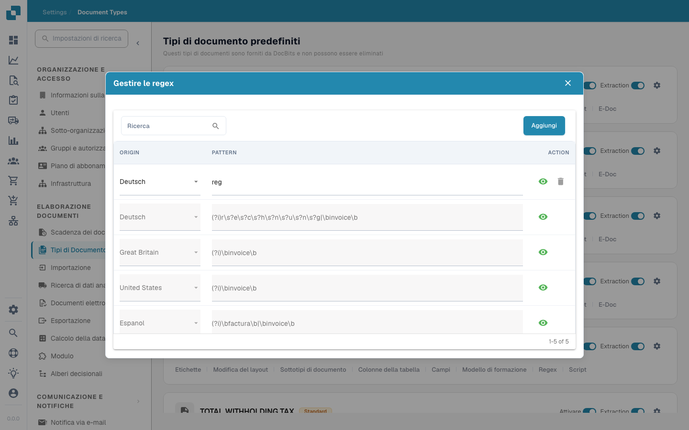

# Espressioni Regolari

<figure><figcaption></figcaption></figure>

In DocBits, le impostazioni Regex consentono agli amministratori di definire modelli personalizzati che il sistema utilizza per trovare ed estrarre dati dai documenti. Questa funzionalità è particolarmente utile in situazioni in cui è necessario estrarre dati da testi non strutturati o quando i dati seguono un formato prevedibile che può essere catturato utilizzando modelli regex.

#### Funzionalità chiave e opzioni

1. **Gestione delle espressioni regolari**:

* **Aggiungi**: Consente di creare un nuovo modello regex per un tipo di documento specifico.
* **Salva modifiche**: Salva le modifiche alle configurazioni regex esistenti.
* **Modello**: Qui puoi definire il modello regex che corrisponde al formato dati specifico richiesto.
* **Origine**: È l'origine del documento - ad esempio, puoi definire un diverso Regex in Germania


