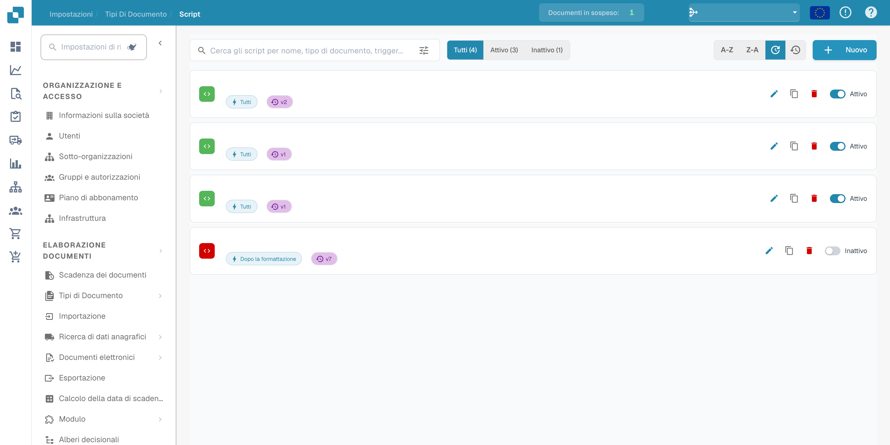
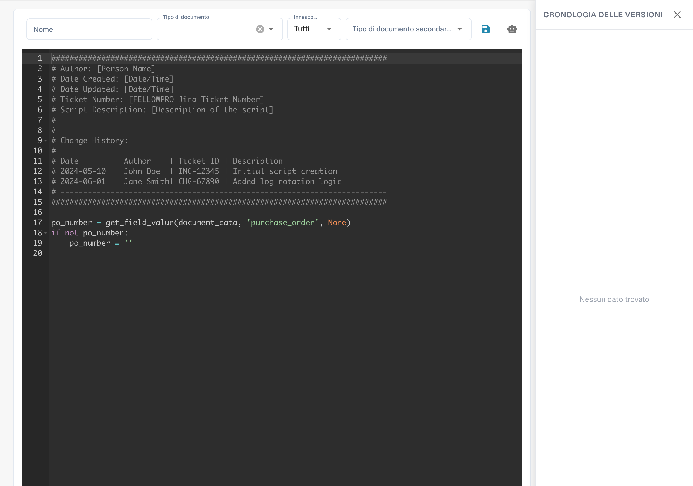

# Creazione e modifica degli script


DocBits Spiegazione degli script dei documenti: automatizza la logica personalizzata nel flusso di lavoro dei documenti



## Per creare un nuovo script in DocBits, segui queste istruzioni dettagliate:

**Scegli il linguaggio di scripting:**

Selezionare un tipo di script e un linguaggio effettivamente disponibili nell’editor e nell’ambiente di esecuzione della propria installazione DocBits. I tipi disponibili e i contesti di esecuzione dipendono dalla versione installata.

**Apri l'ambiente di sviluppo degli script:**

Accedi a DocBits e vai all'ambiente di sviluppo degli script. Si trova nell'area di amministrazione.

<figure><figcaption><p>Elenco degli script con nomi, date e dati dell’organizzazione nascosti.</p></figcaption></figure>

**Crea un nuovo script:**

Fai clic sul pulsante "+ Nuovo" per aprire un nuovo editor di script.

<figure><figcaption><p>Editor di un nuovo script con il modello iniziale fornito; è distinto dall’esempio Python autonomo riportato sotto.</p></figcaption></figure>

**Scrivi il codice:**

Usa l'editor per scrivere il codice del tuo script. Inizia con la sintassi di base del linguaggio di scripting scelto.

Ad esempio, se utilizzi Python, il tuo script potrebbe avere il seguente aspetto:

## 1. Esempio di script in Python


## Funzione per ripulire i nomi dei pazienti

Questo esempio Python autonomo illustra la sintassi. Non è un punto di esecuzione del ciclo di vita DocBits verificato; adattarlo al contesto di script documentato prima dell’uso.

```python
def clean_patient_name(name):
    cleaned_name = name.strip().title()
    return cleaned_name

if __name__ == "__main__":
    patient_name = " john doe "
    cleaned_name = clean_patient_name(patient_name)
    print("Cleaned patient name:", cleaned_name)
```

## 2. Esempio di script


**Testa lo script:**

Controlla il codice per individuare eventuali errori e testalo in un ambiente di prova. Assicurati che lo script produca i risultati attesi e funzioni correttamente.


**Salva lo script:**

Salva lo script in DocBits e assegnagli un nome significativo che ne descriva lo scopo.


**Associazione dello script ai tipi di documento:**

Un passaggio importante è l'associazione dello script ai tipi di documento appropriati. Questo determina quando e come lo script viene applicato. Di solito è possibile farlo tramite un'interfaccia di configurazione in DocBits, dove puoi assegnare lo script a un tipo di documento specifico e indicare in quali condizioni deve essere applicato.


**Revisione e pubblicazione:**

Dopo aver creato, testato e associato lo script, controllalo di nuovo per individuare errori e incoerenze. Se è tutto in ordine, puoi pubblicare lo script nell'ambiente di produzione di DocBits.


Attraverso questi passaggi, puoi creare, testare e implementare con successo un nuovo script in DocBits per automatizzare i processi e migliorare l'efficienza della documentazione medica.
