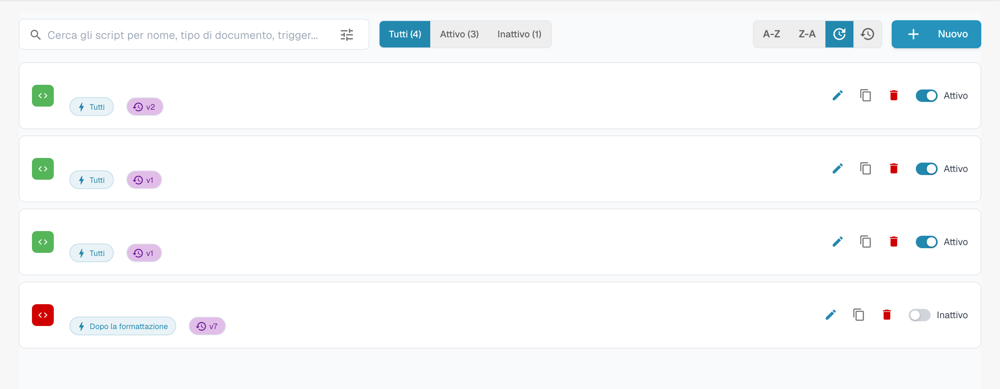

# Attivare e gestire gli script

## Video tutorial: gestire gli script


Gestire gli script di un tipo di documento


Il video mostra l'elenco degli script con filtro e ordinamento, l'attivazione e la disattivazione, la copia, la cronologia delle versioni e l'eliminazione con conferma.

Aprire il tipo di documento e la relativa gestione degli script. L’elenco presenta gli script e i comandi di modifica, duplicazione e stato. Nell’esempio i nomi sono nascosti.

<figure><figcaption>
Gestione degli script e comandi di modifica; i nomi sono nascosti.
</figcaption></figure>

Filtrare per stato o cercare lo script previsto prima di aprirlo. Verificare tipo di documento, evento di esecuzione e codice prima di salvare.

I comandi disponibili dipendono dalle autorizzazioni. Provare le modifiche previste con documenti rappresentativi prima di usarle in un workflow reale.
