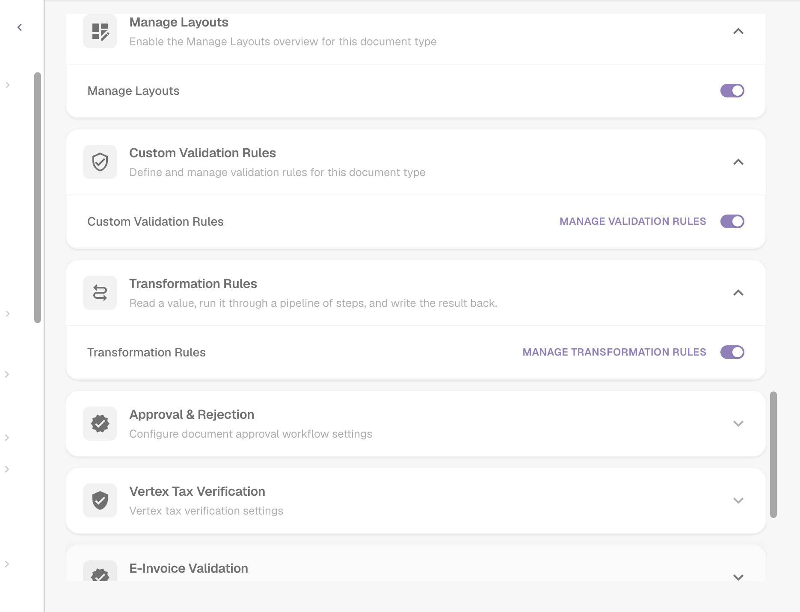

# Regole di Trasformazione

## Panoramica

Le regole di trasformazione puliscono o riscrivono i dati estratti **automaticamente**, ogni volta che un documento viene elaborato e ogni volta che viene salvato. Una regola può modificare:

* un **campo dell'intestazione** (numero fattura, valuta, partita IVA del fornitore …),
* una **colonna** in ogni riga di una tabella (unità, numero articolo, base prezzo …),
* le **righe** di una tabella (cancellarle, aggiungere una riga),
* un **attributo del documento** — oggi la sotto-organizzazione a cui appartiene (**Routing**).

Ogni regola **legge** un valore, lo fa passare attraverso una breve **pipeline** di passaggi e **scrive** il risultato. Le regole vengono eseguite **prima** della validazione, degli script e del matching degli ordini di acquisto, quindi tutto ciò che segue vede già i valori corretti.

Le regole di trasformazione sostituiscono la maggior parte dei piccoli script che le organizzazioni scrivevano per "taglia sempre questo campo", "mappa i codici unità di questo fornitore", "aggiungi il prefisso che si aspetta il nostro ERP" o "raggruppa le righe di questo fornitore in una riga totale" — con un modulo, un'anteprima in tempo reale e senza codice.

### Problemi che risolvono

| Esigenza | Regola |
| --- | --- |
| Un fornitore stampa il numero fattura senza il prefisso `INV-` che si aspetta il nostro ERP | Campo intestazione *Invoice Number*, solo per quel fornitore: Trim → UPPERCASE → Affix: aggiungi prefisso `INV-` |
| I fornitori inviano codici unità tedeschi (`STK`, `Std`), l'ERP si aspetta codici UN/ECE (`PCE`, `HUR`) | Colonna tabella *UNIT*: Map values `STK → PCE`, `KG → KGM`, `Std → HUR` |
| I numeri articolo arrivano con un prefisso come `Art.-Nr. 4711` | Colonna tabella *ITEM_NUMBER*: Affix: rimuovi prefisso `Art.-Nr. ` |
| Le partite IVA contengono spazi e punti | Campo intestazione *Supplier Tax ID*: Sanitise, mantieni alfanumerici |
| Un fornitore viene abbinato sul totale, non sulle righe | Righe tabella: Clear all rows → Add a row con l'importo netto |
| Tutti i documenti di determinati fornitori appartengono a una sotto-organizzazione | Routing: imposta la sotto-organizzazione quando *Supplier ID è uno di …* |
| Le date devono essere scritte in un formato fisso in un campo di testo libero | Campo intestazione: Reformat date `%d.%m.%Y` |


Finché la funzione è in beta, le impostazioni descritte di seguito compaiono solo quando la pagina delle impostazioni **Tipi di Documento** viene aperta con `?beta=true` aggiunto all'indirizzo.


## Attivare le regole di trasformazione

Le regole di trasformazione vengono attivate **per tipo di documento** da un **amministratore dell'organizzazione**.

1. Vai su **Impostazioni → Impostazioni Globali → Tipi di Documento**.
2. Clicca sull'icona **impostazioni** (ingranaggio) nella scheda del tipo di documento.
3. Apri **Regole di Trasformazione** e attiva l'interruttore. Clicca su **Manage transformation rules** per aprire l'elenco.

<figure><figcaption>
L'interruttore Regole di Trasformazione nelle impostazioni aggiuntive di un tipo di documento
</figcaption></figure>

La scheda del tipo di documento ora mostra un link **Regole di Trasformazione** e un link **Logs** per i log di esecuzione.

## L'elenco delle regole

L'elenco mostra tutte le regole del tipo di documento nell'ordine in cui vengono eseguite, ciascuna con un riepilogo in una frase ("When invoice_id is abcd, take invoice_id, make it UPPERCASE, and save it back."), il suo ambito (**Header**, **Table**, **Column**, **Routing**), il numero di passaggi, la sua origine e se **Log execution** è attivo. Puoi filtrare per ambito e per **Active / Inactive**, cercare e usare il menu **⋮** per duplicare o eliminare una regola.

Le regole provengono da tre fonti, come per le regole di validazione: le regole **System default** fornite con DocBits (clicca su **Customize** per ottenere una copia modificabile), le regole di sistema **Customized** (**Reset to Default** ripristina l'originale) e le regole **Custom** create da te.

## Creare una regola

Clicca su **New rule**. Il generatore ha tre passaggi a sinistra e una **Live preview** a destra. In alto riassume la regola in una frase mentre la costruisci.

<figure><figcaption>
Passaggio 1: cosa modifica la regola. La frase in alto descrive la regola in linguaggio semplice
</figcaption></figure>

### Passaggio 1 — Cosa e dove

**What does this rule change?** — l'ambito:

| Ambito | Modifica | Obiettivo | Eseguita |
| --- | --- | --- | --- |
| **Header field** | un valore per documento | un campo dell'intestazione, ad es. *Invoice Number* | una volta per documento |
| **Table rows** | intere righe di articoli — cancellarle o aggiungerle | una tabella, ad es. `INVOICE_TABLE` | una volta per documento |
| **Table column** | un valore in ogni riga di articolo | una tabella e una colonna, ad es. `INVOICE_TABLE` / `UNIT` | una volta per riga |
| **Routing** | un attributo del documento — oggi la sotto-organizzazione | *sub-organisation* | una volta per documento |

Poi inserisci il **Rule Name** (la **Rule key** viene generata da esso), scegli il **Target field** / **Table name** / **Target column** e, facoltativamente, una **Description**. **Log execution** scrive una voce di log per ogni applicazione — utile mentre affini una regola.

### Passaggio 2 — Quando viene eseguita

* **Always** — la regola viene eseguita su ogni documento del tipo.
* **Only when…** — la regola viene eseguita solo se una condizione è vera, ad esempio *Supplier ID is HP0000278*. Per le regole **Table column** la condizione può usare le colonne della riga corrente e viene verificata riga per riga. Vedi [Condizioni delle regole (Applies when)](rule-conditions-applies-when.md) per tutti i campi, gli operatori e gli esempi.

Due opzioni controllano la frequenza con cui la regola viene applicata:

| Opzione | Effetto |
| --- | --- |
| **Run only once per document** | Normalmente le regole vengono eseguite di nuovo a ogni salvataggio. Con questa opzione attiva, la regola si applica **al massimo una volta** a un documento e poi ha finito con esso. Un passaggio in cui le condizioni non corrispondono non conta, quindi la regola può ancora applicarsi a un salvataggio successivo. Necessaria per i passaggi che cambierebbero di nuovo il valore a ogni salvataggio (vedi [Idempotenza](#esecuzione-singola-e-idempotenza)) e per le regole di tabella che non devono ricostruire di nuovo le righe. |
| **Run after lookup population (before PO match)** | *(versioni più recenti)* Esegue la regola in un passaggio aggiuntivo dopo che i dati di lookup (ad esempio i dati anagrafici del fornitore) sono stati compilati e prima del matching degli ordini di acquisto. Usala quando la regola ha bisogno di un valore fornito da un lookup. La regola viene comunque eseguita anche nelle fasi consuete; una regola run-once con questa opzione attende questo passaggio invece di essere eseguita subito dopo l'estrazione. |

### Passaggio 3 — La pipeline

<figure><figcaption>
Read → Trim → Change case → Affix → Write, con il valore dopo ogni passaggio nell'anteprima in tempo reale
</figcaption></figure>

* **Read from** — **il campo (o la colonna) stesso**, oppure **un altro campo**. Leggere da un altro campo ti permette di compilare un campo a partire da un altro, ad esempio copiare il numero dell'ordine di acquisto da un campo di testo libero.
* **Steps** — il valore attraversa i passaggi **dall'alto verso il basso**; l'output di un passaggio è l'input del successivo. Aggiungi passaggi con **+ Add a step**, riordinali con le frecce, rimuovili con **✕**. Ogni passaggio mostra alla sua destra il valore intermedio dell'esempio.
* **Write to** — l'obiettivo del passaggio 1. DocBits scrive il valore memorizzato e poi aggiorna automaticamente il valore visualizzato.

### I passaggi

<figure><figcaption>
Tutti i passaggi, raggruppati per scopo
</figcaption></figure>

| Passaggio | Impostazioni | Esempio input → output |
| --- | --- | --- |
| **Change case** | UPPERCASE, lowercase, Title Case, Capitalise first | `inv-4711` → `INV-4711` |
| **Trim** | lato (entrambi, sinistro, destro); caratteri (vuoto = spazi bianchi) | `  4711 ` → `4711`; con caratteri `0` e lato sinistro: `004711` → `4711` |
| **Pad** | lunghezza, carattere di riempimento, lato | lunghezza 10, `0`, sinistra: `4711` → `0000004711` |
| **Truncate** | lunghezza massima | 10: `ABCDEFGHIJKL` → `ABCDEFGHIJ` |
| **Affix** | aggiungi prefisso, aggiungi suffisso, rimuovi prefisso, rimuovi suffisso; testo | aggiungi prefisso `INV-`: `4711` → `INV-4711`; rimuovi prefisso `Art.-Nr. `: `Art.-Nr. 4711` → `4711` |
| **Sanitise** | mantieni solo (alfanumerici, lettere, cifre, alfanumerici + spazio) oppure rimuovi i caratteri indicati | mantieni alfanumerici: `DE 123.456.789` → `DE123456789` |
| **Take a slice** | inizio, lunghezza o fine | inizio 0, lunghezza 4: `2026-09-29` → `2026` |
| **Extract** | pattern, gruppo di cattura | pattern `PO[- ]?(\d+)`, gruppo 1: `Order PO-45001234` → `45001234` |
| **Find & replace** | pattern, sostituisci con, conteggio (0 = tutti) | pattern `\s+`, sostituisci con ` `: `ACME    GmbH` → `ACME GmbH` |
| **Map values** | mappature (da → a), valore se non c'è corrispondenza (vuoto = mantieni l'input), ignora maiuscole/minuscole | `STK → PCE`: `stk` → `PCE` |
| **Reformat date** | pattern di output (`%d.%m.%Y`, `%m/%d/%Y`, `%Y-%m-%d`, `%d %b %Y`) | `%d.%m.%Y`: `2026-09-29` → `29.09.2026` |
| **Format number** | locale (de_DE, en_US, en_GB, fr_FR), decimali min. e max. | de_DE, 2 decimali: `1234.5` → `1.234,50` |
| **Fix value** | il valore | scrive sempre il valore, qualunque fosse il contenuto del campo |
| **Clear** | – | svuota il campo |

Le regole **Table rows** usano due passaggi diversi, che lavorano sulle righe invece che sui valori:

| Passaggio | Effetto |
| --- | --- |
| **Clear all rows** | elimina ogni riga estratta. Le righe aggiunte da un passaggio successivo restano. |
| **Add a row** | aggiunge una riga **dopo l'ultima riga** o **prima della prima riga**. Per ogni colonna scegli **Value** (un valore fisso) o **Field** (il valore di un campo dell'intestazione). Le colonne che non indichi restano vuote. |


**Reformat date** si aspetta la data così come DocBits la memorizza internamente (`YYYY-MM-DD`). Applicalo al campo stesso, non a un testo che contiene già una data formattata.


### Live preview

L'anteprima in tempo reale esegue la regola su un esempio mentre la costruisci:

* **Sample input** — digita un valore come arriverebbe dal documento. Per le regole di tabella, inserisci il numero di righe estratte (**Sample table**) e i valori dei campi letti dalle nuove righe (**Row source values**).
* **Condition values** — per le regole con una condizione, digita i valori dei campi della condizione. L'anteprima mostra **Conditions match — rule runs** oppure **Conditions do not match — rule is skipped**.
* Più in basso vedi il valore dopo **ogni passaggio** e il risultato finale che verrebbe scritto ("invoice_id → INV-230620-03A", oppure "unchanged").

Durante l'uso dell'anteprima non viene salvato nulla. Clicca su **Save** per memorizzare la regola.

## Esempi

### Pulire il numero fattura di un fornitore

Campo intestazione **Invoice Number** · solo quando *Supplier ID is HP0000278* · Trim → Change case UPPERCASE → Affix aggiungi prefisso `INV-`.
Esempio `  230620-03a ` → `INV-230620-03A`. Vedi lo screenshot della pipeline sopra.

### Mappare i codici unità

Colonna tabella **INVOICE_TABLE / UNIT** · sempre · Trim → Map values `STK → PCE`, `KG → KGM`, `Std → HUR`, **Ignore case when matching** attivo, valore se non c'è corrispondenza vuoto (mantieni l'input).

<figure><figcaption>
Map values sulla colonna UNIT: <code>stk</code> diventa <code>PCE</code>
</figcaption></figure>

### Una riga totale per un fornitore abbinato sul totale

Righe tabella **INVOICE_TABLE** · solo quando *Supplier ID is HP0000278* · Clear all rows → Add a row con `POSITION` = valore `001`, `QUANTITY` = valore `1`, `NET_AMOUNT` = campo *Total Net Amount*.

<figure><figcaption>
Tre righe estratte vengono sostituite da una riga che riporta l'importo netto
</figcaption></figure>

L'ordine conta: **Clear all rows** deve venire **prima** di **Add a row**. Il generatore ti avvisa se non è così ("Clear all rows runs after Add a row …") e ti avvisa anche se un passaggio **Add a row** non è preceduto da **Clear all rows**, perché la regola aggiungerebbe un'altra copia della riga a ogni salvataggio. Abbina questa regola a una regola di matching degli ordini di acquisto sul totale, attiva per i documenti a riga singola.

### Altri esempi

| Obiettivo | Ambito | Condizione | Passaggi |
| --- | --- | --- | --- |
| Rimuovere spazi e punti dalla partita IVA | Header *Supplier Tax ID* | sempre | Sanitise: mantieni alfanumerici |
| Rimuovere il prefisso dell'articolo | Colonna *ITEM_NUMBER* | sempre | Affix: rimuovi prefisso `Art.-Nr. ` |
| Numeri fornitore a 10 cifre | Header *Supplier ID* | sempre | Trim → Pad lunghezza 10 con `0`, sinistra |
| Estrarre il numero PO da un testo di riferimento | Header *Purchase Order*, lettura da un altro campo | solo quando *Purchase Order is empty* | Extract `PO[- ]?(\d+)`, gruppo 1 |
| Usare sempre un'unica valuta per un fornitore | Header *Currency* | solo quando *Supplier ID is 10040* | Fix value `CHF` |
| Rimuovere un valore estratto in modo errato | Header *Discount Term* | solo quando *Supplier ID is 20723* | Clear |
| Base prezzo per unità | Colonna *UNIT_PRICE_PER* | solo quando *row.UNIT_PRICE_PER is empty* | Fix value `1` |
| Instradare i fornitori a una sotto-organizzazione | Routing | *Supplier ID is one of* `10040, 10041` | assegna una sotto-organizzazione fissa |

## Regole di routing (sotto-organizzazione)

Una regola **Routing** non modifica un campo. Quando le sue condizioni corrispondono, imposta un attributo sul documento — oggi la **sotto-organizzazione**. Scegli **Assign a fixed sub-organisation** e selezionala dall'elenco, oppure **Map from a field** per mappare i valori di un campo estratto alle sotto-organizzazioni. Il documento appartiene poi a quella sotto-organizzazione, con i suoi utenti, i suoi permessi e le sue impostazioni. Un valore che non è una sotto-organizzazione valida non viene mai scritto.

## Quando vengono eseguite le regole

* **Durante l'elaborazione**, dopo l'estrazione e prima del lookup dei dati anagrafici, della validazione, degli script e del matching degli ordini di acquisto.
* Ad **ogni salvataggio** del documento in cui i dati estratti sono cambiati. Le regole senza **Run only once per document** vengono applicate di nuovo ogni volta.
* All'interno di un passaggio, le regole vengono eseguite ambito per ambito in questo ordine: **Header → Routing → Table rows → Table column**. Una regola di colonna si applica quindi anche alle righe che una regola di tabella ha appena aggiunto. All'interno di un ambito, le regole vengono eseguite per priorità, poi per chiave.

### Esecuzione singola e idempotenza

La maggior parte dei passaggi dà lo stesso risultato quando viene eseguita sul proprio output — tagliare un valore già tagliato, mappare di nuovo `PCE`, aggiungere un prefisso già presente. Queste regole possono essere eseguite in sicurezza a ogni salvataggio.

**Take a slice**, **Extract** e **Find & replace** sono diversi: eseguiti di nuovo sul proprio risultato, continuano a modificarlo (uno slice prende i primi quattro caratteri dei primi quattro caratteri …). DocBits quindi non ti permette di salvare una regola che applica questi passaggi al proprio campo obiettivo. Devi:

* attivare **Run only once per document**, oppure
* **Read from another field**, in modo che l'input resti invariato.

## Regole di trasformazione e matching degli ordini di acquisto

Le regole di tabella e di colonna modificano ciò che vede il matcher PO:

* Una regola di tabella che **ricostruisce** le righe (ad esempio cancella tutte le righe e aggiunge una riga totale) mantiene un abbinamento esistente con l'ordine di acquisto finché produce **di nuovo le stesse righe** — i valori vengono confrontati per significato, quindi `1.0` e `1.00` sono la stessa riga. Le righe mantengono la loro identità e l'abbinamento sopravvive a ogni salvataggio.
* Se una regola **sostituisce o rimuove righe già abbinate**, l'abbinamento non può essere mantenuto. Il documento registra quale regola lo ha eliminato, la schermata Purchase Order Matching lo mostra come motivo ("_The PO match could not be saved: the transformation rule "…" rebuilt the table_") e gli amministratori ricevono un link alla regola. La **cronologia del matching** del documento mostra un passaggio _Regole di trasformazione_ prima della prima fase di matching, con le regole eseguite.
* Il numero di righe dopo le regole è ciò che contano le [condizioni di attivazione](more-settings/purchase-order/purchase-order-matching-rules.md#condizioni-di-attivazione) delle regole di matching. Una regola che riduce una fattura a **una** riga ha senso solo insieme a una regola di matching sul totale attiva per i documenti a riga singola (`[[count(table_lines)]] >= 1`).

## Log

Con **Log execution** attivo, ogni applicazione della regola viene scritta in **Tipi di Documento → (tipo di documento) → Logs**, con l'esito (applicata, nessuna modifica, saltata), il documento e — per le regole saltate — la traccia della condizione che ne spiega il motivo. Vedi [Leggere la traccia della condizione nei log](rule-conditions-applies-when.md#leggere-la-traccia-della-condizione-nei-log).

## Best practice

* **Uno scopo per regola.** "Pulisci il numero fattura" e "Mappa i codici unità" sono due regole, non una.
* **Costruisci con l'anteprima in tempo reale**, usando valori reali copiati dai documenti, compresi quelli insoliti (spazi, minuscole, prefissi).
* **Limita le regole specifiche per fornitore con una condizione** invece di lasciarle eseguire su tutto.
* **Preferisci i passaggi idempotenti.** Usa run once solo dove serve.
* **Controlla l'abbinamento dell'ordine di acquisto** dopo aver aggiunto regole di tabella; verifica la cronologia del matching di alcuni documenti.
* **Disattiva Log execution** quando la regola funziona.

## Risoluzione dei problemi

| Sintomo | Cosa controllare |
| --- | --- |
| La regola non ha cambiato nulla | È attiva e la funzione è abilitata per il tipo di documento? La condizione è vera per questo documento (valore esatto, compresi spazi e maiuscole/minuscole)? Una regola **run once** è già stata applicata al documento? Controlla la traccia nel log. |
| Il valore cambia di nuovo a ogni salvataggio | La pipeline contiene Take a slice, Extract o Find & replace. Attiva **Run only once per document**, oppure leggi da un altro campo. |
| Una tabella ottiene una riga in più a ogni salvataggio | Un passaggio **Add a row** senza **Clear all rows** prima. Aggiungi prima il passaggio di cancellazione, oppure attiva run once. |
| L'abbinamento dell'ordine di acquisto si perde dopo il salvataggio | Una regola di tabella ha sostituito le righe abbinate. Il motivo nel documento indica la regola; fai in modo che la regola riproduca le stesse righe, oppure impostala su run once. |
| Una regola di matching non viene mai eseguita dopo la trasformazione | La regola ha cambiato il numero di righe; modifica la condizione di attivazione della regola di matching. |
| La regola ha bisogno di un valore dei dati anagrafici del fornitore, ma è ancora vuoto | Attiva **Run after lookup population (before PO match)**. |
| Una data non viene riformattata | Reformat date si aspetta `YYYY-MM-DD` come input. |

## Correlati

* [Condizioni delle regole (Applies when)](rule-conditions-applies-when.md) — le condizioni in dettaglio
* [Regole di validazione personalizzate](custom-validation-rules.md) — controlla i valori trasformati
* [Regole di selezione del layout](layout-manager/layout-selection-rules.md) — scegli il layout usato da un documento
* [Regole di Corrispondenza degli Ordini di Acquisto](more-settings/purchase-order/purchase-order-matching-rules.md)
