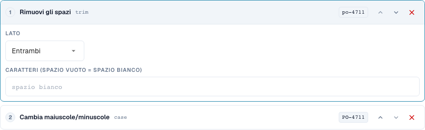
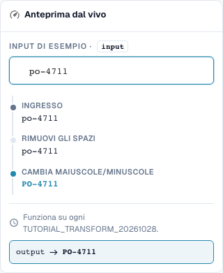
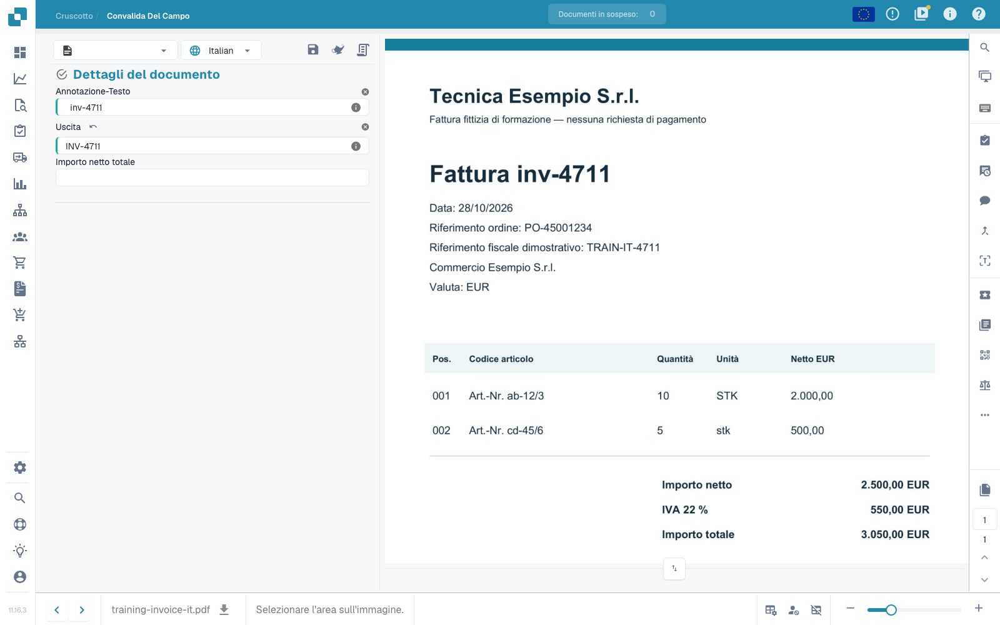

# Fondamenti, ambiti di applicazione e test sicuri

[Torna alla panoramica completa della pratica](complete-practical-guide.md)

Campo intestazione · Risultato obiettivo · Origine testo originale · Trim → Maiuscolo → Prefisso INV-.

## Etichette visibili nell’editor

Alcune etichette dell’interfaccia attuale presentano traduzioni imprecise. La tabella riporta il testo effettivamente visualizzato per trovare il passaggio corretto; le spiegazioni funzionali usano la terminologia tecnica. Le schermate mostrano l’interfaccia senza modifiche.

| Operazione | Etichetta visibile |
| --- | --- |
| trim | Rimuovi gli spazi |
| case | Cambia maiuscole/minuscole |

## Procedura nell'editor

1. Nel tipo di documento di formazione isolato, creare una nuova regola per un **campo intestazione**. Selezionare come obiettivo `output` e come origine separata `header.input`; i nomi effettivi dei campi della propria organizzazione possono differire.
2. Aggiungere i passaggi **Trim**, pagina entrambe, carattere spazio e successivamente **Modifica maiuscole/minuscole**, modalità upper. L'ordine deve essere Trim → Maiuscolo.
3. Inserire il valore di test `  inv-4711  `. L'ultimo valore di anteprima deve essere `INV-4711`; i valori intermedi mostrano prima `inv-4711`.
4. Attivare la regola esclusivamente per l'ambito di formazione e salvare. Riaprire la voce e verificare origine, obiettivo e entrambi i passaggi.
5. Salvare il documento di esercitazione, ricaricarlo e controllare entrambi i campi: l'origine contiene ancora gli spazi originali, l'output è `INV-4711`. Salvare nuovamente e ripetere la stessa verifica.

<figure><figcaption>
Configurazione degli step. Interfaccia reale in italiano. L'anteprima non modifica i documenti memorizzati.
</figcaption></figure>


Configurazione degli step. Interfaccia reale in italiano. L'anteprima non modifica i documenti memorizzati.


<figure><figcaption>
Anteprima live con valori di training. Interfaccia reale in italiano. L'anteprima non modifica i documenti memorizzati.
</figcaption></figure>


Anteprima live con valori di training. Interfaccia reale in italiano. L'anteprima non modifica i documenti memorizzati.


## 1. Ambito di applicazione

Una trasformazione modifica dati già estratti. Non sostituisce il riconoscimento del testo. Nell'editor scelgo prima l'ambito di applicazione. Un campo intestazione viene elaborato una volta per documento. Una colonna tabella viene elaborata per ogni riga. Le regole tabella modificano intere righe di dettaglio. Il routing assegna il documento a una sotto-organizzazione. Queste quattro attività hanno obiettivi diversi e passaggi diversi. Creo i miei esempi su un tipo di documento di test dedicato, in modo che nessuna fattura produttiva venga modificata.

## 2. Origine e elaborazione

Successivamente scelgo il campo obiettivo. L'origine può essere questo campo stesso o un altro campo. I passaggi vengono eseguiti dall'alto verso il basso. Ogni valore intermedio diventa l'input del passaggio successivo. Il mio esempio legge un numero di fattura, rimuove gli spazi esterni e scrive in maiuscolo. Da una lettera minuscola si ottiene una maiuscola. Con una condizione limito la regola al fornitore corretto. Per una colonna tabella, la condizione può inoltre verificare i valori della riga corrente. Più condizioni possono essere combinate con E, O e gruppi.

## 3. Verifica dell'effetto

L'anteprima live non salva nulla. Verifico un valore appropriato, un caso contrario e un risultato già corretto. Successivamente salvo la regola, la riapro e controllo le impostazioni salvate. Per l'effetto effettivo sul documento ho bisogno inoltre di un documento di test, un'operazione di salvataggio e il risultato dopo il ricaricamento. Un'anteprima non dimostra né un'esportazione avvenuta né un'abbinamento ordine riuscito. I log di esecuzione mi aiutano a distinguere tra condizioni applicate e condizioni saltate. Nei prossimi episodi analizzeremo le singole trasformazioni e i loro limiti.

## Esempi verificati e casi contrari

Questi valori sono stati verificati lato server come test a secco. Tale test non modifica i documenti salvati.

| Caso | Input | Risultato server |
| --- | --- | --- |
| copy | `  po-4711  ` | `PO-4711` |

## Accettazione

Verificare un caso appropriato, un caso contrario, un valore vuoto e un risultato già elaborato. Ripetere l'operazione di salvataggio del documento. Verificare inoltre l'abbinamento PO e la ricezione ERP, se rientrano nell'obiettivo funzionale.

## Effetto salvato sul documento di esercitazione

<figure><figcaption>
Il valore originale preparato rimane conservato; l'output mostra INV-4711. Due operazioni di salvataggio native, ricaricamento e un'interrogazione server separata confermano il risultato stabile. Questo documenta l'effetto della regola su valori di test preparati, non l'accuratezza di un'estrazione automatica.
</figcaption></figure>


Il valore originale preparato rimane conservato; l'output mostra INV-4711. Due operazioni di salvataggio native, ricaricamento e un'interrogazione server separata confermano il risultato stabile. Questo documenta l'effetto della regola su valori di test preparati, non l'accuratezza di un'estrazione automatica.


## Tutorial video


Configurazione, esempi pratici e casi contrari.


[Apri il video con sottotitoli italiani e capitoli](https://docbits-videos.fra1.cdn.digitaloceanspaces.com/settings-assistant/transformation-rules-01-foundations-preview-admin/v1/it.html). Questa versione di revisione attende la verifica funzionale e un ascolto completo.
