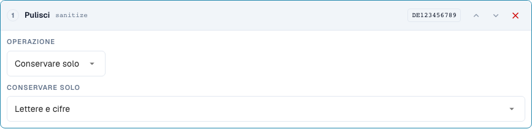
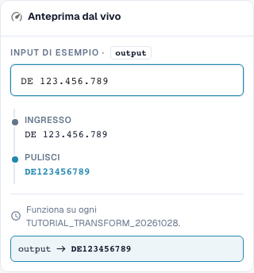

# Pulizia del testo: maiuscole/minuscole, trim e caratteri

[Torna alla panoramica completa della pratica](complete-practical-guide.md)

Campo intestazione · Risultato obiettivo · Testare i passaggi singolarmente: case, trim, sanitize.

## Etichette visibili nell’editor

Alcune etichette dell’interfaccia attuale presentano traduzioni imprecise. La tabella riporta il testo effettivamente visualizzato per trovare il passaggio corretto; le spiegazioni funzionali usano la terminologia tecnica. Le schermate mostrano l’interfaccia senza modifiche.

| Operazione | Etichetta visibile |
| --- | --- |
| case | Cambia maiuscole/minuscole |
| trim | Rimuovi gli spazi |
| sanitize | Pulisci |

## Procedura nell'editor

1. Per il campo intestazione di formazione creare un singolo passaggio **Cambia maiuscole/minuscole**. Verificare le modalità upper, lower, title e capitalize in sequenza con gli esempi della tabella.
2. Per il numero fattura iniziare una nuova pipeline con **Trim**. Entrambi i lati e un campo caratteri vuoto rimuovono lo spazio esterno; `47 11` deve mantenere il suo spazio interno.
3. Come verifica separata per il trim impostare lato sinistro e carattere `0`: `004711` diventa `4711`, `000` diventa vuoto. Non adottare questo passaggio senza verifica per identificatori reali.
4. Per una partita IVA utilizzare **Pulisci caratteri** mantenendo alfanumerico. `DE 123.456.789` deve dare `DE123456789`. Verificare le altre modalità di mantenimento con `DE-123` e `ACME GmbH!`.
5. Per capitalize confrontare esplicitamente anteprima e server: per il valore verificato `aCME GMBH` questi risultati sono diversi. Il risultato server è `Acme gmbh`; una visualizzazione browser adeguata da sola non è sufficiente.

<figure><figcaption>
Configurazione degli step. Interfaccia reale in italiano. L'anteprima non modifica i documenti memorizzati.
</figcaption></figure>


Configurazione degli step. Interfaccia reale in italiano. L'anteprima non modifica i documenti memorizzati.


<figure><figcaption>
Anteprima live con valori di training. Interfaccia reale in italiano. L'anteprima non modifica i documenti memorizzati.
</figcaption></figure>


Anteprima live con valori di training. Interfaccia reale in italiano. L'anteprima non modifica i documenti memorizzati.


## 1. Maiuscole/minuscole

La maiuscola uniforma ad esempio un numero fattura. La minuscola può uniformare una chiave tecnica di confronto. Title Case e la maiuscola del primo carattere possono modificare anche il resto della parola. Da un'abbreviazione aziendale può quindi risultare una diversa grafia. Per i nomi propri utilizzo queste varianti solo con una chiara indicazione di dominio. Per la modalità Capitalise first esiste una discrepanza nello stato verificato: l'anteprima browser lascia invariata la grafia rimanente, mentre il server trasforma il resto in minuscolo. Non mi affido quindi solo all'anteprima, ma confronto esplicitamente il valore server.

## 2. Trim

Il trim rimuove i caratteri ai margini. Entrambi i lati rimuove gli spazi esterni, ma nessuno spazio all'interno di un numero. Sinistra con il carattere zero rimuove tutti gli zeri iniziali. Un valore composto solo da zeri diventa vuoto. Destra opera analogamente alla fine. Il campo Caratteri è un insieme di singoli caratteri e non un prefisso completo. Un prefisso articolo fisso lo rimuovo quindi con Affisso. Riempimento e troncamento li trattiamo nella puntata successiva.

## 3. Pulisci caratteri

Nella pulizia posso mantenere solo lettere e cifre, solo lettere, solo cifre o anche spazi aggiuntivi. Una partita IVA tedesca con spazi e punti diventa così una chiave continua. Per un codice articolo i trattini possono invece essere rilevanti dal punto di vista del dominio. La rimozione di tali caratteri deve corrispondere alla grafia nel sistema di destinazione. La rimozione alternativa di caratteri opera con una classe di caratteri delle espressioni regolari. Un trattino richiede particolare attenzione al suo interno. Per il mio esempio verifico quindi il valore server effettivo oltre all'anteprima. Valori già puliti e input vuoti devono essere inclusi in ogni test.

## Esempi verificati e casi limite

Questi valori sono stati verificati lato server come test a secco. Tale test non modifica i documenti salvati.

| Caso | Input | Risultato server |
| --- | --- | --- |
| case-upper | `inv-4711` | `INV-4711` |
| case-upper | `INV-4711` | `INV-4711` |
| case-lower | `INFO@BEISPIEL.DE` | `info@beispiel.de` |
| case-title | `acme gmbh` | `Acme Gmbh` |
| case-capitalize | `aCME GMBH` | `Acme gmbh` |
| trim | `  4711  ` | `4711` |
| trim | `47 11` | `47 11` |
| trim-zero | `004711` | `4711` |
| trim-zero | `000` | `` |
| sanitize | `DE 123.456.789` | `DE123456789` |
| sanitize-alpha | `DE-123` | `DE` |
| sanitize-numeric | `DE-123` | `123` |
| sanitize-space | `ACME GmbH!` | `ACME GmbH` |
| sanitize-strip | `ab-12/3.` | `ab123` |

## Collaudo

Verificare un caso adeguato, un caso limite, un valore vuoto e un risultato già elaborato. Ripetere l'operazione di salvataggio del documento. Verificare inoltre la riconciliazione PO e la ricezione ERP, se rientrano nell'obiettivo di dominio.

## Tutorial video


Configurazione, esempi pratici e casi contrari.


[Apri il video con sottotitoli italiani e capitoli](https://docbits-videos.fra1.cdn.digitaloceanspaces.com/settings-assistant/transformation-rules-02-text-cleaning-preview-admin/v1/it.html). Questa versione di revisione attende la verifica funzionale e un ascolto completo.
