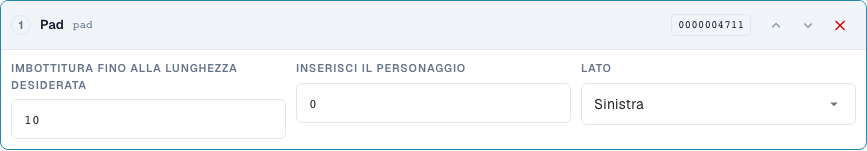
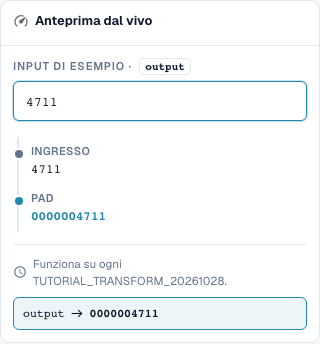

# Modellare i numeri: riempimento, troncamento, prefisso e suffisso

> Limite noto dell’anteprima (verificato il 29 ottobre 2026, versione 11.15.2): aggiungendo il prefisso `INV-`, l’anteprima modifica erroneamente `INV-4711` in `INV-INV-4711`. Il test indipendente del server mantiene `INV-4711`. Verifica anche l’esecuzione ripetuta con un test del server; un risultato corretto nell’anteprima, da solo, non dimostra l’esecuzione completa al salvataggio.

[Torna alla panoramica completa della pratica](complete-practical-guide.md)

Campo di intestazione · pad: lunghezza 10, carattere 0, sinistra; truncate: lunghezza 10; affix: operazione esatta di prefisso/suffisso.

## Etichette visibili nell’editor

Alcune etichette dell’interfaccia attuale presentano traduzioni imprecise. La tabella riporta il testo effettivamente visualizzato per trovare il passaggio corretto; le spiegazioni funzionali usano la terminologia tecnica. Le schermate mostrano l’interfaccia senza modifiche.

| Operazione | Etichetta visibile |
| --- | --- |
| pad | Pad |
| truncate | Troncare |
| affix | Prefisso/suffisso |

## Procedura nell'editor

1. Seleziona lo step di riempimento per il numero. Imposta lunghezza minima 10, carattere di riempimento `0`, e lato sinistro. `4711` deve diventare `0000004711`.
2. Verificare con un input già di undici cifre: il riempimento non deve tagliare nulla. Per le aggiunte a destra testare separatamente lunghezza 6, carattere `_` e input `ABC`.
3. In una regola separata impostare **Troncamento** con lunghezza massima 10. `ABCDEFGHIJKL` diventa `ABCDEFGHIJ`, `ABC` rimane invariato. Verificare se input diversi potrebbero produrre lo stesso identificativo.
4. Testare **Affix** con aggiunta prefisso `INV-`. Successivamente verificare l'input `INV-4711`: il prefisso esattamente presente non deve essere aggiunto nuovamente.
5. Configurare separatamente le altre varianti Affix: aggiunta suffisso `-DE`, rimozione prefisso `Art.-Nr. ` e rimozione suffisso ` EUR`. Durante la rimozione testare anche un bordo non corrispondente e una maiuscola diversa.
6. Utilizzare nuovamente l'output come input. In particolare durante la rimozione di affissi presenti più volte, una seconda esecuzione può modificare ulteriormente.

<figure><figcaption>
Configurazione degli step. Interfaccia reale in italiano. L'anteprima non modifica i documenti memorizzati.
</figcaption></figure>


Configurazione degli step. Interfaccia reale in italiano. L'anteprima non modifica i documenti memorizzati.


<figure><figcaption>
Anteprima live con valori di training. Interfaccia reale in italiano. L'anteprima non modifica i documenti memorizzati.
</figcaption></figure>


Anteprima live con valori di training. Interfaccia reale in italiano. L'anteprima non modifica i documenti memorizzati.


## 1. Lunghezza

Il riempimento aggiunge a sinistra o a destra un singolo carattere di riempimento fino alla lunghezza minima. Con dieci cifre e zero a sinistra, un numero di quattro cifre diventa un identificativo di dieci cifre. Un numero già più lungo rimane più lungo. Il riempimento non è quindi un controllo di lunghezza. Il troncamento invece conserva solo i primi caratteri fino alla lunghezza massima scelta. Questa informazione va persa. Prima di un utilizzo ERP verifico se numeri diversi potrebbero diventare identici dopo il troncamento. I valori brevi rimangono invariati.

## 2. Prefisso e suffisso

I seguenti risultati delle operazioni sugli affissi descrivono l’esecuzione verificata del server.

Affix offre quattro varianti: aggiunta prefisso, aggiunta suffisso, rimozione prefisso e rimozione suffisso. Un prefisso aggiunto non viene integrato una seconda volta se il valore inizia già esattamente con esso. Lo stesso vale per un suffisso. La rimozione invece verifica esattamente l'inizio o la fine. Una maiuscola diversa non viene automaticamente equiparata. Se il testo si trova al centro del valore, viene conservato. Per occorrenze arbitrarie utilizzo Cerca e sostituisci.

## 3. Nuova applicazione

Anche una pipeline semplice necessita di un test di ripetizione. Se rimuovo un prefisso da un prefisso raddoppiato, dopo la prima esecuzione ne rimane uno. Al passaggio successivo anche questo scomparirebbe. Pertanto verifico l'intera regola e non solo ogni passaggio singolarmente. La tipica pipeline per i numeri di fattura è: trim, maiuscolo, aggiunta prefisso. Testo un numero grezzo, un numero già pronto e un fornitore diverso. La condizione garantisce che venga modificato solo il caso concordato.

## Esempi verificati e casi limite

Questi valori sono stati verificati lato server come test asciutto. Tale test non modifica i documenti salvati.

| Caso | Input | Risultato server |
| --- | --- | --- |
| pad | `4711` | `0000004711` |
| pad | `12345678901` | `12345678901` |
| pad-right | `ABC` | `ABC___` |
| truncate | `ABCDEFGHIJKL` | `ABCDEFGHIJ` |
| truncate | `ABC` | `ABC` |
| prefix-add | `4711` | `INV-4711` |
| prefix-add | `INV-4711` | `INV-4711` |
| suffix-add | `4711` | `4711-DE` |
| suffix-add | `4711-DE` | `4711-DE` |
| prefix-strip | `Art.-Nr. 4711` | `4711` |
| prefix-strip | `ART.-NR. 4711` | `ART.-NR. 4711` |
| prefix-strip | `Art.-Nr. Art.-Nr. 4711` | `Art.-Nr. 4711` |
| suffix-strip | `123 EUR` | `123` |
| suffix-strip | `123 EUR netto` | `123 EUR netto` |

## Collaudo

Verificare un caso appropriato, un caso limite, un valore vuoto e un risultato già elaborato. Ripetere l'operazione di salvataggio del documento. Verificare inoltre la conciliazione PO e la ricezione ERP, se rientrano nell'obiettivo funzionale.

## Tutorial video


Configurazione, esempi pratici e casi contrari.


[Apri il video con sottotitoli italiani e capitoli](https://docbits-videos.fra1.cdn.digitaloceanspaces.com/settings-assistant/transformation-rules-03-numbers-and-affixes-preview-admin/v1/it.html). Questa versione di revisione attende la verifica funzionale e un ascolto completo.
