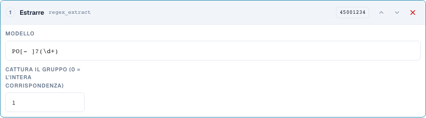
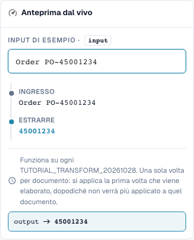

# Sottostringhe e pattern: tagliare, estrarre, sostituire

[Torna alla panoramica completa della pratica](complete-practical-guide.md)

Campo di intestazione · Origine header.input · Destinazione output · regex_extract: PO[- ]?(\d+), gruppo 1. Origine e destinazione rimangono separati.

## Etichette visibili nell’editor

Alcune etichette dell’interfaccia attuale presentano traduzioni imprecise. La tabella riporta il testo effettivamente visualizzato per trovare il passaggio corretto; le spiegazioni funzionali usano la terminologia tecnica. Le schermate mostrano l’interfaccia senza modifiche.

| Operazione | Etichetta visibile |
| --- | --- |
| substring | Prendi una fetta |
| regex_extract | Estrarre |
| regex_replace | Trova e sostituisci |

## Procedura nell'editor

1. Per tutti e tre i passaggi scegliere una destinazione come `output` e un'**origine originale separata** come `header.input`. Anche "Solo una volta per documento" non consente un'origine su sé stessa.
2. Per **Sottostringa** impostare prima inizio 0 e lunghezza 4: `2026-10-28` produce `2026`. Poi verificare inizio 3 e fine 7 con `DE-4711-X`; la fine non è inclusa.
3. Come variante propria testare inizio −4 senza lunghezza/fine: `INV-4711` produce `4711`. Un input più breve è un caso limite necessario.
4. Per **Estrarre** utilizzare pattern `PO[- ]?(\d+)` e gruppo di cattura 1. `Order PO-45001234` produce `45001234`; `Invoice 4711` produce vuoto. Il gruppo 0 fornisce invece l'intera corrispondenza.
5. Per **Cerca e sostituisci** configurare pattern `\s+`, sostituzione uno spazio e quantità 0. `ACME    GmbH` deve produrre `ACME GmbH`. Poi pattern `-`, sostituzione `/`, quantità 1 con `AB-CD-EF` da verificare: solo il primo trattino viene sostituito.
6. Verificare i pattern concreti anche lato server. Un pattern riuscito nel browser da solo non dimostra, per espressioni complesse, un'elaborazione identica lato server.

<figure><figcaption>
Configurazione degli step. Interfaccia reale in italiano. L'anteprima non modifica i documenti memorizzati.
</figcaption></figure>


Configurazione degli step. Interfaccia reale in italiano. L'anteprima non modifica i documenti memorizzati.


<figure><figcaption>
Anteprima live con valori di training. Interfaccia reale in italiano. L'anteprima non modifica i documenti memorizzati.
</figcaption></figure>


Anteprima live con valori di training. Interfaccia reale in italiano. L'anteprima non modifica i documenti memorizzati.


## 1. Sottostringa

Una sottostringa viene definita tramite inizio e lunghezza o tramite inizio e fine. Il primo indice è zero. La fine non appartiene più al risultato. Un inizio negativo conta dal margine destro. Per gli ultimi quattro caratteri utilizzo un inizio di meno quattro e nessuna fine. Scelgo un'origine diversa dalla destinazione. Così ogni esecuzione rilegge il testo originale. Il server rifiuta questi passaggi sul proprio campo di destinazione, perché altrimenti il valore potrebbe essere modificato sempre più ad ogni nuova elaborazione. Solo una volta per documento non sostituisce qui questa origine separata.

## 2. Estrarre

Estrarre cerca la prima corrispondenza di un'espressione regolare. Il mio pattern riconosce le lettere P e O, opzionalmente un trattino o uno spazio e poi cifre. Il gruppo uno fornisce solo le cifre, il gruppo zero l'intera corrispondenza. Senza corrispondenza viene restituita una stringa vuota. Imposto quindi una condizione adeguata o verifico consapevolmente se un valore di destinazione vuoto è voluto in questo caso. Più numeri d'ordine in un testo non diventano automaticamente più risultati.

## 3. Sostituire

Cerca e sostituisci elabora le corrispondenze di un pattern. Con una quantità di zero tutte le corrispondenze vengono sostituite. Uno modifica solo la prima corrispondenza. Più spazi possono essere sostituiti da un singolo spazio. Anche qui utilizzo un'origine originale separata. L'anteprima nel browser e l'elaborazione sul server possono utilizzare regole diverse per espressioni regolari complesse. Per questo testo prima pattern semplici e confronto poi il valore effettivo del server. Un caso adatto, nessuna corrispondenza e più corrispondenze formano la mia verifica minima.

## Esempi verificati e casi limite

Questi valori sono stati verificati lato server come test a secco. Un tale test non modifica i documenti salvati.

| Caso | Input | Risultato server |
| --- | --- | --- |
| substring | `2026-10-28` | `2026` |
| substring | `AB` | `AB` |
| substring-end | `DE-4711-X` | `4711` |
| substring-negative | `INV-4711` | `4711` |
| regex-extract | `Order PO-45001234` | `45001234` |
| regex-extract | `Invoice 4711` | `` |
| regex-replace | `ACME    GmbH` | `ACME GmbH` |
| regex-count | `AB-CD-EF` | `AB/CD-EF` |

## Collaudo

Verificare un caso adatto, un caso limite, un valore vuoto e un risultato già elaborato. Ripetere l'operazione di salvataggio del documento. Verificare anche l'abbinamento PO e la ricezione ERP se rientrano nell'obiettivo funzionale.

## Tutorial video


Configurazione, esempi pratici e casi contrari.


[Apri il video con sottotitoli italiani e capitoli](https://docbits-videos.fra1.cdn.digitaloceanspaces.com/settings-assistant/transformation-rules-04-substrings-and-patterns-preview-admin/v1/it.html). Questa versione di revisione attende la verifica funzionale e un ascolto completo.
