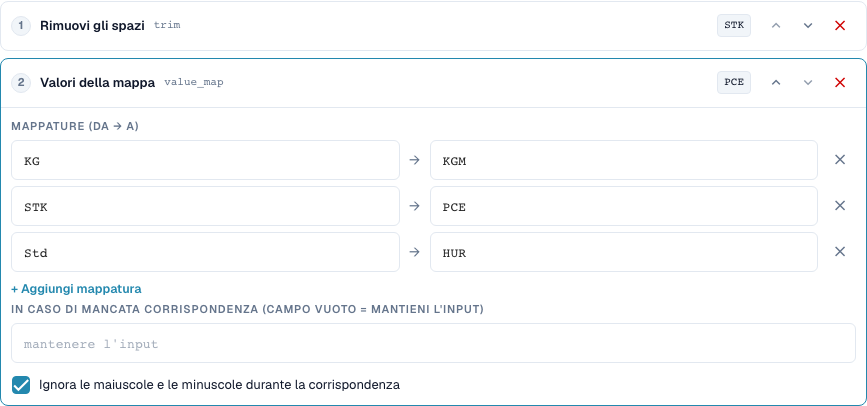
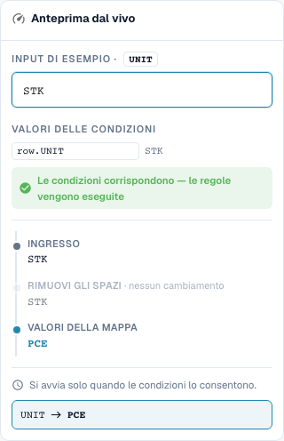

# Mappature dei valori e regole per riga di tabella

[Torna alla panoramica completa della pratica](complete-practical-guide.md)

Colonna di tabella UNIT · Trim → value_map: STK→PCE, KG→KGM, Std→HUR · Ignorare maiuscole/minuscole.

## Etichette visibili nell’editor

Alcune etichette dell’interfaccia attuale presentano traduzioni imprecise. La tabella riporta il testo effettivamente visualizzato per trovare il passaggio corretto; le spiegazioni funzionali usano la terminologia tecnica. Le schermate mostrano l’interfaccia senza modifiche.

| Operazione | Etichetta visibile |
| --- | --- |
| trim | Rimuovi gli spazi |
| value_map | Valori della mappa |

## Procedura nell'editor

1. Selezionare **Ambito di validità colonna di tabella**, tabella `INVOICE_TABLE` e colonna di destinazione `UNIT`. Qui ogni riga di tabella viene elaborata singolarmente.
2. Impostare **Trim** prima di **Mappa valori**. Catturare le coppie `STK→PCE`, `KG→KGM` e `Std→HUR` e attivare l'opzione per ignorare maiuscole/minuscole.
3. Lasciare vuoto il campo per il sostituto senza corrispondenza, in modo che i codici sconosciuti vengano conservati. `stk` deve risultare `PCE`, `BOX` deve rimanere `BOX`.
4. Verificare un'anteprima con condizione di riga corrispondente e con condizione non corrispondente. La condizione non deve catturare involontariamente le altre righe.
5. Per un test effettivo su più righe, preparare i valori iniziali `STK`, `STK`, `BOX`. Nel test server verificato si ottengono `PCE`, `PCE`, `BOX`; quantità e prezzo restano da verificare separatamente sul piano funzionale.
6. Verificare nuovamente ogni codice di destinazione come input. Una sostituzione forfettaria come `C62` e le mappature concatenate possono nascondere valori sconosciuti o modificarli ulteriormente nei cicli successivi.

<figure><figcaption>
Configurazione degli step. Interfaccia reale in italiano. L'anteprima non modifica i documenti memorizzati.
</figcaption></figure>


Configurazione degli step. Interfaccia reale in italiano. L'anteprima non modifica i documenti memorizzati.


<figure><figcaption>
Anteprima live con valori di training. Interfaccia reale in italiano. L'anteprima non modifica i documenti memorizzati.
</figcaption></figure>


Anteprima live con valori di training. Interfaccia reale in italiano. L'anteprima non modifica i documenti memorizzati.


## 1. Coppie di valori

Una mappatura dei valori traduce interi valori di input. Nel mio esempio si assegna il codice P C E a Stück, il codice K G M a Kilogramm e il codice H U R a Stunden. Inserisco i codici effettivi del fornitore e i codici di destinazione previsti come coppie. Con l'opzione per ignorare le maiuscole/minuscole viene riconosciuto anche un codice scritto in minuscolo. Ciò non elimina ancora gli spazi. Per questo motivo imposto un passaggio di trim prima della mappatura. Verifico esplicitamente un codice sconosciuto.

## 2. Senza corrispondenza

Un campo vuoto per il valore senza corrispondenza significa: conservare l'input. Non significa: eliminare l'input. Un valore di sostituzione inserito fisso sostituisce invece ogni codice sconosciuto. Ciò può nascondere errori. Per unità funzionalmente diverse non assegnerei un codice di sostituzione forfettario. Una mappatura non è inoltre automaticamente ripetibile in ogni combinazione. Se l'output di una coppia è contemporaneamente l'input di un'altra coppia, un ciclo successivo può continuare a mappare. Verifico quindi anche ogni codice di destinazione come nuovo input.

## 3. Per riga di tabella

Per le tabelle seleziono la tabella concreta e la colonna di destinazione. La pipeline viene quindi eseguita per ogni riga. Una condizione può collegare il codice unità della riga attuale con una caratteristica fornitore dall'intestazione. Nell'esempio due righe corrispondenti vengono modificate, mentre un codice unità sconosciuto viene conservato. Ciò non modifica quantità o prezzi tramite una conversione di unità. Rinominare una stringa non è una conversione matematica. Verifico il reale allineamento dell'ordine d'acquisto e un'esportazione separatamente dalla trasformazione.

## Esempi verificati e casi limite

Questi valori sono stati verificati lato server come test a secco. Tale test non modifica i documenti salvati.

| Caso | Input | Risultato server |
| --- | --- | --- |
| map | `stk` | `PCE` |
| map | `PCE` | `PCE` |
| map | `BOX` | `BOX` |
| map-fallback | `BOX` | `C62` |
| item-pipeline | `Art.-Nr. ab-12/3` | `AB123` |

## Accettazione

Verificare un caso corrispondente, un caso limite, un valore vuoto e un risultato già elaborato. Ripetere l'operazione di salvataggio del documento. Verificare inoltre l'allineamento PO e la ricezione ERP, se rientrano nell'obiettivo funzionale.

## Tutorial video


Configurazione, esempi pratici e casi contrari.


[Apri il video con sottotitoli italiani e capitoli](https://docbits-videos.fra1.cdn.digitaloceanspaces.com/settings-assistant/transformation-rules-05-value-mapping-preview-admin/v1/it.html). Questa versione di revisione attende la verifica funzionale e un ascolto completo.
