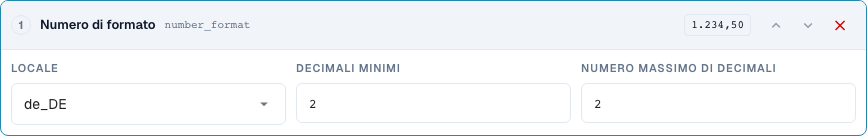
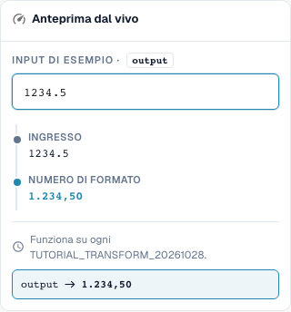

# Formattare correttamente date e numeri

[Torna alla panoramica completa della pratica](complete-practical-guide.md)

Obiettivo testo · date_format: %d.%m.%Y; number_format: de_DE, min. 2, max. 2 cifre decimali.

## Etichette visibili nell’editor

Alcune etichette dell’interfaccia attuale presentano traduzioni imprecise. La tabella riporta il testo effettivamente visualizzato per trovare il passaggio corretto; le spiegazioni funzionali usano la terminologia tecnica. Le schermate mostrano l’interfaccia senza modifiche.

| Operazione | Etichetta visibile |
| --- | --- |
| date_format | Data di riformattazione |
| number_format | Numero di formato |

## Procedimento nell'editor

1. Per un primo tentativo facilmente leggibile utilizzare un **obiettivo testo** e il passaggio **Formatta data**. Impostare modello di output `%d.%m.%Y` e input `2026-10-28`; ci si aspetta `28.10.2026`.
2. Confrontare le varianti `%m/%d/%Y`, `%Y-%m-%d` e `%d %b %Y` con lo stesso input univoco. I modelli non sono un riconoscimento affidabile di qualsiasi formato di data.
3. Verificare con `kein Datum` e un input ambiguo. Per un vero campo intestazione DATE controllare separatamente anche il valore ISO memorizzato e la rappresentazione visibile.
4. In una regola propria **Formatta numero**, scegliere impostazioni locali `de_DE`, cifre decimali minime e massime entrambe 2. L'input server `1234.5` deve produrre `1234,50`.
5. Verificare la stessa input con `en_US`: risultato server `1234.50`. Il separatore delle migliaia dell'anteprima browser verificata non viene scritto lato server.
6. Verificare zero, un importo negativo e cifre decimali aggiuntive. Successivamente rielaborare l'output e controllare il valore effettivamente memorizzato.

<figure><figcaption>
Configurazione degli step. Interfaccia reale in italiano. L'anteprima non modifica i documenti memorizzati.
</figcaption></figure>


Configurazione degli step. Interfaccia reale in italiano. L'anteprima non modifica i documenti memorizzati.


<figure><figcaption>
Anteprima live con valori di training. Interfaccia reale in italiano. L'anteprima non modifica i documenti memorizzati. Il separatore delle migliaia visibile appartiene all'anteprima del browser; il risultato server verificato è 1234,50.
</figcaption></figure>


Anteprima live con valori di training. Interfaccia reale in italiano. L'anteprima non modifica i documenti memorizzati. Il separatore delle migliaia visibile appartiene all'anteprima del browser; il risultato server verificato è 1234,50.


## 1. Data e tipo di dato

Riformattare data scrive una data secondo il modello scelto. Una data ISO univoca è un buon input di test. Giorno, mese e anno possono essere visualizzati ad esempio con punti. Per un vero campo intestazione data il valore interno può rimanere in formato ISO, mentre cambia la visualizzazione. Un campo di testo o una cella di tabella può invece contenere il testo formattato. Per questo confronto non solo il campo visibile, ma anche il valore memorizzato e l'utilizzo successivo.

## 2. Dati illeggibili e ambigui

Una data illeggibile non viene semplicemente inventata. Nel mio test server il testo rimane invariato, e il risultato indica il motivo. Indicazioni ambigue come giorno e mese con numeri piccoli richiedono un contesto univocamente concordato. Una data formattata non deve essere letta come un altro giorno al salvataggio successivo. Verifico quindi un secondo passaggio. Da un testo qualsiasi senza data valida questa trasformazione non può creare una data affidabile.

## 3. Formato numerico

Formatta numeri utilizza un'impostazione locale e un numero minimo e massimo di cifre decimali. Questo modifica la rappresentazione e eventualmente l'arrotondamento, ma non un tasso di cambio né un'unità di misura. Per il mio input mille duecento trentaquattro virgola cinque il server attuale con due cifre decimali fornisce una notazione tedesca con virgola o una notazione inglese con punto. Un separatore delle migliaia non è contenuto nel risultato server verificato. Non considero quindi una rappresentazione browser più gradevole come prova per l'esportazione. Zero, importi negativi, cifre decimali aggiuntive e il valore del risultato memorizzato richiedono test propri.

## Esempi verificati e casi limite

Questi valori sono stati verificati lato server come test asciutto. Un tale test non modifica i documenti memorizzati.

| Caso | Input | Risultato server |
| --- | --- | --- |
| date | `2026-10-28` | `28.10.2026` |
| date | `kein Datum` | `kein Datum` |
| number-de | `1234.5` | `1234,50` |
| number-us | `1234.5` | `1234.50` |

## Collaudo

Verificare un caso appropriato, un caso limite, un valore vuoto e un risultato già elaborato. Ripetere l'operazione di salvataggio del documento. Verificare inoltre la riconciliazione PO e la ricezione ERP, se rientrano nell'obiettivo funzionale.

Nello stato verificato, anteprima numerica e server differiscono per i separatori delle migliaia. La tabella indica il valore server effettivo.

## Tutorial video


Configurazione, esempi pratici e casi contrari.


[Apri il video con sottotitoli italiani e capitoli](https://docbits-videos.fra1.cdn.digitaloceanspaces.com/settings-assistant/transformation-rules-06-dates-and-numbers-preview-admin/v1/it.html). Questa versione di revisione attende la verifica funzionale e un ascolto completo.
