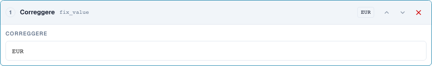
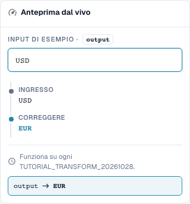
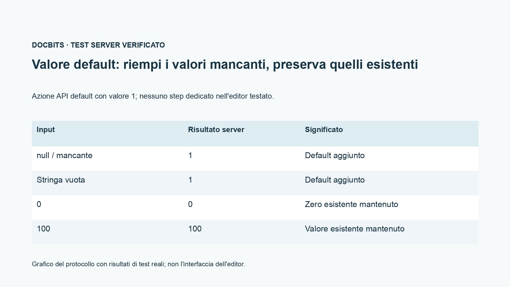

# Campi di origine, valori fissi, svuotamento e valori predefiniti

[Torna alla panoramica completa della pratica](complete-practical-guide.md)

Risultato obiettivo · Testo originale di origine per la copia del campo; valore fisso solo in condizione stretta; svuotamento testato separatamente.

## Etichette visibili nell’editor

Alcune etichette dell’interfaccia attuale presentano traduzioni imprecise. La tabella riporta il testo effettivamente visualizzato per trovare il passaggio corretto; le spiegazioni funzionali usano la terminologia tecnica. Le schermate mostrano l’interfaccia senza modifiche.

| Operazione | Etichetta visibile |
| --- | --- |
| trim | Rimuovi gli spazi |
| case | Cambia maiuscole/minuscole |
| fix_value | Correggere |
| clear | Libero |

## Procedura nell'editor

1. Per una **copia del campo** scegliere un campo di origine diverso dal campo di destinazione. Nell'ambito dell'esercitazione, la destinazione è `output`, l'origine `header.input`.
2. Configurare i passaggi Trimma → Maiuscolo e testare `  po-4711  `. L'output sarà `PO-4711`; l'origine originale non deve essere svuotata.
3. Per un numero ordine produttivo utilizzare una condizione aggiuntiva che si attivi solo quando la destinazione è vuota. Testare come caso contrario un valore di destinazione corretto già esistente.
4. In una regola separata creare **valore fisso** con `EUR`. Anche un input `USD` viene sovrascritto; non si tratta di una conversione valutaria.
5. **Svuotamento** verificare separatamente con `Altwert`. L'output è la stringa vuota. Prestare attenzione alla differenza funzionale tra svuotamento intenzionale e valore di output mancante.
6. Testare il passaggio di interfaccia `default` solo tramite il contratto API previsto; nel menu dei passaggi normali verificato non esiste una voce dedicata. Il grafico del protocollo mostra: mancante e vuoto vengono integrati, `0` e `100` vengono conservati.

<figure><figcaption>
Configurazione degli step. Interfaccia reale in italiano. L'anteprima non modifica i documenti memorizzati.
</figcaption></figure>


Configurazione degli step. Interfaccia reale in italiano. L'anteprima non modifica i documenti memorizzati.


<figure><figcaption>
Anteprima live con valori di training. Interfaccia reale in italiano. L'anteprima non modifica i documenti memorizzati.
</figcaption></figure>


Anteprima live con valori di training. Interfaccia reale in italiano. L'anteprima non modifica i documenti memorizzati.


## 1. Copia del campo

Per una copia del campo scelgo prima il campo di destinazione e poi un'altra origine. Se il numero ordine si trova nel campo sbagliato, posso leggerlo da quel campo, trimmarlo e salvarlo nel campo di destinazione corretto. Una condizione destinazione vuota protegge un numero ordine già esistente. L'origine rimane conservata. Si tratta di una copia con elaborazione e non di uno spostamento. Verifico una destinazione vuota, una destinazione già compilata e un'origine vuota.

## 2. Valore fisso e svuotamento

Un valore fisso ignora il contenuto precedente. Se imposto la valuta su Euro, la regola sovrascrive anche una valuta diversa già esistente. Per questo serve una condizione funzionale stretta. Lo svuotamento scrive una stringa vuota nel campo di destinazione. Non è una cancellazione dell'intero campo o documento. Nell'anteprima verifico soprattutto il caso contrario, affinché la regola non rimuova valori validi. Il solo salvataggio della regola non dimostra ancora una modifica di un documento.

## 3. Valori predefiniti

L'interfaccia server supporta inoltre un'azione di valore predefinito. Essa integra un valore solo in caso di input mancante o vuoto. Uno zero esistente rimane zero. Questa azione non è presente come passaggio a sé stante nella selezione dei passaggi verificata dell'editor normale. Nell'editor posso spesso rappresentare il caso predefinito desiderato con la condizione destinazione vuota e un valore fisso. Mostro questa distinzione in modo trasparente e non affermo l'esistenza di una voce di menu aggiuntiva. Un valore predefinito è sempre una decisione funzionale, specialmente per base prezzo, quantità o valuta.

## Esempi verificati e casi contrari

Questi valori sono stati verificati lato server come test a secco. Tale test non modifica documenti salvati.

| Caso | Input | Risultato server |
| --- | --- | --- |
| fixed | `USD` | `EUR` |
| fixed | `null` | `EUR` |
| clear | `Altwert` | `` |
| clear | `` | `` |
| default-api | `null` | `1` |
| default-api | `` | `1` |
| default-api | `0` | `0` |
| default-api | `100` | `100` |
| copy | `  po-4711  ` | `PO-4711` |

## Accettazione

Verificare un caso adatto, un caso contrario, un valore vuoto e un risultato già elaborato. Ripetere l'operazione di salvataggio del documento. Verificare inoltre la riconciliazione PO e la ricezione ERP, se rientrano nell'obiettivo funzionale.

<figure><figcaption>
Risultati di test server e persistenza reali mostrati come grafico del protocollo. Questa non è un'interfaccia editor ricreata.
</figcaption></figure>


Risultati di test server e persistenza reali mostrati come grafico del protocollo. Questa non è un'interfaccia editor ricreata.


## Tutorial video


Configurazione, esempi pratici e casi contrari.


[Apri il video con sottotitoli italiani e capitoli](https://docbits-videos.fra1.cdn.digitaloceanspaces.com/settings-assistant/transformation-rules-07-field-copy-and-defaults-preview-admin/v1/it.html). Questa versione di revisione attende la verifica funzionale e un ascolto completo.
