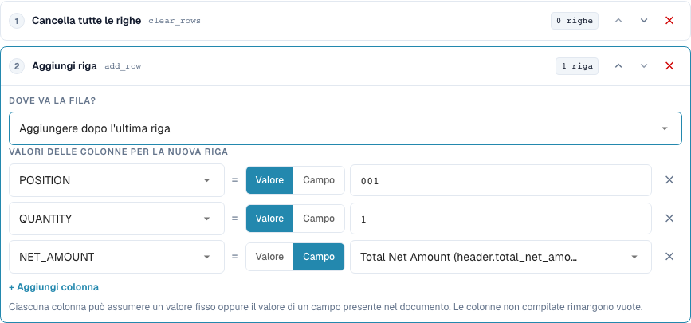
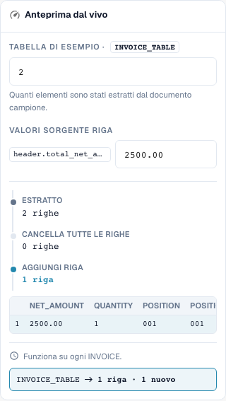

# Ricostruzione delle righe della tabella

[Torna alla panoramica completa della pratica](complete-practical-guide.md)

Tabella INVOICE_TABLE · clear_rows → add_row alla fine · POSITION=001, QUANTITY=1, NET_AMOUNT da header.total_net_amount.

## Etichette visibili nell’editor

Alcune etichette dell’interfaccia attuale presentano traduzioni imprecise. La tabella riporta il testo effettivamente visualizzato per trovare il passaggio corretto; le spiegazioni funzionali usano la terminologia tecnica. Le schermate mostrano l’interfaccia senza modifiche.

| Operazione | Etichetta visibile |
| --- | --- |
| clear_rows | Cancella tutte le righe |
| add_row | Aggiungi riga |

## Procedura nell'editor

1. Selezionare l'ambito di validità **Righe della tabella** e la tabella specifica `INVOICE_TABLE`. Una condizione fornitore appropriata limita la ricostruzione completa.
2. Configurare prima **Elimina tutte le righe**, poi configurare **Aggiungi riga**. Per la nuova riga impostare valori fissi `POSITION=001`, `QUANTITY=1` e per `NET_AMOUNT` la sorgente `header.total_net_amount`.
3. Testare con l'importo di testata `2500.00` e due righe esistenti: rimane esattamente la riga totale appena definita. Verificare anche un importo di testata mancante, prima che la regola diventi attiva.
4. Al momento dell'aggiunta, confrontare la posizione prima della prima riga o dopo l'ultima riga. Per questa verifica della posizione rimuovere l'eliminazione precedente o testare separatamente, altrimenti non esiste alcuna riga esistente come riferimento.
5. Verificare intenzionalmente l'ordine inverso delle operazioni **Aggiungi → Elimina** come caso limite: il risultato è vuoto. Ripristinare poi l'ordine previsto.
6. Verificare il doppio salvataggio. L'aggiunta senza eliminazione precedente può moltiplicare le righe; una ricostruzione può rimuovere irrimediabilmente dal risultato del lavoro le posizioni fornitore a livello funzionale. Verificare separatamente l'abbinamento ordine.

<figure><figcaption>
Configurazione degli step. Interfaccia reale in italiano. L'anteprima non modifica i documenti memorizzati.
</figcaption></figure>


Configurazione degli step. Interfaccia reale in italiano. L'anteprima non modifica i documenti memorizzati.


<figure><figcaption>
Anteprima live con valori di training. Interfaccia reale in italiano. L'anteprima non modifica i documenti memorizzati.
</figcaption></figure>


Anteprima live con valori di training. Interfaccia reale in italiano. L'anteprima non modifica i documenti memorizzati.


## 1. Costruzione delle righe

Elimina tutte le righe rimuove le righe esistenti della tabella selezionata. Aggiungi riga costruisce successivamente una nuova riga. Per ogni colonna scelgo un valore fisso o il valore di un campo di testata. Nel mio esempio si crea una posizione totale con quantità uno e un importo netto dalla testata della fattura. Le colonne non compilate rimangono vuote. La nuova riga può trovarsi all'inizio o alla fine. Questa non è una raggruppamento automatico o una sommatoria delle posizioni esistenti selezionate.

## 2. Ordine delle operazioni

L'ordine è decisivo. Eliminare e poi aggiungere produce la nuova riga desiderata. Aggiungere e poi eliminare rimuove anche la riga appena generata. Senza eliminazione precedente, un ulteriore passaggio aggiungerebbe un'altra riga. Per questo la regola richiede un'esecuzione una tantum appropriata. Un'anteprima con un conteggio delle righe verifica la struttura, ma non sostituisce ancora un test con una tabella estratta reale. Controllo i valori delle colonne e il conteggio delle righe dopo il salvataggio.

## 3. Verifica separata dell'abbinamento ordine

Una regola di tabella viene eseguita prima delle regole di colonna. Una regola di colonna successiva può quindi ripulire anche le righe appena aggiunte. La ricostruzione delle posizioni può modificare le identificazioni delle righe esistenti e gli abbinamenti ordine. Per una fattura che viene abbinata consapevolmente all'importo totale, ho bisogno inoltre della regola di abbinamento ordine appropriata. La sola trasformazione non conferma un abbinamento completo. Testo questo solo con un documento isolato e verifico separatamente il conteggio delle righe e lo stato dell'abbinamento dopo un nuovo salvataggio.

## Collaudo

Verificare un caso appropriato, un caso limite, un valore vuoto e un risultato già elaborato. Ripetere l'operazione di salvataggio del documento. Verificare inoltre l'abbinamento PO e la ricezione ERP, se rientrano nell'obiettivo funzionale.

## Tutorial video


Configurazione, esempi pratici e casi contrari.


[Apri il video con sottotitoli italiani e capitoli](https://docbits-videos.fra1.cdn.digitaloceanspaces.com/settings-assistant/transformation-rules-08-table-rows-preview-admin/v1/it.html). Questa versione di revisione attende la verifica funzionale e un ascolto completo.
