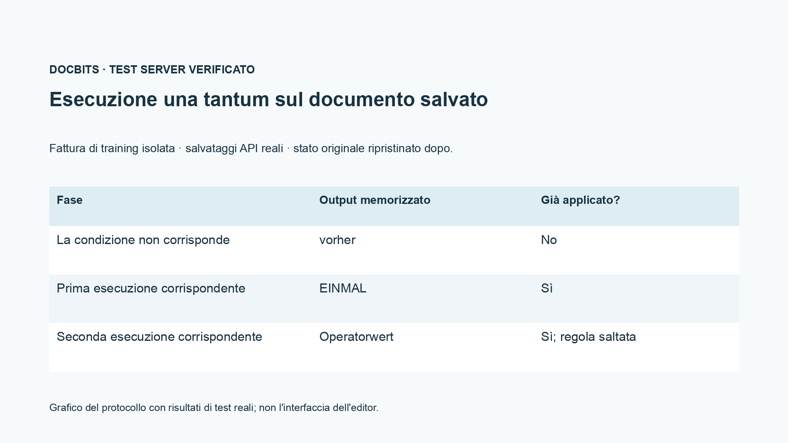
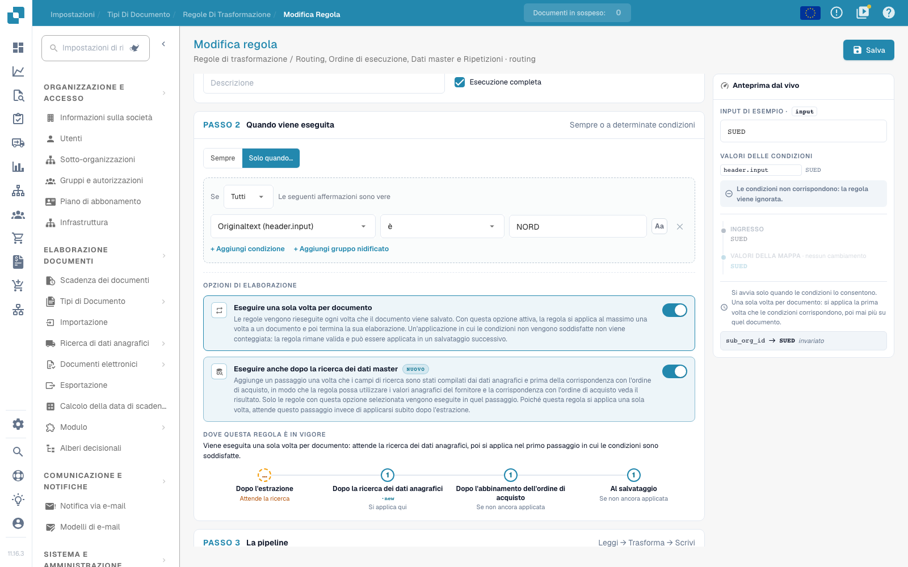

# Routing, Ordine, Dati master e Ripetizioni

[Torna alla panoramica completa della pratica](complete-practical-guide.md)

Routing · Destinazione Sottoorganizzazione · utilizzare destinazione esistente; condizioni, fasi di esecuzione e ripetizione verificare separatamente.

Nella registrazione video sono nascosti il nome e l'identificativo interno della destinazione di routing esistente. Per la propria configurazione, la destinazione deve provenire dalla selezione effettivamente esistente delle sottoorganizzazioni.

## Procedura nell'editor

1. Per **Routing** scegliere l'attributo di documento proposto `sub_org_id`. Utilizzare esclusivamente una sottoorganizzazione effettivamente esistente come destinazione fissa o come risultato di una mappatura dei valori.
2. Aggiungere una condizione fornitore o identificativo adeguata. Nell'esempio di esercitazione `NORD` deve soddisfare la condizione e `SUED` deve saltarla. La registrazione mostra solo l'anteprima e non sposta documenti produttivi.
3. Confrontare l'indicatore delle fasi con il flusso Campo intestazione → Routing → Righe tabella → Colonna tabella. Priorità e chiave di regola si applicano solo all'interno dello stesso ambito.
4. Attivare **Eseguire anche dopo la ricerca dati master** e considerare la fase aggiuntiva prima del riconciliazione ordine. Una sorgente che proviene solo dai dati master necessita di un passaggio adeguato.
5. Verificare **Solo una volta per documento** prima con condizione non corrispondente, poi eseguire la prima volta con corrispondenza. Nel caso di formazione verificato, il primo passaggio saltato non consuma l'applicazione.
6. Dopo la prima applicazione corrispondente, inserire un valore operatore e salvare nuovamente. Il test deve dimostrare che la regola una tantum non sovrascrive nuovamente questo valore; controllare condizione, risultato, fase e prova di applicazione nel log.

## 1. Sottoorganizzazione

Il routing scrive attualmente la sottoorganizzazione del documento. Posso impostare una destinazione fissa dalla selezione esistente o mappare un valore sorgente su una sottoorganizzazione. Una condizione fornitore adeguata limita l'assegnazione. Questo non è né un'autorizzazione utente né una decisione di rilascio. Utilizzo solo sottoorganizzazioni valide ed esistenti e verifico il caso contrario. In questa sequenza l'esempio di routing rimane un'anteprima; non sposta documenti produttivi.

## 2. Fasi di esecuzione

Gli ambiti di validità procedono nell'ordine Campo intestazione, Routing, Righe tabella e Colonna tabella. All'interno di un ambito valgono priorità e chiave di regola. Una sorgente intestazione ripulita può quindi essere già letta dal routing. Con l'esecuzione aggiuntiva dopo il lookup dati master, una regola può utilizzare valori che vengono integrati solo dai dati master. Questa opzione aggiunge un passaggio prima del riconciliazione ordine. Non sposta tutte le altre esecuzioni lì.

## 3. Regole una tantum e prova

Eseguire solo una volta per documento limita una regola effettivamente applicata. Una condizione non soddisfatta non consuma ancora questa esecuzione. Insieme all'opzione di lookup, la regola attende durante il primo passaggio di estrazione la fase successiva. Per sottostringhe ed espressioni regolari, la sorgente separata rimane comunque necessaria. Verifico un'applicazione iniziale, un caso non corrispondente e un nuovo salvataggio. Nel log cerco condizione, risultato e fase di esecuzione. Solo un documento ricaricato attesta l'effetto salvato. Un ingresso ERP e una riconciliazione ordine necessitano ciascuno della propria prova.

## Accettazione

Verificare un caso corrispondente, un caso contrario, un valore vuoto e un risultato già elaborato. Ripetere l'operazione di salvataggio del documento. Verificare anche riconciliazione PO e ricezione ERP se rientrano nell'obiettivo funzionale.

<figure><figcaption>
Risultati di test server e persistenza reali mostrati come grafico del protocollo. Questa non è un'interfaccia editor ricreata.
</figcaption></figure>


Risultati di test server e persistenza reali mostrati come grafico del protocollo. Questa non è un'interfaccia editor ricreata.


Nel test di integrazione salvato, una condizione non corrispondente non ha consumato l'esecuzione una tantum. Al primo salvataggio corrispondente è stato scritto EINMAL. Al secondo salvataggio corrispondente il valore operatore preparato è rimasto preservato, e la prova di applicazione salvata era ancora impostata. Il documento di test è stato successivamente ripristinato. Il test a secco sul server può ancora calcolare un risultato ipotetico; verificare quindi anche il suo avviso `already_applied` e il documento effettivamente salvato.

<figure><figcaption>
Esecuzione una tantum e la fase di lookup aggiuntiva nell'editor reale. La condizione di esempio non corrispondente è saltata; gli identificatori di routing interni sono nascosti. Queste opzioni sono un'anteprima non salvata.
</figcaption></figure>


Esecuzione una tantum e la fase di lookup aggiuntiva nell'editor reale. La condizione di esempio non corrispondente è saltata; gli identificatori di routing interni sono nascosti. Queste opzioni sono un'anteprima non salvata.


## Tutorial video


Configurazione, esempi pratici e casi contrari.


[Apri il video con sottotitoli italiani e capitoli](https://docbits-videos.fra1.cdn.digitaloceanspaces.com/settings-assistant/transformation-rules-09-routing-and-execution-preview-admin/v1/it.html). Questa versione di revisione attende la verifica funzionale e un ascolto completo.
