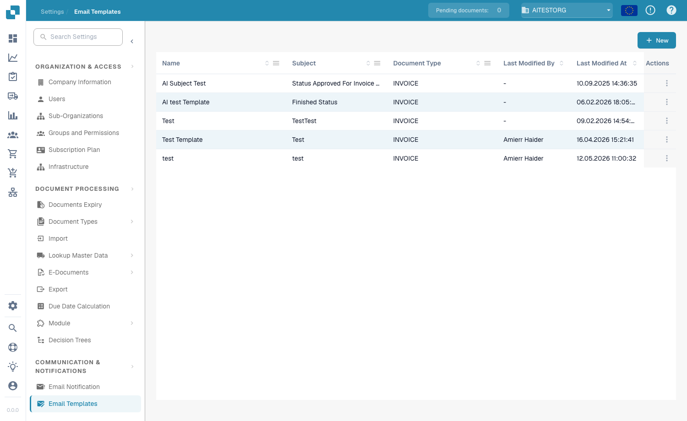

# Modelli di E-Mail

## **Panoramica**

I modelli di email ti permettono di personalizzare le email automatiche inviate da DocBits — ad esempio i promemoria di approvazione o le notifiche di errore. Un modello definisce l'oggetto e il corpo del messaggio e può includere campi dinamici (ad es. `{{InvoiceNumber}}`), immagini e formattazione rich text.

## **Accesso ai Modelli di Email**

Vai su **Settings → Communication & Notifications → Email Templates**. L'elenco mostra ogni modello con **Name**, **Subject**, **Document Type**, la data di **Last Modified** e **Actions** (modifica o elimina).

<figure><figcaption>
L'elenco dei modelli di email
</figcaption></figure>

## **Creazione di un Modello**

1. Clicca su **+ New** in alto a destra.
2. Compila i campi:
   * **Name** — un identificatore descrittivo (ad es. "Document Error Notification").
   * **Document Type** — il tipo di documento a cui si applica il modello (ad es. `INVOICE`).
   * **Include Document As Attachment** — attiva questo interruttore per allegare all'email il documento di origine.
   * **Subject** — l'oggetto dell'email. Clicca sul pulsante **+** accanto al campo per inserire un campo dinamico, oppure digita direttamente `{{FieldID}}`.
3. Crea il corpo del messaggio nell'editor rich text — formatta il testo (grassetto, corsivo, elenchi, allineamento), inserisci immagini con **Upload**, modifica l'HTML grezzo con il pulsante `<>` e usa il pulsante **+** per inserire campi dinamici.
4. Clicca su **Save**.

<figure><figcaption>
L'editor del modello — nome, tipo di documento, interruttore dell'allegato, oggetto e corpo rich text
</figcaption></figure>

## **Campi Dinamici**

I campi dinamici vengono sostituiti con i dati del documento al momento dell'invio dell'email. Inseriscili con il pulsante **+**, oppure digitali manualmente usando le doppie parentesi graffe:

* `{{invoice_id}}` — il numero fattura
* `{{supplier_name}}` — il nome del fornitore
* `{{total_amount}}` — l'importo totale
* `{{status}}` — lo stato attuale del documento

## **Invio di una Email di Test**

Clicca su **Send Test** nell'editor, inserisci un indirizzo **Receiver Email** e clicca su **Send**. DocBits invia un'anteprima del modello, così puoi controllare il layout e verificare che i campi dinamici vengano risolti correttamente prima di salvare.

<figure><figcaption>
La finestra Send Test
</figcaption></figure>

## **Utilizzo dei Modelli nelle Notifiche**

I modelli salvati possono essere collegati ai flussi di lavoro delle [**Notifiche Email**](email-notification/) — ad esempio promemoria di approvazione o aggiornamenti di cambio stato.
