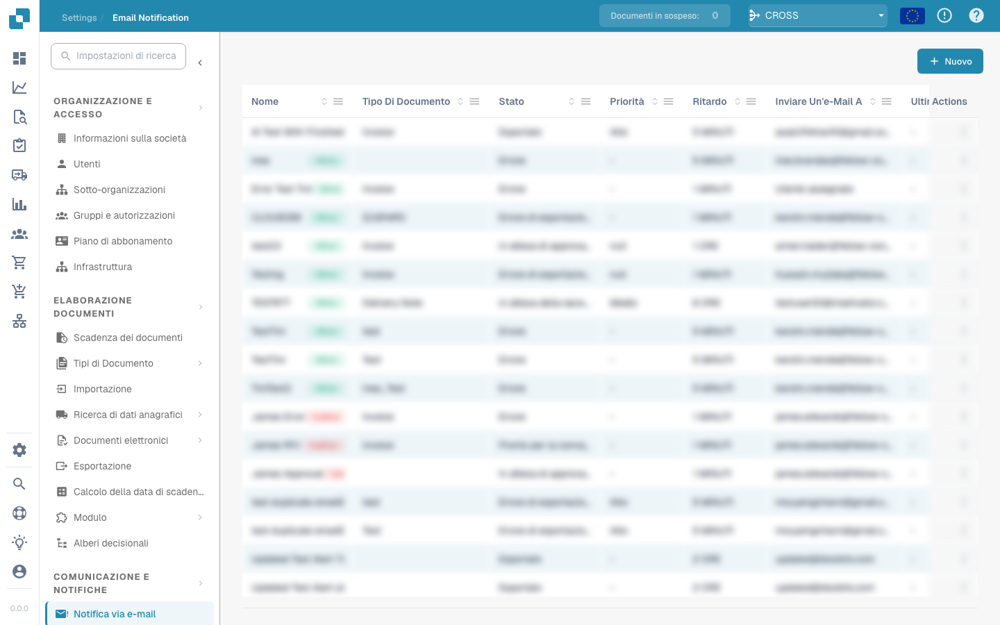

# Notifica e-mail


DocBits Tutorial su attività e notifiche: assegna lavoro, monitora lo stato e gestisci le attività del flusso di lavoro


<figure><figcaption></figcaption></figure>

La configurazione delle notifiche e-mail è fondamentale. Le notifiche e-mail in DocBits possono essere configurate per avvisare gli utenti di vari eventi relativi ai documenti, come: completamento dell'elaborazione, errori di importazione o esportazione o richieste di intervento dell'utente. Questo strumento è essenziale per mantenere una comunicazione efficace e la continuità operativa negli ambienti di elaborazione dei documenti. Ecco alcuni motivi per cui questo è importante:

**Comunicazione in tempo reale:**

* Gli avvisi e-mail consentono agli utenti di essere immediatamente informati di eventi importanti o modifiche nel proprio sistema di gestione dei documenti. Ciò garantisce che tutte le parti interessate siano immediatamente informate di aggiornamenti importanti.

**Trasparenza e tracciabilità:**

* Configurando le notifiche e-mail, gli utenti possono tenere traccia e monitorare lo stato degli eventi di elaborazione dei documenti. Ciò migliora la trasparenza e la tracciabilità del sistema di gestione dei documenti.

**Timely reactions:**

* La notifica automatica di eventi quali rilasci di documenti, commenti o approvazioni consente agli utenti di rispondere rapidamente a richieste o aggiornamenti. Ciò aiuta ad aumentare l’efficienza e la produttività.

**Automazione dei flussi di lavoro:**

* Le notifiche e-mail possono essere integrate nei flussi di lavoro per inviare automaticamente notifiche agli utenti interessati quando vengono intraprese determinate azioni. Ciò consente l'automazione senza interruzioni dei processi aziendali.

**Promemoria e scadenze:**

* La configurazione delle notifiche via email può essere utilizzata per ricordare agli utenti le scadenze imminenti o le attività in sospeso. Ciò aiuta a garantire che le attività importanti vengano completate in tempo.

Nel complesso, la configurazione delle notifiche tramite posta elettronica svolge un ruolo importante nel migliorare la comunicazione, aumentare l'efficienza e garantire che gli eventi di elaborazione dei documenti siano gestiti in modo tempestivo ed efficace. Automatizzando le notifiche, le organizzazioni possono garantire che le informazioni importanti non vadano perse e che tutte le parti interessate siano sempre aggiornate.

Questa impostazione è fondamentale per garantire che le parti interessate siano informate sullo stato di elaborazione dei documenti importanti, il che aiuta a prendere decisioni rapide e a gestire in modo efficiente i flussi di lavoro dei documenti.
