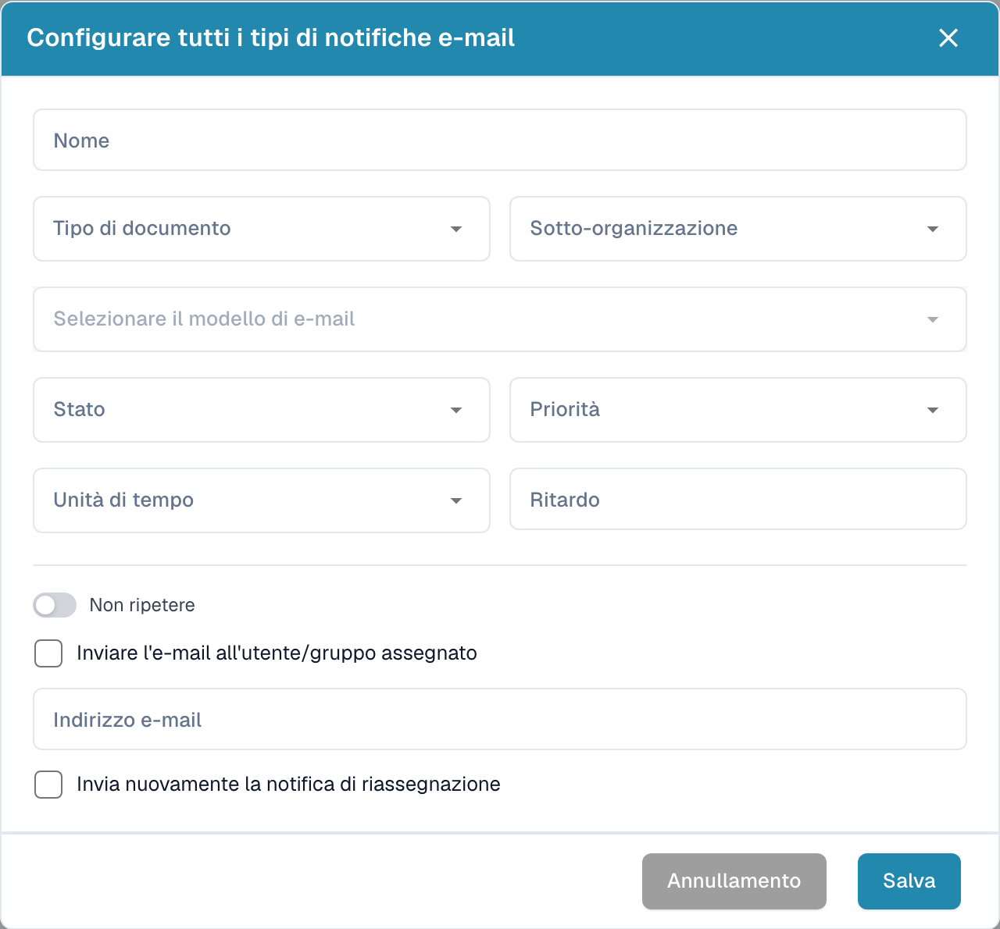

# Configurare le notifiche via e-mail

Aprire le impostazioni delle notifiche via e-mail e creare una nuova configurazione. Definire il momento dell’invio e i destinatari previsti.

<figure><figcaption>
Finestra di configurazione di una notifica via e-mail.
</figcaption></figure>

1. Inserire un nome e scegliere il tipo di documento e, se necessario, la sotto-organizzazione.
2. Selezionare il modello di e-mail e lo stato del documento.
3. Definire priorità, unità di tempo e ritardo.
4. Verificare se la notifica deve ripetersi.
5. Scegliere l’utente o il gruppo assegnato oppure indicare l’indirizzo e-mail previsto.
6. Verificare l’eventuale nuovo invio in caso di riassegnazione.

Controllare destinatari, ritardi e messaggi prima di salvare. L’immagine mostra una configurazione vuota non salvata e non dimostra l’invio di un’e-mail.
