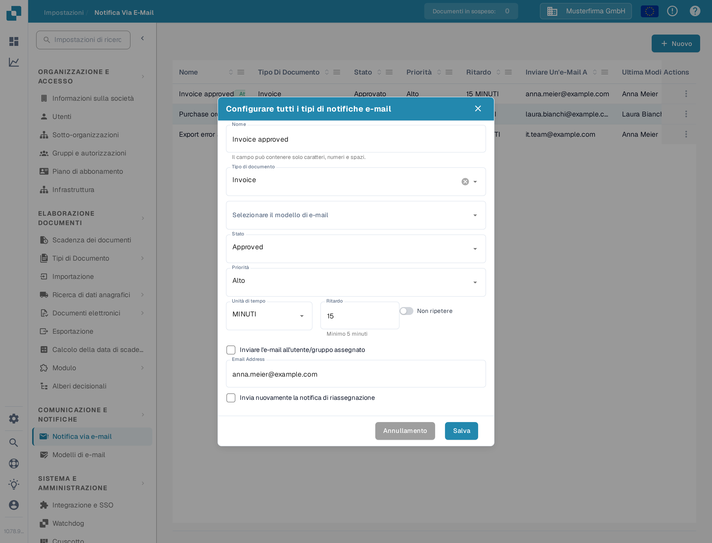
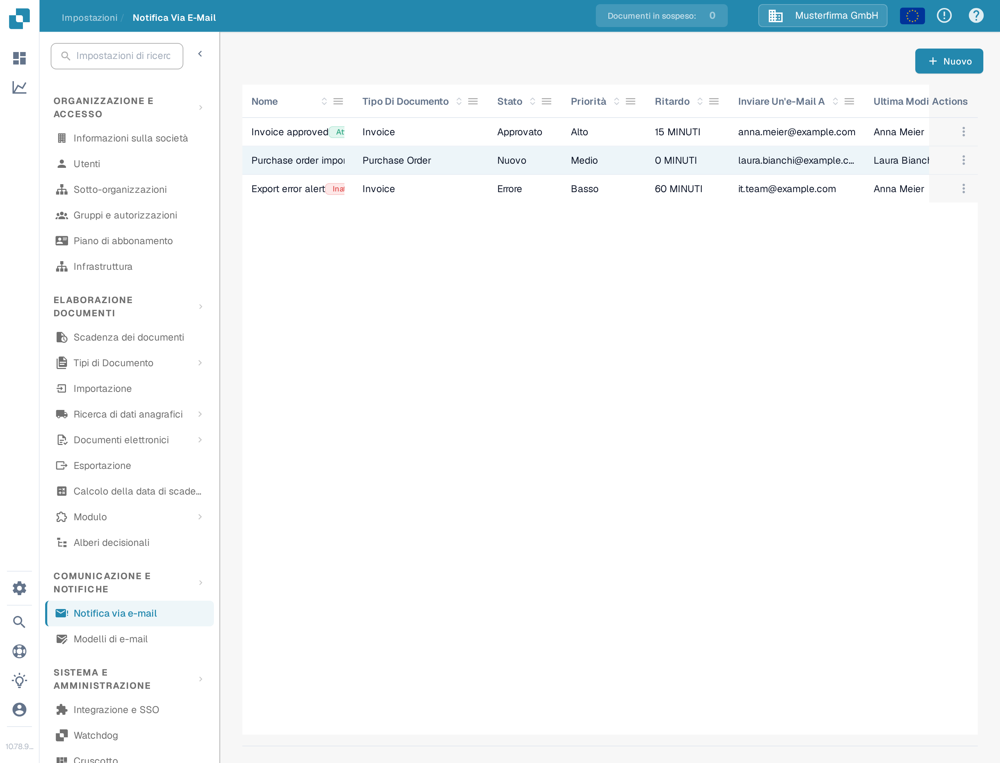
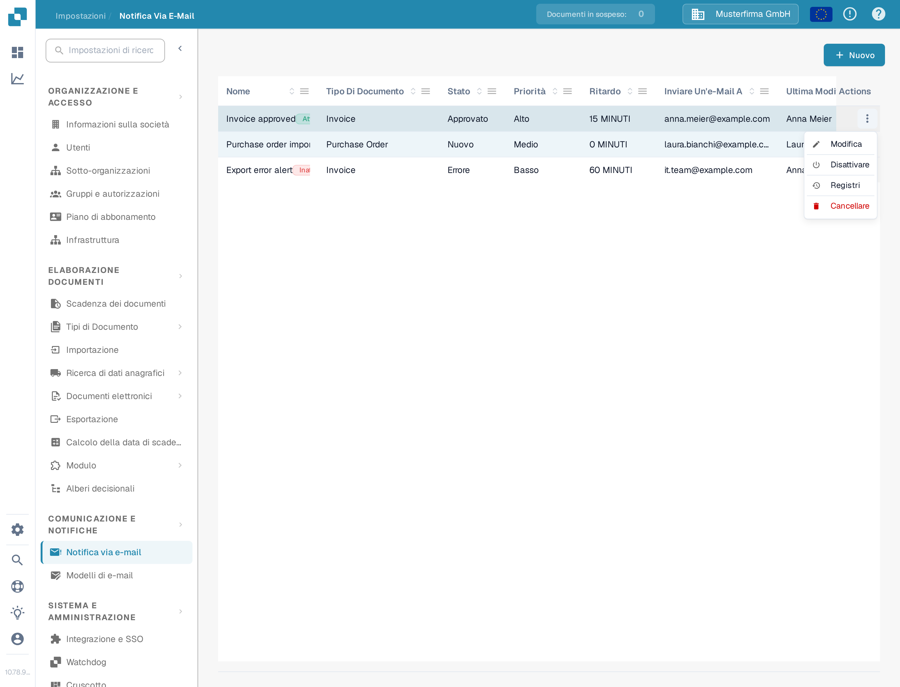

# Gestione delle notifiche

Apri **Impostazioni → Notifica via e-mail** per vedere le regole della tua organizzazione. Una regola collega uno stato del documento a un modello di e-mail e a un destinatario. L'esempio seguente usa una regola dimostrativa per le fatture e rimane **inattiva** nella Sandbox di DocBits.

## Esempio: una fattura è pronta per la validazione

Prima di creare una regola, prepara un modello di e-mail per **Invoice** sotto **Impostazioni → Modelli di e-mail**. In questo esempio il modello si chiama **Docs Demo Invoice Notification**. Il modello fornisce l'oggetto e il testo dell'e-mail.

1. Seleziona **Nuovo** nella pagina **Notifica via e-mail**.
2. Inserisci **Docs Demo Invoice Validation** come nome, seleziona **Invoice** come tipo di documento e scegli il modello di e-mail preparato.
3. Scegli **Approved** come stato e **Alto** come priorità. Imposta **Unità di tempo** su **MINUTI** e **Ritardo** su **10**. Il ritardo minimo per i minuti è cinque.
4. Seleziona **Inviare l'e-mail all'utente/gruppo assegnato**. Attiva **Non ripetere** se il messaggio deve essere inviato una sola volta. Controlla il destinatario e la tempistica, poi seleziona **Salva**.

<figure><figcaption>
La regola di esempio salvata, aperta per la modifica. I suoi valori mostrano quando e a chi verrebbe inviata la notifica.
</figcaption></figure>

La regola compare ora nell'elenco. La regola di esempio della documentazione è stata poi disattivata, quindi il suo menu **Actions** offre **Attivare**. Controlla nome, tipo di documento, stato, ritardo e destinatario nel tuo elenco prima di attivare una regola.

<figure><figcaption>
L'esempio salvato ti offre una regola da trovare e gestire nell'elenco.
</figcaption></figure>

## Modificare, attivare o eliminare una regola

Apri il menu **Actions** della riga. **Modifica** apre la regola con i suoi valori attuali. **Attivare** abilita questo esempio inattivo; una regola attiva offre al suo posto **Disattivare**. **Registri** apre la cronologia delle sue notifiche. **Cancellare** rimuove la regola dopo la conferma. Controlla destinatari e tempistica prima di attivare o modificare una regola.

<figure><figcaption>
Le azioni disponibili dipendono dal fatto che la regola sia attiva o meno.
</figcaption></figure>

Se l'elenco mostra **No Record Found!**, crea prima una regola. Se l'elenco dei **Tipi di Documento** o dei modelli di e-mail è vuoto, configura un tipo di documento attivo e un modello corrispondente prima di tornare a questo modulo.

Per la configurazione iniziale, vedi [Configurazione delle notifiche](configuring-notifications.md). Se le e-mail non arrivano come previsto, vedi [Risoluzione dei problemi](troubleshooting.md).
